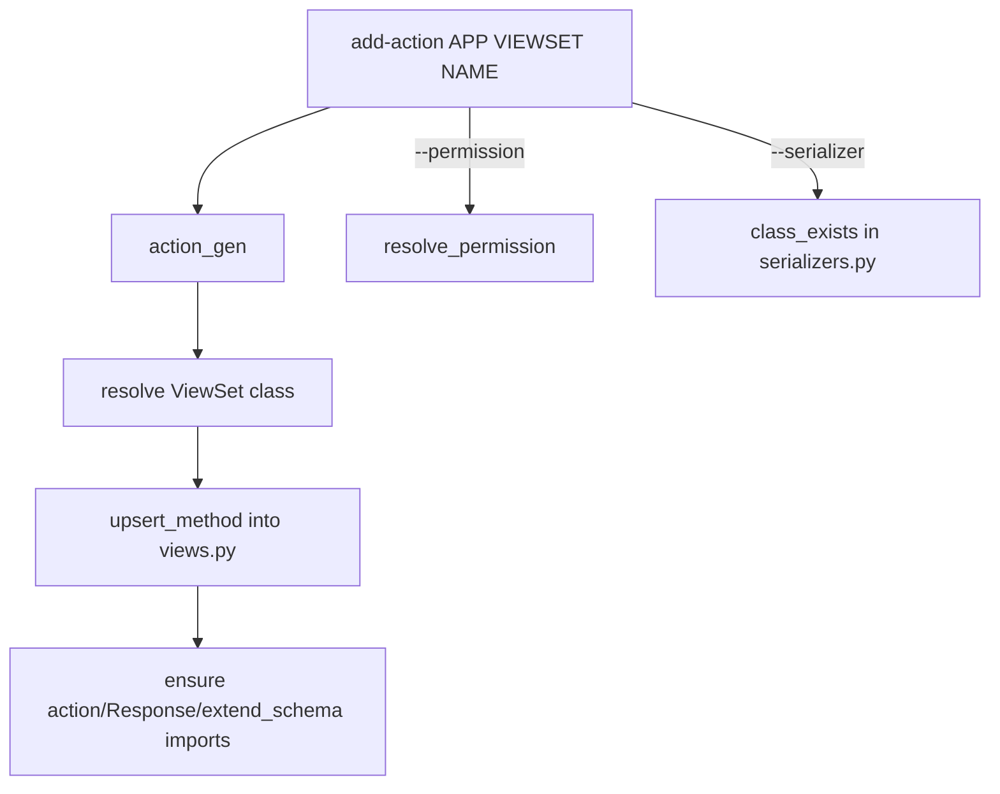

# Design Document

## Overview

Add `django-octave add-action` to inject a DRF `@action`-decorated method onto an existing `{Model}ViewSet` in `apps/<app>/views.py`, with Spectacular `@extend_schema`, optional per-action `permission_classes` / `serializer_class`, and a safe stub body (detail uses `self.get_object()`).

## Steering Document Alignment

### Technical Standards (tech.md)

- Typer/Rich dual UX; libcst for surgical edits to generated Python; no Django runtime of the target project during codegen.

### Project Structure (structure.md)

- Actions live on domain viewsets under `apps/<app>/views.py` (same place as `add-viewset` output). No new package layer.

## Code Reuse Analysis

### Existing Components to Leverage

- **`detect_project`**, **`validate_app_name`**
- **`permission_gen.resolve_viewset_class_name`** — Model → `ModelViewSet`
- **`viewset_gen.resolve_permission`** — stock or `apps.<app>.permissions`
- **`cst_util`**: `class_exists`, `add_to_import`, `ensure_import_lines`; extend with **`method_exists`** + **`upsert_method`** (new)
- **`naming.pascal_to_snake`** — default Spectacular tag when class tag undetectable
- **`class_exists` on serializers.py** — validate `--serializer`

### Integration Points

- Existing `DefaultRouter` registration already routes `@action` methods — no `urls.py` change
- OpenAPI via drf-spectacular picks up `@extend_schema` on the method

## Architecture



### Modular Design Principles

- **`api_parts/action_gen.py`**: build method source + orchestration
- **`models_gen/cst_util.py`**: generic `method_exists` / `upsert_method` (reusable)
- **`commands/add_action.py`** + **`prompts/add_action.py`**: thin CLI / dual UX

## Components and Interfaces

### CLI

```text
django-octave add-action APP VIEWSET ACTION_NAME
  --detail / --list          # mutually exclusive; default --detail
  --methods post             # comma-separated; default: post (detail) / get (list)
  --url-path PATH            # optional @action url_path
  --url-name NAME            # optional @action url_name
  --permission CLASS         # optional; stock or apps.<app>.permissions
  --serializer ClassName     # optional; must exist in serializers.py
  --tag TAG                  # optional Spectacular tag; else detect / snake
  --path DIR
  --force
```

- `VIEWSET`: `Post` or `PostViewSet` → `PostViewSet`
- `ACTION_NAME`: snake_case Python identifier (`publish`, `set_password`); refuse invalid names

### Method stubs

**Detail (default)**

```python
@extend_schema(tags=["{tag}"])
@action(detail=True, methods=["post"][, url_path=..., url_name=..., permission_classes=[...], serializer_class=...])
def publish(self, request, pk=None):
    obj = self.get_object()
    # TODO: implement domain logic for publish
    return Response({"id": getattr(obj, "pk", None), "status": "ok"})
```

**List**

```python
@extend_schema(tags=["{tag}"])
@action(detail=False, methods=["get"], ...)
def recent(self, request):
    qs = self.filter_queryset(self.get_queryset())
    # TODO: implement domain logic for recent
    page = self.paginate_queryset(qs)
    if page is not None:
        serializer = self.get_serializer(page, many=True)
        return self.get_paginated_response(serializer.data)
    serializer = self.get_serializer(qs, many=True)
    return Response(serializer.data)
```

### Tag detection

1. If `--tag` given → use it.
2. Else scan the viewset class body for `@extend_schema_view(... tags=["X"] ...)` first tag found.
3. Else `pascal_to_snake` of model stem (`PostViewSet` → `post`).

### libcst method upsert

Add to `cst_util`:

```python
def method_exists(source: str, class_name: str, method_name: str) -> bool: ...

def upsert_method(
    path: Path,
    class_name: str,
    method_name: str,
    method_src: str,
    *,
    force: bool,
    header_imports: list[str],
) -> None:
    # Parse; find ClassDef; if FunctionDef with name exists:
    #   force → remove then append; else raise ActionExistsError (caller)
    # Append FunctionDef (and its decorators) to class.body
```

Caller raises `ActionExistsError` before calling when `method_exists and not force`. Unparseable views → `ModelWriteError`-style clear error.

### Imports to ensure

Always:

- `from rest_framework.decorators import action`
- `from rest_framework.response import Response`
- `from drf_spectacular.utils import extend_schema` (may already have `extend_schema_view`)

Conditionally:

- `--permission` → `from {module} import {symbol}` via `add_to_import`
- `--serializer` → `from apps.{app}.serializers import {Name}`

### ActionOptions

```
app_name, viewset_class, action_name, detail: bool,
methods: list[str], url_path: str | None, url_name: str | None,
permission: str | None, serializer: str | None, tag: str | None, force: bool
```

## Data Models

No Django models. Generator-only dataclasses as above.

## Error Handling

1. Not octave / missing app → exit 1  
2. Missing viewset class → exit 1 + hint `add-viewset`  
3. Invalid action name (not snake_case identifier) → exit 1  
4. Unknown HTTP method in `--methods` → exit 1 (allowlist: get, post, put, patch, delete, head, options)  
5. Duplicate method without `--force` → exit 1  
6. `--permission` unresolved → same error as add-viewset  
7. `--serializer` missing from serializers.py → exit 1 + hint `add-serializer`  
8. Unparseable views.py → exit 1  

## Testing Strategy

### Unit

- `build_action_method` for detail/list + optional kwargs  
- `method_exists` / `upsert_method` force/refuse  
- methods parsing / validation  
- tag detection helper  

### Integration (CliRunner)

- `new` → `add` → `add-model` → `add-viewset` → `add-action blog Post publish`  
- `--list` path  
- refuse / `--force`  
- `--permission IsOwner` after `add-permission`  
- missing viewset / bad name  

## Implementation Notes

1. Do not modify `urls.py` (router discovers actions).  
2. Keep stub minimal; TODO comment is intentional.  
3. Prefer decorator order: `@extend_schema` then `@action` (Spectacular convention).  
4. README section after add-permission.  
5. MDX-safe docs.
