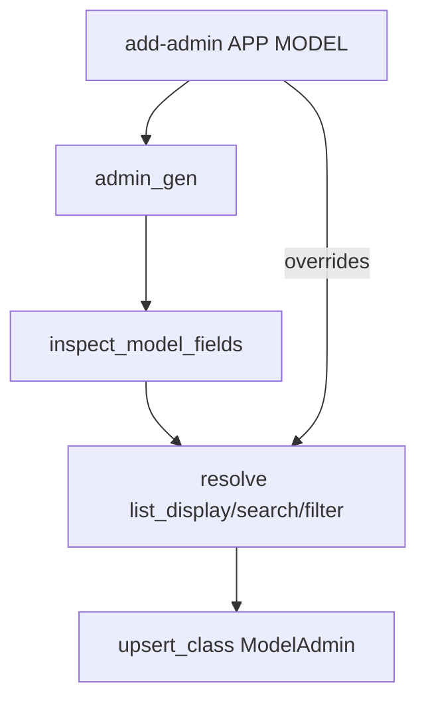

# Design Document

## Overview

Add `django-octave add-admin` to create or refresh `{Model}Admin` in `apps/<app>/admin.py` from libcst-inspected model fields, with opinionated changelist defaults and optional flag overrides. Does not change `add-model` stub generation in v1 (shared heuristics are structured so a later refactor can call them).

## Steering Document Alignment

### Technical Standards (tech.md)

- Typer/Rich dual UX; libcst upsert; static analysis only (no Django runtime of target project).

### Project Structure (structure.md)

- Domain admin lives in `apps/<app>/admin.py` (existing convention from app templates / `api_sync`).

## Code Reuse Analysis

### Existing Components to Leverage

- **`inspect_model_fields` / `inspect_model_fields_path`**, `searchable_names`, `filterable_names`, `RelationInfo`
- **`cst_util.upsert_class`**, `add_to_import`, `class_exists`
- **`api_sync._admin_class`** — reference for current stub shape; **do not** tightly couple; new `admin_gen` is the canonical refine path
- **`detect_project`**, `validate_app_name`, `validate_model_name`, `model_exists`

### Integration Points

- `apps/<app>/admin.py` + `models.py`
- Django admin site already mounted at `/admin/` in kickstart templates

## Architecture



### Modular Design Principles

- **`api_parts/admin_gen.py`**: heuristics + `build_admin_class` + `write_admin`
- **`commands/add_admin.py`** + **`prompts/add_admin.py`**: thin CLI
- Keep `api_sync._admin_class` as-is for add-model (optional comment pointing to admin_gen for future)

## Components and Interfaces

### CLI

```text
django-octave add-admin APP MODEL
  --list-display a,b,c     # optional; replaces heuristic
  --search a,b             # optional
  --filter a,b             # optional → list_filter
  --ordering a,-b          # optional ModelAdmin.ordering
  --no-date-hierarchy      # omit date_hierarchy
  --path DIR
  --force
```

### Heuristics

**Exclude from default `list_display`:** `TextField`, `JSONField`, `BinaryField`, `FileField`, `ImageField`, `ManyToManyField`.

**Include order for default `list_display` (cap at 8 after `id`):**

1. Prefer `name` / `title` / `slug` / `email` if present  
2. Then BooleanFields  
3. Then FK/O2O (relation names)  
4. Then other short scalar fields (Char, Integer, UUID, Slug, …)  
5. Append `created_at`, `updated_at` when `has_timestamps`  
6. Always start with `id`

**`search_fields`:** `searchable_names(info)` (Char/Slug/Email/Text).

**`list_filter`:** BooleanField + ForeignKey/OneToOneField names; plus `created_at` if timestamps (DateTimeField filter works in admin). Cap at ~6.

**`list_select_related`:** FK/O2O names that appear in final `list_display`.

**`date_hierarchy`:** `"created_at"` if timestamps and not `--no-date-hierarchy`.

**`ordering`:** only when `--ordering` provided (no silent default beyond Django’s).

### Generated shape

```python
@admin.register(Post)
class PostAdmin(admin.ModelAdmin):
    list_display = ("id", "title", "published", "author", "created_at", "updated_at")
    list_filter = ("published", "author", "created_at")
    search_fields = ("title",)
    list_select_related = ("author",)
    date_hierarchy = "created_at"
    # ordering = (...)  # if flagged
```

Decorators: `@admin.register(Model)` must be part of upserted class source (same as `api_sync`).

### File create header

```python
"""Admin for {app}."""

from __future__ import annotations

from django.contrib import admin

from apps.{app}.models import {Model}
```

When upserting into existing file: `add_to_import` for model; ensure `from django.contrib import admin`.

### AdminOptions

```
app_name, model_name,
list_display: list[str] | None,
search: list[str] | None,
list_filter: list[str] | None,
ordering: list[str] | None,
date_hierarchy: bool = True,  # False when --no-date-hierarchy
force: bool
```

### Validation

- Override lists validated against `info.available_names` ∪ relation keys ∪ `id` / timestamps as applicable.
- Ordering entries may be prefixed with `-`; strip for validation against available names.

## Data Models

Generator-only `AdminOptions` dataclass; no Django models.

## Error Handling

1. Not octave / missing app → exit 1  
2. Missing model → exit 1 + hint `add-model`  
3. Duplicate `{Model}Admin` without force → exit 1  
4. Unknown override field → exit 1 with valid list  
5. Unparseable admin/models → exit 1  

## Testing Strategy

### Unit

- Heuristic builders (timestamps, FK select_related, text excluded from display)  
- Override validation  
- `write_admin` create / force  

### Integration

- `new` → `add` → `add-model` → `add-admin --force`  
- Override flags  
- Bad field / missing model  

## Implementation Notes

1. Do not theme admin; no `format_html` callables.  
2. Prefer tuples in generated source (`list_display = ("a", "b")`) matching existing stubs.  
3. README after add-action section.  
4. MDX-safe docs.  
5. Class name always `{Model}Admin`.
