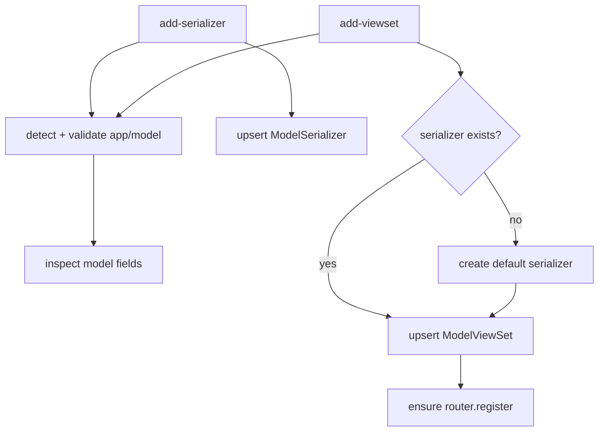

# Design Document

## Overview

Implement `django-octave add-serializer` and `django-octave add-viewset` as dedicated API-part generators. Both target an existing app/model in an octave project, upsert libcst-managed classes, and keep imports/router wiring coherent. `add-viewset` auto-creates a default serializer when missing so it can stand alone.

## Steering Document Alignment

### Technical Standards (tech.md)

- Typer/Rich; DRF + Spectacular conventions from kickstart; allowlisted permissions only.

### Project Structure (structure.md)

- Generated code under `apps/<app>/serializers.py`, `views.py`, `urls.py`; thin viewsets.

## Code Reuse Analysis

### Existing Components to Leverage

- **`detect_project`**, **`validate_app_name`**, **`validate_model_name`**, **`pascal_to_snake`**, **`pluralize`**
- **`model_exists` / `_RemoveClass`** from `models_gen/writer.py`
- **Upsert helpers** in `models_gen/api_sync.py` (`_upsert_class`, `_add_to_import`, `_ensure_router_registration`) — extract shared primitives into `models_gen/cst_util.py` (or `codegen/upsert.py`) to avoid duplication
- Field discovery: new inspector that reads `models.py` via libcst to list attribute names assigned as `models.*Field` (plus inherited timestamps when base is TimeStamped/TenantAware)

### Integration Points

- Existing stubs from `add` / `add-model`
- Router in `urls.py`

## Architecture



### Modular Design Principles

- **`inspect/model_fields.py`**: list concrete field names from `models.py` for a class.
- **`api_parts/serializer_gen.py`**: build serializer class source + write.
- **`api_parts/viewset_gen.py`**: build viewset class source + router ensure.
- **`commands/add_serializer.py`**, **`commands/add_viewset.py`**: thin CLI.
- Extract **`cst_util`**: class exists, remove class, upsert class, ensure import — used by add-model sync and these commands over time (minimal extraction in this spec: share with api_sync where easy).

## Components and Interfaces

### Shared resolution

```text
resolve(app, model, path) -> (OctaveProject, app_dir, model_name, field_names[])
```

- Fail if app dir missing or `model_exists` is false.

### Field inspection

Using libcst on `models.py`:

- Find `class ModelName`
- Collect targets of assignments whose value is a `models.<Something>Field(...)` call (or `models.ForeignKey` etc. if present)
- If bases include `TimeStampedModel` or `TenantAwareModel`, ensure `created_at`, `updated_at` are available for serializers (treat as present even if not in class body)
- Always treat `id` as available for Meta.fields

Do **not** require Django runtime import of the project.

### `add-serializer`

```text
django-octave add-serializer APP MODEL
  --fields a,b,c          # optional; default = inspected fields + id + timestamps when applicable
  --read-only a,b         # optional; merged with defaults id/created_at/updated_at ∩ fields
  --no-id                 # omit id from fields
  --path DIR
  --force
```

- Validate every name in `--fields` / `--read-only` against inspected set ∪ `{id, created_at, updated_at}`.
- Default read-only: intersection of `{id, created_at, updated_at}` with chosen fields.
- Upsert `<Model>Serializer`; ensure `from apps.<app>.models import <Model>` and `serializers` import.
- Create `serializers.py` if missing (file header matching add stubs).

### `add-viewset`

```text
django-octave add-viewset APP MODEL
  --permission IsAuthenticated|AllowAny|IsAdminUser   # default IsAuthenticated
  --filter f1,f2          # optional filterset_fields
  --search f1,f2          # optional search_fields
  --ordering f1,f2        # optional ordering_fields
  --tag name              # spectacular tag; default snake_case model
  --path DIR
  --force
```

- If `<Model>Serializer` missing → call default serializer generation (all inspected fields, standard read-only) equivalent to `add-serializer` without extra flags.
- Upsert `<Model>ViewSet` with spectacular `extend_schema_view`, chosen permissions/filters.
- Default filters: inspected fields whose types look simple — without full type info from AST, use heuristic: include all inspected names except `created_at`/`updated_at` for filterset by default when `--filter` omitted, **or** prefer names that appear as Char/Bool/Int/Slug/UUID/Email in the assignment AST. **Prefer AST type heuristic** matching `filterable_field_names` intent.
- Default search: char/slug/email/text-like fields from AST.
- Default ordering: `name`/`title` if present else `created_at` if present else empty.
- Ensure router registration via existing helper (plural path + basename).

### Permissions allowlist

```python
PERMISSIONS = {
  "IsAuthenticated": "rest_framework.permissions.IsAuthenticated",
  "AllowAny": "rest_framework.permissions.AllowAny",
  "IsAdminUser": "rest_framework.permissions.IsAdminUser",
}
```

Import the chosen symbol into `views.py`.

## Data Models

### `SerializerOptions`

```
app_name, model_name, fields: list[str], read_only: list[str], include_id: bool, force: bool
```

### `ViewSetOptions`

```
app_name, model_name, permission: str, filters: list[str] | None,
search: list[str] | None, ordering: list[str] | None, tag: str, force: bool
```

## Error Handling

1. Not octave project / missing app / missing model → exit 1 + hint.
2. Unknown field in flags → exit 1 listing valid fields.
3. Unknown permission → exit 1 listing allowlist.
4. Duplicate without force → exit 1.
5. Unparseable Python → ModelWriteError-style exit 1.
6. Missing args non-interactive → exit 2.

## Testing Strategy

### Unit

- Field inspector on sample `models.py` snippets (with/without timestamps base).
- Serializer/viewset source builders for options matrices.

### Integration (CliRunner)

- `new` → `add blog` → `add-model blog Post --field title:char` → `add-serializer blog Post --fields title,id`
- `add-viewset blog Post --permission AllowAny --filter title`
- Viewset without serializer present (delete serializer class / file scenario) auto-creates serializer
- Refuse without force; force replaces
- Bad field / bad permission

## Implementation Notes

1. Prefer extracting `_upsert_class` / import helpers to a small shared module; refactor `api_sync` to use it without behavior change.
2. Do not change `add-model` CLI flags in this spec beyond shared util refactor.
3. README sections for both commands with examples.
4. Keep MDX-safe docs (backtick paths like `apps/<app>/`).
