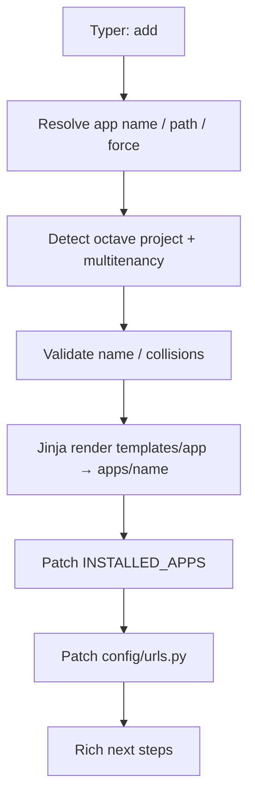

# Design Document

## Overview

Implement `django-octave add` to scaffold a domain app under `apps/<name>/` inside an existing django-octave project, including a starter model, DRF + Spectacular API stubs, optional `services.py`, and automated wiring into `INSTALLED_APPS` and `config/urls.py`.

Reuses the kickstart Jinja/rendering approach with a new `templates/app/` tree and a small project-patching layer for settings/urls.

## Steering Document Alignment

### Technical Standards (tech.md)

- Typer + Rich + Jinja2; generated apps stay standalone (no runtime dependency on django-octave).
- DRF, Spectacular, django-filter, JWT defaults already present in target projects from `new`.
- Multitenancy: if the target project was generated with tenancy, starter models use `TenantAwareModel`.

### Project Structure (structure.md)

- Apps under `apps/`; CLI command `add`; templates in `src/django_octave/templates/app/`.
- Shared primitives from `apps.core`; thin viewsets; optional `services.py` for writes.

## Code Reuse Analysis

### Existing Components to Leverage

- **`cli.py` / Typer `app`**: Register `add` alongside `new`.
- **`prompts/` pattern**: Interactive name resolution like `resolve_new_project_options`.
- **`rendering/context.normalize_slug`**: Reuse or thin-wrap for app module names.
- **Jinja `FileSystemLoader` pattern** from `rendering/engine.py`: second root `templates/app/`.
- **Kickstart tests**: Generate a temp project with `render_project` / CliRunner `new`, then run `add` against it.

### Integration Points

- **Target project `config/settings/base.py`**: append `INSTALLED_APPS` entry.
- **Target project `config/urls.py`**: append `path("api/<app>/", include(...))`.
- **Target `apps.core.models`**: `TimeStampedModel` / `TenantAwareModel`.

## Architecture



### Modular Design Principles

- **`commands/add.py`**: CLI only.
- **`project/detect.py`**: Locate project root markers; detect multitenancy.
- **`project/patch.py`**: Idempotent settings/urls edits.
- **`rendering/app_context.py` + `app_writer.py`**: App-specific context and render.
- **`templates/app/`**: App file templates only (not full project).

## Components and Interfaces

### `add` command

- **Args/flags:**
  - `name: str | None` — app module name (`snake_case`)
  - `--path` — project root (default `.`)
  - `--force` — replace existing `apps/<name>/` (re-apply patches idempotently)
- **Flow:** resolve options → detect project → build `AppContext` → render → patch → summarize.

### Project detection (`project/detect.py`)

Markers (all required unless noted):

- Directory `apps/` with `__init__.py`
- `config/settings/base.py` (or `config/settings/base.py` readable) containing `INSTALLED_APPS`
- `config/urls.py`
- Prefer also `manage.py` as a soft check

**Multitenancy detection:** `True` if `apps/core/models.py` defines `TenantAwareModel` (simple source scan / AST or substring `class TenantAwareModel`) **or** `apps/core/middleware.py` exists with `TenantMiddleware`.

### Naming

- App module: normalized `snake_case` via shared helper; must be a valid Python identifier; reject reserved: `core`, `users`, `config`, `django`, `test`, `tests`.
- **Starter model:** singular PascalCase from app name using a simple inflection:
  - `orders` → `Order`
  - `catalog` → `Catalog`
  - If name already looks singular, use as-is PascalCase (`inventory` → `Inventory`)
  - Implementation: dependency-free heuristic (rstrip trailing `s` when length > 3 and not ending in `ss`/`us`/`is`) — document limitations; optional override flag **out of scope for v1** (always derive).
- Serializer: `{Model}Serializer`
- ViewSet: `{Model}ViewSet`
- URL basename: app name; list route at `api/<app_name>/`

### App templates (`templates/app/`)

Rendered into `apps/<app_name>/`:

| File | Purpose |
|------|---------|
| `__init__.py` | package |
| `apps.py.j2` | `AppConfig` |
| `models.py.j2` | starter model on TimeStamped / TenantAware + `__str__` with a `name` CharField |
| `admin.py.j2` | register model |
| `serializers.py.j2` | ModelSerializer |
| `views.py.j2` | ModelViewSet + spectacular extend_schema_view (light) |
| `urls.py.j2` | DefaultRouter |
| `services.py.j2` | empty module docstring placeholder for writes |
| `migrations/__init__.py` | migrations package |

No initial migration file shipped (user runs `makemigrations`) — avoids brittle migration templates per model shape.

### Patching settings

- Read `config/settings/base.py` as text.
- Find `INSTALLED_APPS = [` … `]` block; if `apps.<name>` missing, insert before closing `]` (after last app entry), preserving quote style when possible (prefer double quotes to match kickstart templates).
- Idempotent: skip if already present.
- `--force` does not duplicate entries.

### Patching urls

- Ensure `from django.urls import include, path` (add `include` to existing import if needed).
- Append (if missing):

```python
path("api/<app_name>/", include("apps.<app_name>.urls")),
```

- Prefer inserting before the closing of `urlpatterns = [` … `]` list.
- Idempotent on path string / include module.

### Failure / atomicity

- Render app files to a temp dir under the project, then move into `apps/<name>`.
- Apply settings patch, then urls patch.
- If patch fails after render: leave app directory in place, print which patch failed and manual fix hints (acceptable v1); do not silently claim full success.
- Without `--force`, never delete existing app dir.

## Data Models

### Generator: `AppContext`

```
AppContext
- project_root: Path
- app_name: str              # snake_case module
- model_name: str            # PascalCase
- model_verbose: str
- use_multitenancy: bool
- force: bool
- installed_app: str         # "apps.<app_name>"
- api_mount: str             # "api/<app_name>/"
```

### Generated starter model (conceptual)

```
class <Model>(TimeStampedModel | TenantAwareModel):
    name: CharField(max_length=255)
    # timestamps from base; tenant FK if TenantAware
```

## Error Handling

1. **Not an octave project** — exit 1; list missing markers.
2. **Invalid/reserved name** — exit 1; explain rules.
3. **App exists without `--force`** — exit 1.
4. **Unpatchable settings/urls** — exit 1 after render; message with manual snippet.
5. **Missing name non-interactive** — exit 2 (same convention as `new`).

## Testing Strategy

### Unit Testing

- `singularize` / model name derivation cases.
- Detection: fixtures with/without multitenancy markers.
- Patch functions: sample `base.py` / `urls.py` strings → idempotent insert.

### Integration Testing

- CliRunner: `new` into `tmp_path` → `add blog` → assert files, INSTALLED_APPS line, urls include, no duplicate on second `--force` add.
- Multitenancy project: `add` uses `TenantAwareModel` in models.py.
- Reject `add core`, `add users`.

### End-to-End (optional / marked)

- Generated project: `add` → `makemigrations` → `migrate` → reverse starter list URL (slow marker).

## Implementation Notes

1. Register `add` via side-effect import in `cli._register_commands`.
2. Keep app Jinja env separate (`templates/app`) from project env.
3. Starter viewset: `permission_classes = [IsAuthenticated]`; `filterset_fields = ["name"]`; queryset `Model.objects.all()`.
4. Spectacular: `@extend_schema_view` with brief tags=`[app_name]` on the viewset.
5. Update package README with `add` examples.
6. Do not change `django-octave new` templates except if a tiny marker comment helps patching — **prefer robust parsing without markers** to support already-generated projects.
