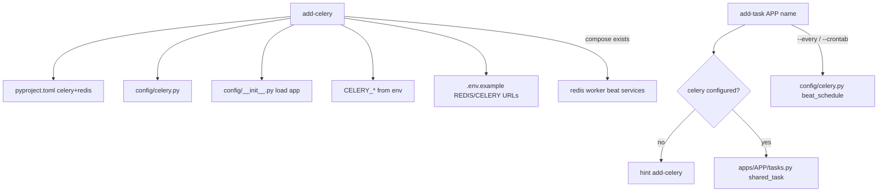

# Design Document

## Overview

Opt-in Celery + Redis for octave projects via `django-octave add-celery`, plus `django-octave add-task` for `@shared_task` stubs and optional code-based Beat schedules. Docker Compose gains `redis` / `worker` / `beat` when a compose file exists. Beat stays first-class (not deprecated).

## Steering Document Alignment

### Technical Standards (tech.md)

- uv-managed deps; env via django-environ; optional Docker already in kickstart.
- Celery is **not** an always-on dependency — only after `add-celery`.

### Project Structure (structure.md)

- Celery app under `config/celery.py`; autodiscover `apps.*.tasks`.
- Domain tasks in `apps/<app>/tasks.py`.

## Code Reuse Analysis

### Existing Components to Leverage

- **`detect_project`**, compose/`Dockerfile` presence as Docker signal
- **`versions.py`** — add `CELERY`, `REDIS` (redis-py) constraint constants
- Env / settings patch patterns from add-app (`patch.py` style text edits)
- Dual UX command patterns from `add_permission` / `add_test`

### Integration Points

- `config/settings/base.py` (+ local/prod if needed for broker host)
- `.env.example`, `pyproject.toml`
- `docker-compose.yml` (+ prod compose if present — light touch: document or mirror services)
- Optional: `new --celery` calls same writer after render (v1: **include** thin flag)

## Architecture



### Modular Design Principles

- **`src/django_octave/celery_gen/`** package:
  - `setup.py` — project wiring
  - `task_gen.py` — task upsert + schedule
  - `compose.py` — compose service inject
  - `detect.py` — “already has celery?” probe
- **`commands/add_celery.py`**, **`commands/add_task.py`**, prompts
- No django-celery-beat in v1 (code `beat_schedule` only) — keeps deps smaller; can add `--database-scheduler` later

## Components and Interfaces

### CLI: `add-celery`

```text
django-octave add-celery
  --path DIR
  --force
```

(Optional later: `--no-compose`.)

### CLI: `add-task`

```text
django-octave add-task APP TASK_NAME
  --bind                 # @shared_task(bind=True)
  --every SECONDS        # beat_schedule entry interval
  --crontab EXPR         # mutually exclusive with --every; 5-field cron → crontab()
  --path DIR
  --force
```

Task name: snake_case identifier.

### `config/celery.py` (generated)

```python
import os
from celery import Celery

os.environ.setdefault("DJANGO_SETTINGS_MODULE", "config.settings.local")

app = Celery("{{project_slug}}")
app.config_from_object("django.conf:settings", namespace="CELERY")
app.autodiscover_tasks()

# beat_schedule populated/extended by add-task
app.conf.beat_schedule = {
    # "name": {"task": "apps.blog.tasks.send_digest", "schedule": 3600.0},
}
```

### `config/__init__.py`

Ensure:

```python
from .celery import app as celery_app
__all__ = ("celery_app",)
```

Merge with existing content if file already has other exports.

### Settings (base)

```python
CELERY_BROKER_URL = env("CELERY_BROKER_URL", default=env("REDIS_URL", default="redis://127.0.0.1:6379/0"))
CELERY_RESULT_BACKEND = env("CELERY_RESULT_BACKEND", default=CELERY_BROKER_URL)
CELERY_ACCEPT_CONTENT = ["json"]
CELERY_TASK_SERIALIZER = "json"
CELERY_RESULT_SERIALIZER = "json"
CELERY_TIMEZONE = TIME_ZONE
CELERY_TASK_TRACK_STARTED = True
```

### Dependencies

Append to project `pyproject.toml` dependencies (not only dev):

- `celery[redis]>=5.4,<6` (or pin in `versions.py`)
- ensure redis extra pulls redis client

Idempotent: skip if `celery` already listed.

### Compose inject (when `docker-compose.yml` exists)

Add services (YAML-safe append / marker comments `# octave-celery-begin` … `# octave-celery-end` for force refresh):

```yaml
  redis:
    image: redis:7-alpine
    ports: ["6379:6379"]

  worker:
    build: .
    command: uv run celery -A config worker -l INFO
    env_file: [.env]
    volumes: [.:/app]
    depends_on: [redis, web]  # web optional; redis required; db if present

  beat:
    build: .
    command: uv run celery -A config beat -l INFO
    env_file: [.env]
    volumes: [.:/app]
    depends_on: [redis, worker]
```

Update `.env.example`:

```
REDIS_URL=redis://127.0.0.1:6379/0
CELERY_BROKER_URL=redis://127.0.0.1:6379/0
CELERY_RESULT_BACKEND=redis://127.0.0.1:6379/0
```

For Compose network, document using `redis://redis:6379/0` in `.env` when running under Compose (or set in compose `environment`).

### Task stub

```python
from celery import shared_task

@shared_task
def send_digest() -> str:
    # TODO: implement
    return "ok"
```

With `--bind`:

```python
@shared_task(bind=True)
def send_digest(self) -> str:
    ...
```

Schedule key: `f"{app_name}.{task_name}"` → task path `apps.{app}.tasks.{task_name}`.

`--every 3600` → `"schedule": 3600.0`  
`--crontab "0 8 * * *"` → `from celery.schedules import crontab` + `crontab(minute=0, hour=8)` (parse 5 fields; fail clearly on invalid).

### Detection

Celery configured if `config/celery.py` exists **or** `CELERY_BROKER_URL` in settings. `add-task` requires `config/celery.py`.

### `new --celery`

Add Typer flag `--celery/--no-celery` default False; after successful `new`, if True, invoke setup writer on the new project root (same as `add-celery`).

## Data Models

No Django models in v1 (no django-celery-beat tables).

## Error Handling

1. Not octave → exit 1  
2. Already configured without force → exit 1  
3. `add-task` without celery → exit 1 + hint  
4. Invalid task name / crontab → exit 1  
5. Duplicate task without force → exit 1  
6. Unparseable compose/settings → exit 1 with path  

## Testing Strategy

### Unit

- celery.py / settings / env snippet builders  
- task stub + beat_schedule merge  
- crontab parse  
- compose marker inject  

### Integration

- `new` → `add-celery` → files exist  
- `add-task blog digests --every 60`  
- refuse / force  
- `new --celery` smoke if implemented  

## Implementation Notes

1. Prefer marker blocks in compose for safe re-runs.  
2. Do not commit Redis passwords.  
3. README: worker + beat commands; Compose; `worker --beat` local-only warning.  
4. Update roadmap shipped table when done.  
5. MDX-safe docs.
