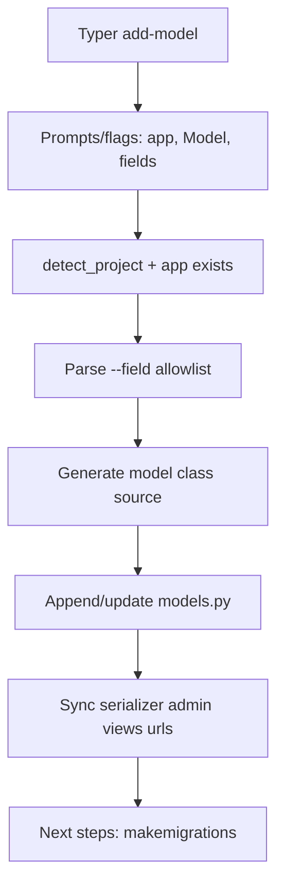

# Design Document

## Overview

Implement `django-octave add-model` to append a new Django model (with CLI-declared fields) into an existing `apps/<app>/` package, subclassing `TimeStampedModel` or `TenantAwareModel`, and keeping serializer / admin / viewset / router stubs in sync so the API stays usable.

This is the first dedicated **`add-*` part command**; later specs can add `add-serializer`, `add-viewset`, etc., without changing this contract.

## Steering Document Alignment

### Technical Standards (tech.md)

- Typer/Rich CLI; allowlisted field mapping (no `eval`); generated code uses project conventions.
- Multitenancy detection reused from `add-app`.

### Project Structure (structure.md)

- Domain apps under `apps/`; thin viewsets; services untouched unless empty placeholder already exists.
- Prefer maintainable file updates for repeated `add-model` calls.

## Code Reuse Analysis

### Existing Components to Leverage

- **`detect_project` / `OctaveProject`**: project root + multitenancy.
- **`validate_app_name` / naming helpers**: app argument validation; new helpers for PascalCase model names and `snake_case` fields.
- **`add` templates**: patterns for serializer/viewset/admin/urls as generation targets when creating stubs for an additional model.
- **CliRunner test pattern**: `new` → `add` → `add-model`.

### Integration Points

- `apps/<app>/models.py` (v1 assumes single-file models from `add`; no models package yet)
- `serializers.py`, `admin.py`, `views.py`, `urls.py` in the same app

## Architecture



### Modular Design Principles

- **`fields/parser.py`**: parse `name:type[:options]` → typed `FieldSpec`.
- **`fields/codegen.py`**: map `FieldSpec` → Django field constructor source snippet.
- **`models/writer.py`**: insert model class into `models.py` (libcst or structured text strategy — see below).
- **`api_sync.py`**: update/create DRF stubs for the model.
- **`commands/add_model.py`**: thin orchestration.

## Components and Interfaces

### CLI: `add-model`

```text
django-octave add-model APP MODEL
  --field name:type[:k=v...]   (repeatable; default if none: name:char:max=255)
  --path DIR
  --force                      replace existing model class + related stub registrations
```

- **APP**: existing app module under `apps/` (validated like `add`).
- **MODEL**: PascalCase class name (`Order`, `BlogPost`). Reject `snake_case` model args; suggest conversion.
- **Default field**: if zero `--field` and non-interactive, use `name:char:max=255`. Interactive mode may prompt to add fields or accept default.

### Field DSL

Form: `name:type` or `name:type:opt=val:opt2=val2`

| type | Django field | Notes |
|------|--------------|-------|
| `char` | `CharField` | `max` default 255 |
| `text` | `TextField` | |
| `int` | `IntegerField` | |
| `bool` | `BooleanField` | `default` true/false |
| `decimal` | `DecimalField` | require `max_digits`, `decimal_places` (defaults 10, 2) |
| `date` | `DateField` | |
| `datetime` | `DateTimeField` | |
| `email` | `EmailField` | |
| `url` | `URLField` | |
| `slug` | `SlugField` | |
| `uuid` | `UUIDField` | `default=uuid.uuid4` optional via `default=uuid` |

Options (allowlist): `null`, `blank`, `unique` (flags as `null` / `null=true`), `default=...`, `max=N`, `max_digits=N`, `decimal_places=N`.

Reject unknown types/options. Field **names** must be `snake_case` identifiers; reject reserved (`id`, `pk`, `objects`, …).

### Model code generation

- Base: `TenantAwareModel` if `project.use_multitenancy` else `TimeStampedModel`.
- Ensure imports: `models`, base class, and `uuid` if needed.
- `__str__`: `name` or `title` if present; else first `char`/`slug`/`email` field; else `str(self.pk)`.
- `Meta.ordering`: `(first_str_field,)` when that field exists; else omit or `("pk",)`.

### Writing `models.py`

**Strategy (v1):** Prefer **libcst** if we add it as a dependency; otherwise a conservative approach:

1. If model class name already exists → error unless `--force` (then replace that class block).
2. Append new class at end of file.
3. Merge imports at top (add `uuid` / base class import if missing).

**Decision:** Add **`libcst`** as a generator dependency for robust class insert/replace. Fallback without libcst is too fragile for `--force` replace.

If libcst feels heavy, alternative: store each model in `models/<snake>.py` and import in `models/__init__.py` — nicer for repeated adds, but requires migrating the `add` template from single `models.py` to package **or** supporting both layouts.

**Chosen approach:**

1. Keep single `models.py` from current `add`.
2. Use **libcst** for append + replace of `class ModelName`.
3. Document that hand-edited exotic layouts may not be patchable (fail clearly).

### API sync

For model `Foo` in app `blog`:

| File | Action |
|------|--------|
| `serializers.py` | Add `FooSerializer` if missing; `--force` regenerates that class |
| `admin.py` | Register `Foo` with list_display from field names + timestamps |
| `views.py` | Add `FooViewSet` with filterset_fields for simple types |
| `urls.py` | `router.register("foos", FooViewSet, basename="foo")` — basename = snake of model; path prefix = pluralized snake heuristic |

**Plural URL segment:** simple heuristic (`Order` → `orders`, `Category` → `categories`) matching `singularize` inverse lightly; document limitations.

If stub files missing entirely: create them (same content shape as `add` templates) including router + imports — so `add-model` works even on a minimal app folder (still require app exists with `apps.py`).

Idempotency: do not duplicate serializer/viewset/router entries; `--force` replaces generated class bodies for that model only.

### Detection of existing model

libcst parse `models.py` for `class ModelName`; or regex fallback `^class ModelName\b` if parse fails → PatchError.

## Data Models

### `FieldSpec`

```
FieldSpec
- name: str
- type_key: str
- null: bool = False
- blank: bool = False
- unique: bool = False
- default: str | None   # literal source fragment or None
- max_length: int | None
- max_digits: int | None
- decimal_places: int | None
```

### `AddModelContext`

```
AddModelContext
- project: OctaveProject
- app_name: str
- model_name: str          # PascalCase
- model_snake: str
- model_plural: str        # URL segment
- fields: list[FieldSpec]
- force: bool
- use_multitenancy: bool
- app_dir: Path
```

## Error Handling

1. Not octave project / app missing → exit 1 + hint `add`.
2. Invalid model/field → exit 1 with parse details.
3. Duplicate model without force → exit 1.
4. Unpatchable models.py / stubs → exit 1; message what failed.
5. Missing args non-interactive → exit 2.

## Testing Strategy

### Unit

- Field parser: happy paths + bad tokens.
- Codegen snippets for each type.
- Pluralize/snake helpers.

### Integration

- `new` → `add blog` → `add-model blog Post --field title:char --field published:bool`
- Assert model/serializer/admin/viewset/router content.
- Multitenancy base class.
- Duplicate without force fails; with force updates.
- Default `name:char` when no fields.

## Implementation Notes

1. Dependency: `libcst` via `uv add libcst`.
2. Register command in `cli._register_commands`.
3. README section for `add-model` + field table.
4. Do not auto-run `makemigrations`.
5. Future `add-serializer` can eventually own serializer edits; until then `add-model` owns minimal sync.
6. Avoid MDX issues in docs: escape `<` in task docs as needed.
