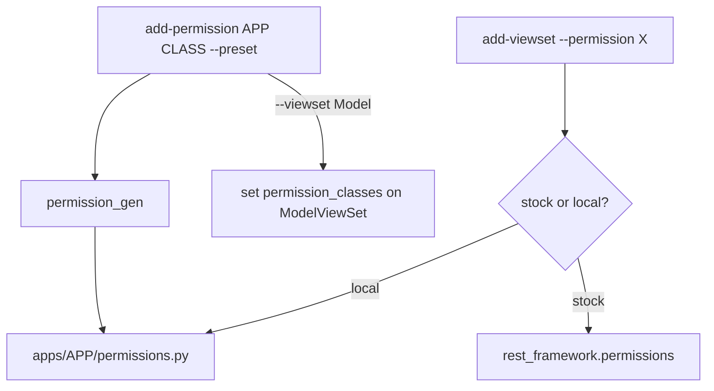

# Design Document

## Overview

Add `django-octave add-permission` to generate opinionated DRF `BasePermission` subclasses into `apps/<app>/permissions.py`, optionally wire them onto a viewset, and extend `add-viewset --permission` to resolve custom classes from that module.

## Steering Document Alignment

### Technical Standards (tech.md)

- Typer/Rich; libcst upsert for views; dual UX.

### Project Structure (structure.md)

- Domain permissions live under `apps/<app>/permissions.py` (not a separate policy package).

## Code Reuse Analysis

### Existing Components to Leverage

- **`detect_project`**, **`validate_app_name`**, naming validators
- **`cst_util`**: `class_exists`, `upsert_class`, `add_to_import`, `ensure_import_lines`
- **`viewset_gen.PERMISSIONS` / `validate_permission`**: extend resolution path
- **`project.use_multitenancy`**: gate `tenant_member` preset

### Integration Points

- `apps/<app>/views.py` viewset `permission_classes`
- Future Vue UI relies on consistent JWT + permission behavior

## Architecture



### Modular Design Principles

- **`api_parts/permission_gen.py`**: presets + upsert + optional viewset wire
- **`commands/add_permission.py`**: thin CLI
- **`viewset_gen.validate_permission`**: accept stock **or** class present in app `permissions.py`

## Components and Interfaces

### CLI

```text
django-octave add-permission APP CLASS_NAME
  --preset owner|staff_or_read|auth_or_read|tenant_member   # default: owner
  --owner-attr owner     # owner preset only; default owner (also try documented fallbacks in code comments: user)
  --viewset Model        # optional; Model or ModelViewSet → target ModelViewSet
  --append               # if set with --viewset: append to permission_classes instead of replace
  --path DIR
  --force
```

Class name: PascalCase; recommend `Is…` prefix but do not require (validate via existing model-name style or a dedicated `validate_permission_class_name`).

### Presets (generated source)

**`owner`**

```python
class IsOwner(BasePermission):
    def has_object_permission(self, request, view, obj) -> bool:
        owner = getattr(obj, "{attr}", None)
        if owner is None:
            return False
        return owner == request.user
```

Also implement `has_permission` → `True` if authenticated (object checks do the rest). Deny if anonymous.

**`staff_or_read`**

```python
# SAFE_METHODS → True; else request.user.is_staff
```

**`auth_or_read`**

```python
# SAFE_METHODS → True; else request.user.is_authenticated
```

**`tenant_member`**

```python
# has_permission: user authenticated and getattr(request, "tenant", None) is not None
# (TenantMiddleware already binds membership-checked tenant)
```

Refuse if `not project.use_multitenancy`.

### File layout

Create `permissions.py` if missing:

```python
"""Permissions for {app}."""
from __future__ import annotations
from rest_framework.permissions import BasePermission, SAFE_METHODS
```

Upsert class with `--force` semantics matching serializers.

### Viewset wiring

- Resolve viewset class name: if arg ends with `ViewSet` use as-is; else `{Model}ViewSet`.
- Replace `permission_classes = [...]` via libcst or careful text replace; prefer small libcst transformer or regenerate attribute assignment line.
- Practical approach: read source; if class exists, use regex/libcst to set `permission_classes = [ClassName]` (or append unique). Ensure `from apps.{app}.permissions import ClassName`.

### `add-viewset` resolution

```python
def resolve_permission(app_dir, app_name, name: str) -> tuple[str, str]:
    # returns (import_module_or_from, symbol)
    if name in PERMISSIONS:
        return ("rest_framework.permissions", name)
    perms = app_dir / "permissions.py"
    if perms.exists() and class_exists(perms.read_text(), name):
        return (f"apps.{app_name}.permissions", name)
    raise ViewSetPermissionError(...)
```

Update `build_viewset_class` / imports accordingly (custom uses `from apps.x.permissions import Y` not `rest_framework.permissions`).

## Data Models

### PermissionOptions

```
app_name, class_name, preset, owner_attr, viewset: str | None, append: bool, force: bool
```

### Preset enum

`owner | staff_or_read | auth_or_read | tenant_member`

## Error Handling

1. Not octave / missing app → exit 1  
2. Unknown preset → exit 1 listing presets  
3. `tenant_member` without multitenancy → exit 1  
4. Duplicate class without force → exit 1  
5. `--viewset` missing class → exit 1  
6. Invalid class name → exit 1  

## Testing Strategy

### Unit

- Preset source builders  
- resolve_permission stock vs local  

### Integration

- `new` → `add blog` → `add-permission blog IsOwner --preset owner`  
- `--force` replace  
- `--viewset Post` after add-model/add-viewset  
- `add-viewset --permission IsOwner --force`  
- tenant preset on multitenancy project vs refuse on non-tenant  

## Implementation Notes

1. Do not change DEFAULT_PERMISSION_CLASSES in settings.  
2. Owner attr default `owner`; document that models need that FK/field for object checks to pass.  
3. README section after add-viewset.  
4. Keep MDX-safe docs.
