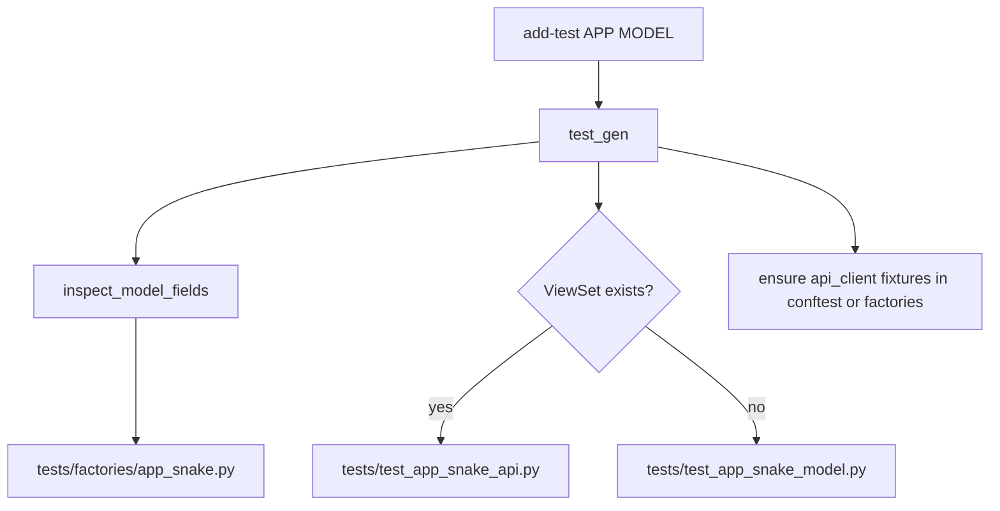

# Design Document

## Overview

Add `django-octave add-test` to scaffold factory-boy factories and pytest-django API (or model) smoke tests under the generated project’s `tests/` tree for an existing model, reusing kickstart pytest + factory-boy deps.

## Steering Document Alignment

### Technical Standards (tech.md)

- Generated projects already include pytest, pytest-django, factory-boy; generator remains static (writes files, no running target Django for codegen).

### Project Structure (structure.md)

- Target layout: project-root `tests/` (not under `apps/`). Factories in `tests/factories/`.

## Code Reuse Analysis

### Existing Components to Leverage

- **`inspect_model_fields`**, relation metadata, `pascal_to_snake`, `pluralize`
- **`class_exists`** on `views.py` for `{Model}ViewSet`
- **`detect_project`**, naming validators, `model_exists`
- Kickstart URL convention: `path("api/<app>/", include(...))` + `router.register("<plural>", …, basename="<snake>")` → reverse names `{snake}-list` / `{snake}-detail`

### Integration Points

- Existing `tests/conftest.py` (autouse `db`) — extend with optional API fixtures if absent
- Custom user model via `get_user_model()`

## Architecture



### Modular Design Principles

- **`api_parts/test_gen.py`**: factory builders + test module writers + orchestration
- **`commands/add_test.py`** + **`prompts/add_test.py`**: thin CLI
- Shared helpers for “ensure package dir `__init__.py`”

## Components and Interfaces

### CLI

```text
django-octave add-test APP MODEL
  --path DIR
  --force
```

No extra flags in v1 (keep opinionated). Optional future: `--api-only` / `--factory-only`.

### File layout

| Artifact | Path |
|----------|------|
| Factory | `tests/factories/<app>_<snake>.py` → `{Model}Factory` |
| User factory (once) | `tests/factories/user.py` → `UserFactory` if missing |
| Factories package | `tests/factories/__init__.py` |
| API tests | `tests/test_<app>_<snake>_api.py` when viewset exists |
| Model tests | `tests/test_<app>_<snake>_model.py` when no viewset |
| Fixtures | Append to `tests/conftest.py` if `api_client` / `auth_client` / `user` missing |

### Factory field mapping (opinionated)

| Django type | factory_boy |
|-------------|-------------|
| CharField / SlugField | `factory.Sequence(lambda n: f"…-{n}")` or `Faker("word")` for name/title |
| TextField | `factory.Faker("paragraph")` |
| EmailField | `factory.Faker("email")` |
| BooleanField | `True` or model default if obvious |
| Integer / Positive* | `factory.Sequence(lambda n: n)` |
| UUIDField | `factory.Faker("uuid4")` |
| Date/DateTime (non-auto) | `factory.Faker("date_time")` |
| FK / O2O same-app | `factory.SubFactory(RelatedFactory)` if we can resolve/create related factory file; else `factory.SubFactory` pointing at a generated sibling in same run when `to` is local model name |
| FK cross-app / User | Prefer `SubFactory(UserFactory)` when `to` is User/AUTH; else omit if `null=True`, else `SubFactory` with TODO comment requiring manual fix |
| M2M / File / Image / JSON / Binary | omit + comment |

Skip `created_at` / `updated_at` / auto fields.

### UserFactory

```python
class UserFactory(factory.django.DjangoModelFactory):
    class Meta:
        model = get_user_model()
    email = factory.Sequence(lambda n: f"user{n}@example.com")
    # set username if field exists — inspect User is heavy; use email-first matching kickstart custom user
    password = factory.PostGenerationMethodCall("set_password", "password")
```

Kickstart users app uses email as primary — design: generate UserFactory against `get_user_model()` with `email` Sequence and optional `username` only if we detect CharField username on a quick inspect of users.models, else email-only + `is_active=True`.

### API test stubs

```python
@pytest.mark.django_db
def test_list_requires_auth(api_client):
    url = reverse("post-list")  # basename snake
    assert api_client.get(url).status_code in {401, 403}

@pytest.mark.django_db
def test_list_ok(auth_client):
    PostFactory()
    resp = auth_client.get(reverse("post-list"))
    assert resp.status_code == 200

@pytest.mark.django_db
def test_retrieve_ok(auth_client):
    obj = PostFactory()
    resp = auth_client.get(reverse("post-detail", kwargs={"pk": obj.pk}))
    assert resp.status_code == 200
```

Create test: only if we can build a minimal JSON dict from non-relation required fields (char/bool/int); otherwise omit create test (document in README). Prefer omit over flaky create.

### Fixtures (conftest append)

```python
@pytest.fixture
def api_client():
    return APIClient()

@pytest.fixture
def user(db):
    return UserFactory()

@pytest.fixture
def auth_client(user):
    client = APIClient()
    client.force_authenticate(user=user)
    return client
```

Idempotent: only append if symbols not already defined in conftest source.

### Multitenancy

If `project.use_multitenancy` and model bases include `TenantAwareModel` (inspect bases like field inspector): add comment + `pytest.mark.skip(reason="tenant setup required")` on API create/list that need tenant, OR attach a minimal Tenant factory if `apps.core.models.Tenant` is importable — **prefer skip with reason** for v1 reliability over half-broken tenant wiring.

### Force / refuse

- Refuse if factory file exists with `{Model}Factory` or API/model test file exists without `--force`.
- `--force` overwrites those specific files (not entire factories package).

### TestOptions

```
app_name, model_name, force: bool
```

## Data Models

Generator-only dataclasses; no new Django models.

## Error Handling

1. Not octave / missing app / missing model → exit 1  
2. Collision without force → exit 1  
3. Unparseable models/views → exit 1  

## Testing Strategy

### Unit (generator)

- Factory source builders for sample ModelFieldInfo  
- Viewset detection → API vs model file choice  
- Fixture ensure idempotent  

### Integration

- `new` → `add` → `add-model` → `add-viewset` → `add-test`  
- Refuse / force  
- Without viewset → model test only  

Optional: run `uv run pytest` inside generated project in one integration test if fast enough; otherwise syntax/`ast.parse` smoke on written files.

## Implementation Notes

1. URL reverse basename = `pascal_to_snake(model)` matching `viewset_gen` / `api_sync`.  
2. Do not add new runtime deps to generated projects (already present).  
3. README after add-admin.  
4. MDX-safe docs.
