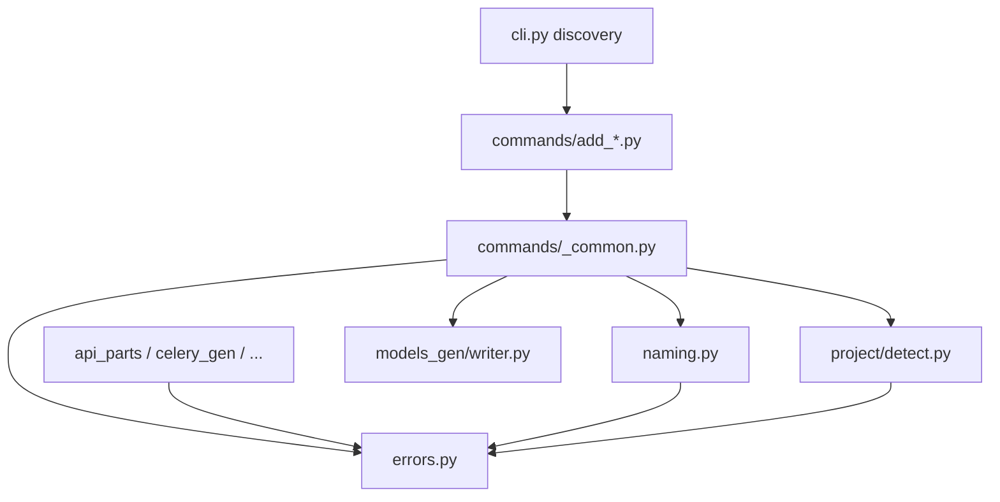

# Design Document

## Overview

Move the plumbing every command repeats into three small shared pieces, then make `cli.py` discover commands instead of listing them:

1. `django_octave/errors.py` — `OctaveError`, the base of every expected, user-facing failure.
2. `django_octave/commands/_common.py` — one stderr console, `handle_errors()` (context manager that prints and exits 1) and `resolve_target()` (project + app + model checks).
3. `cli.py` — `pkgutil`-based discovery of `django_octave.commands.*`.

Plus the dead-code removals from audit item 5. No generated output, message text, exit code or `--help` text changes.

## Steering Document Alignment

### Technical Standards (tech.md)
Python 3.14, Typer/Rich, fully annotated public functions, `X | None` unions, frozen dataclasses with `slots=True` (same style as `OctaveProject`), Ruff for lint/format, pytest for tests.

### Project Structure (structure.md)
`commands/` stays the thin Typer layer. The base exception lives at package top level next to `safe_names.py`, `naming.py` and `rollback.py` (the existing home of cross-cutting helpers). Tests mirror the package under `tests/`.

## Code Reuse Analysis

### Existing Components to Leverage
- **`detect_project` / `OctaveProject`** (`project/detect.py`): called by `resolve_target`, unchanged.
- **`validate_app_name`, `validate_model_name`** (`naming.py`): called by `resolve_target`, so allow-list validation still happens before any file access.
- **`model_exists`** (`models_gen/writer.py`): called by `resolve_target`.
- **`rollback_on_error`** (`rollback.py`): untouched; commands keep wrapping their write in it.
- **`tests/commands/test_option_probe.py`**: the regression guard for validation order and injection.

### Integration Points
- **Generators** (`api_parts/`, `celery_gen/`, `frontend_gen/`, `project/`, `rendering/`): their exception classes change base classes only.
- **Typer app** (`cli.py`): discovery replaces `_register_commands`.

## Architecture

Exceptions keep their current built-in base **and** gain `OctaveError`, so every existing `except ValueError` / `pytest.raises(ValueError)` / `pytest.raises(FileExistsError)` still matches:

```python
class OctaveError(Exception): ...

class InvalidAppNameError(OctaveError, ValueError): ...
class SerializerExistsError(OctaveError, FileExistsError): ...
```

`errors.py` imports nothing from `django_octave`, so any layer can import it without cycles.

`handle_errors()` catches exactly what the commands catch today, no more:

```python
CAUGHT = (OctaveError, ValueError, FileNotFoundError, FileExistsError, NotADirectoryError)
```

(`OctaveError` is listed for clarity and for future classes that are not `ValueError`s.) Anything else (a bug) still raises a traceback, as today.

### Modular Design Principles
- **Single File Responsibility**: `errors.py` = types only; `_common.py` = command plumbing only.
- **Component Isolation**: generators never import from `commands/`.
- **Utility Modularity**: `_common.py` is private (underscore), and discovery skips modules that start with `_`.



## Components and Interfaces

### `errors.py`
- **Purpose:** single base for expected failures.
- **Interfaces:** `class OctaveError(Exception)`.
- **Dependencies:** none.
- **Reuses:** —
- **Rollout:** add `OctaveError` as an extra base of the existing classes found by `grep "class .*Error"` (about 30, in `naming`, `safe_names`, `rollback`, `tenancy`, `project/detect`, `api_parts/*`, `celery_gen/*`, `models_gen/writer`, `frontend_gen/*`, `rendering/writer`). Names and import paths do not change.

### `commands/_common.py`
- **Purpose:** the shared plumbing.
- **Interfaces:**
  ```python
  err_console: Console            # the only Console(stderr=True) in commands/
  console: Console                # stdout console used for summaries

  @contextmanager
  def handle_errors() -> Iterator[None]: ...   # print "[red]{exc}[/red]", raise typer.Exit(1) from exc

  @dataclass(frozen=True, slots=True)
  class Target:
      project: OctaveProject
      app: str            # validated
      model: str | None   # validated, None when no model was requested
      app_dir: Path
      models_source: str | None

  def resolve_target(path: Path, app: str, model: str | None = None) -> Target: ...
  ```
- **Dependencies:** `typer`, `rich`, `detect_project`, `validate_app_name`, `validate_model_name`, `model_exists`.
- **Reuses:** the exact check order and message strings from `add_serializer.py` (lines 87-103): detect project, validate app, validate model, app dir, `models.py`, model exists.
- **Note on `console`:** the 14 stdout `Console()` instances are also folded in here, since they are the same duplication; stderr handling is the requirement, stdout is a free follow-on.

### `commands/add_serializer.py`, `add_viewset.py`, `add_admin.py`, `add_test.py`
- **Purpose:** keep only command-specific logic.
- **Shape after the change:**
  ```python
  with handle_errors():
      target = resolve_target(options.path, options.app, options.model)
      ...write...
  ```
  `add_viewset` keeps `validate_tag` before `resolve_target` and the `rollback_on_error` block inside, so the order stays: tag check, project, names, files.
- Commands that do not use a model (`add`, `add-celery`, `add-frontend`, `add-task`, `add-model`, `add-permission`, `add-action`, `new`) use `handle_errors()` and, where they need the app, `resolve_target(path, app)` with no model. Commands whose flow differs materially (`new`, `add-frontend`) adopt `handle_errors()` only, not `resolve_target`.

### `cli.py`
- **Purpose:** register commands without a hand-kept list.
- **Interface:**
  ```python
  def _register_commands() -> None:
      for info in pkgutil.iter_modules(commands.__path__):
          if not info.name.startswith("_"):
              importlib.import_module(f"django_octave.commands.{info.name}")
  ```
  No `try/except` around the import, so a broken module fails loudly.
- **Ordering:** Typer lists commands in registration order. Discovery is alphabetical, so `--help` order could differ from today's hand-written order. Mitigation: compare `--help` before and after in a test; if the order differs, sort or pin it explicitly so output stays identical (Requirement 4.2).

### Dead-code removals (Requirement 5)
- `frontend_gen/django_patch.py::patch_urls`: delete the no-op `if … pass` and the `force` parameter; update the callers at lines 261-262 and any in tests.
- `naming.py::validate_app_name`: delete the unreachable `startswith("project_") and stripped[:1].isdigit()` check after a test pins current accept/reject behavior.
- `rendering/writer.py`: delete the unreachable `elif target.exists() and not target.is_dir()` branch after confirming an earlier check handles that case (a test for "target is a file" must still pass).
- `fields/codegen.py`: merge the three identical `max_length` branches into one `in {"char", "slug", "email"}`.

## Data Models

### `Target`
```
- project: OctaveProject
- app: str                  validated snake_case app name
- model: str | None         validated PascalCase model name
- app_dir: Path             project.apps_dir / app
- models_source: str | None text of models.py when a model was requested
```

## Error Handling

### Error Scenarios
1. **Expected failure** (invalid name, missing app/model, file exists, parse failure):
   - **Handling:** raised as today; `handle_errors()` prints `[red]{exc}[/red]` to stderr and exits 1.
   - **User Impact:** none; identical text and exit code.
2. **Unexpected exception** (a bug, `OSError` other than the listed ones):
   - **Handling:** not caught.
   - **User Impact:** traceback, as today.
3. **`rollback_on_error` failure:**
   - **Handling:** the rollback context sits inside `handle_errors()`, so files are restored before the message is printed (same order as today).
4. **Command module fails to import at discovery:**
   - **Handling:** exception propagates from `cli.py`.
   - **User Impact:** the CLI does not start and the traceback names the module.

## Testing Strategy

### Unit Testing
- `tests/test_errors.py`: every `OctaveError` subclass found by walking the package is also an instance of its previous built-in base (guards Requirement 1.2 permanently).
- `tests/commands/test_common.py`: `handle_errors` maps `OctaveError`, `ValueError`, `FileNotFoundError` to exit 1 and stderr text, and lets a `RuntimeError` through; `resolve_target` returns the expected `Target` and raises the three "not found" messages byte-for-byte (parametrized).
- Pinning tests before the dead-code removals: accepted and rejected names for `validate_app_name`, "target is a file" for the writer, and `max_length` output for `char`/`slug`/`email`.

### Integration Testing
- Run the whole suite unchanged first (baseline: 218 passed), then after each task; no existing test may be edited to pass, only added to.
- `tests/commands/test_option_probe.py` must keep passing, which proves validation order is preserved.
- A `--help` snapshot test comparing command names and order (and each command's help text) with the pre-refactor output captured in the first task.

### End-to-End Testing
- `OCTAVE_E2E=1 uv run pytest -m e2e` (and `OCTAVE_E2E_DOCKER=1` once at the end) on the final state; the e2e suites generate real projects and run the generated tests, which covers byte-level output regressions indirectly.
- Before/after generation check: generate one project with every `add-*` command at the base commit and at the final commit and `diff -r` the trees (Requirement 6.2).

## Task Ordering (for the tasks phase)
1. Capture baselines (`--help` snapshot, test count, generated tree).
2. Add `errors.py` and attach it to the existing exception classes, with the subclass test.
3. Add `commands/_common.py` with tests.
4. Migrate the four model-targeting commands.
5. Migrate the remaining commands to `handle_errors()`.
6. Switch `cli.py` to discovery.
7. Dead-code removals, each pinned by a test first.
8. Final verification: ruff, full suite, e2e, tree diff, and update the audit doc status.
