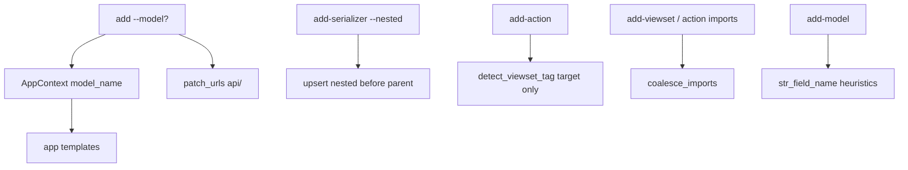

# Design Document

## Overview

Harden generator heuristics found in support-desk / recipe benchmarks: nested serializer definition order, Spectacular tags on `@action`, shared `api/` URL mounts (no `/api/<app>/<plural>/` doubling), smarter `Meta.ordering`, coalesced imports, and optional starter model name via `add --model`.

## Steering Document Alignment

### Technical Standards (tech.md)

- Typer CLI + Jinja/libcst generators; thin commands; shared helpers.
- Ruff remains optional best-effort formatting (unchanged from generator-polish).

### Project Structure (structure.md)

- Domain apps under `apps/`; project URLs in `config/urls.py`; routers in `apps/<app>/urls.py`.
- Helpers stay in `models_gen/`, `api_parts/`, `fields/`, `project/`, `rendering/`.

## Code Reuse Analysis

### Existing Components to Leverage

- **`upsert_class` / `class_exists`** (`cst_util.py`) — extend with insert-before-anchor for nested helpers
- **`detect_viewset_tag`** (`action_gen.py`) — fix lookbehind so it only sees the target class’s decorators
- **`str_field_name`** (`fields/codegen.py`) — tighten preference order; exclude `text` when char-like exists
- **`ensure_import_lines` / `add_to_import`** (`cst_util.py`) — coalesce same-module imports
- **`patch_urls`** (`project/patch.py`) — switch new mounts to `api/`
- **`AppContext` / `model_name_from_app` / `validate_model_name`** — optional explicit starter model
- **`add_to_import` already merges symbols on one line** — extend so *separate* `from X import A` lines merge

### Integration Points

- `serializer_gen._ensure_nested_helpers` + `write_serializer`
- `action_gen.detect_viewset_tag` + route-shape helper
- `project/patch.patch_urls`, `rendering/app_context.py`, `commands/add.py`, `prompts/add_app.py`
- `fields/codegen.str_field_name` → `models_gen/writer.py`
- Docs: `docs/commands/add.md` (brief `--model` note)

## Architecture



### Modular Design Principles

- Nested helpers: insert relative to the **parent** class name, never blind append when a parent already exists.
- Tag detection: window = text between previous top-level `class` and the target `class` line; use the **last** `tags=[...]` in that window (the viewset’s own `@extend_schema_view`).
- URL mount: one shared `api/` include per app; uniqueness of plurals is a documented convention.
- Imports: coalesce after generator writes that touch `views.py` (and optionally serializers) via a small helper.

## Components and Interfaces

### 1. Nested serializer insert-before-parent

**File:** `api_parts/serializer_gen.py` + `models_gen/cst_util.py`

Add `upsert_class_before(path, class_name, class_src, *, before_class: str, force, header_imports)` (or a `before=` kwarg on `upsert_class`):

1. If `class_name` already exists and not force → ensure imports only / return.
2. If force and exists → remove old class body.
3. Parse module; find top-level `ClassDef` named `before_class`; insert the new class **immediately before** that node (with blank-line leading_lines).
4. If `before_class` missing → append at end (current behavior) — parent will be written next in `write_serializer`.

`_ensure_nested_helpers` receives `parent_class = f"{options.model_name}Serializer"` and upserts each nested helper with `before=parent_class` when the parent already exists; when parent does not exist yet, append helpers first then append parent (helpers naturally precede parent).

Order in `write_serializer`:

1. Ensure nested helpers (before parent if parent exists).
2. Upsert parent serializer (append or replace in place).

If parent is force-replaced via remove+append-at-end, nested helpers that were before it stay earlier in the file — still valid. If parent did not exist, helpers appended then parent appended → correct order.

### 2. `detect_viewset_tag` fix

**File:** `api_parts/action_gen.py`

Replace “800 chars before class + first match” with:

```python
idx = source.find(f"class {class_name}")
prev = source.rfind("\nclass ", 0, idx)
window = source[0 if prev < 0 else prev : idx]
matches = list(_TAG_RE.finditer(window))
return matches[-1].group(1) if matches else None
```

Fallback remains `default_tag_for_viewset` (stem snake).

Route shape in action success message: `/api/{plural}/…` (drop `app_name` segment).

### 3. Shared `api/` URL mount

**Files:** `project/patch.py`, `rendering/app_context.py`, `api_parts/action_gen.py`, tests

`patch_urls(urls_path, app_name)`:

- Consider already-wired if `include("apps.{app}.urls")` appears **either** as `path("api/{app}/", …)` (legacy) **or** `path("api/", …)` (new).
- When adding a **new** include, emit:

```python
path("api/", include("apps.{app_name}.urls")),
```

- Do not rewrite legacy mounts automatically.

`AppContext.api_mount`: change to `api/` for summary display, or show concrete collection path `api/{model_plural}/` in the add success markdown (prefer `api/{model_plural}/` so the user sees the real collection URL).

### 4. `str_field_name` preference

**File:** `fields/codegen.py`

```python
PREFERRED = ("name", "title", "subject", "slug")
# 1) preferred names if present
# 2) first char/slug/email field (not text)
# 3) first text field if nothing else
# 4) None → writer uses pk __str__
```

### 5. Import coalescing

**File:** `models_gen/cst_util.py`

Add `coalesce_from_imports(source: str) -> str`:

- Group consecutive/all `from module import a, b` lines by `module`.
- Merge symbols (stable order: first-seen), emit one line per module.
- Leave `import x` alone; leave multi-line parenthesized imports alone in v1 if parsing is hard — regex for single-line `from X import Y` is enough for generator output.

Call after `write_viewset` / `write_action` (and optionally serializer) finalize, before optional ruff format.

Also improve `ensure_import_lines`: if an incoming line is `from M import S` and a `from M import …` already exists, use `add_to_import` instead of inserting a duplicate line.

### 6. `add --model`

**Files:** `commands/add.py`, `prompts/add_app.py`, `rendering/app_context.py`, docs

- CLI: `--model / -m` optional PascalCase name; validate with `validate_model_name`.
- `AddAppOptions.model: str | None`
- Interactive: prompt “Starter model name” defaulting to `model_name_from_app(app)`.
- `AppContext.build(..., model_name: str | None = None)` — if provided use validated name; else derive.
- Templates already keyed off `model_name` / `model_snake` / `model_plural` — no template redesign beyond existing plural register.

## Data Models

N/A (generator tooling only).

## Error Handling

1. **Invalid `--model`:** `InvalidModelNameError` → CLI exit 1 (same as add-model).
2. **Nested helper without parent yet:** append; parent written next — no error.
3. **Tag undetectable:** fallback to stem snake — no error.
4. **Legacy URL already present:** `patch_urls` returns False (idempotent); new apps still get `api/`.
5. **Import coalesce parse failure:** leave source unchanged (best-effort).

## Testing Strategy

### Unit Testing

- Nested: write parent+User nested → `UserNestedSerializer` index < `TicketSerializer` index; second nested write does not move helper below parent.
- Tags: two viewsets in one file; action on second → second tag.
- `str_field_name`: body+note → note; name+body → name; only body → body.
- `coalesce_from_imports` / ensure_import_lines: two permission imports → one line.
- `patch_urls`: new include is `api/`; legacy `api/app/` counts as present.
- CLI: `add accounts --model Customer` → Customer in models.py and `customers` router path.

### Integration Testing

- Existing CLI tests for add/add-model/add-action remain green; extend as needed.

### End-to-End Testing

- Out of scope as automated E2E; manual support_desk re-scaffold optional after ship.

## Implementation Notes / Risks

- Shared `api/` means two apps registering the same plural collide — document in add.md / requirement acceptance.
- Docstring on `ensure_router_registration` still mentions preserving `""` — already outdated after generator-polish; clean comment while touching the file.
- `api_mount` summary string change may affect snapshot-like tests that assert `/api/<app>/`.
