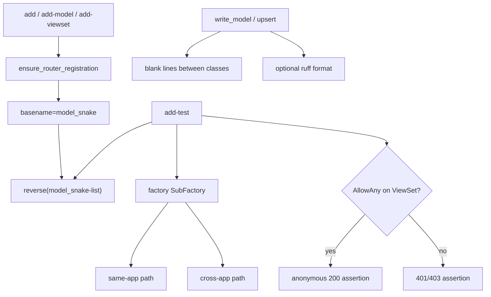

# Design Document

## Overview

Align router basenames with `add-test` reverses, wire cross-app FK SubFactories, make API smoke tests respect `AllowAny`, and keep multi-class generated Python spaced (blank lines / best-effort Ruff). Fixes gaps found in the recipe-site generator benchmark.

## Steering Document Alignment

### Technical Standards (tech.md)

- Typer CLI + Jinja/libcst generators; Ruff is the formatter for this ecosystem.
- No new always-on runtime deps required for the published wheel.

### Project Structure (structure.md)

- Apps under `apps/`; routers in `apps/<app>/urls.py`; tests under `tests/`.
- Shared helpers stay in `models_gen/`, `api_parts/`, `rendering/`.

## Code Reuse Analysis

### Existing Components to Leverage

- **`pascal_to_snake` / `pluralize`** — basename and path segments
- **`ensure_router_registration`** (`cst_util.py`) — extend to **rewrite** stale lines
- **`_field_factory_line` / `resolve_related_app_and_model`** (`test_gen.py`) — cross-app SubFactory
- **`write_model` / `upsert_class_source`** — spacing between top-level classes
- **`resolve_permission` / viewset source** — detect `AllowAny` for test generation

### Integration Points

- `templates/app/urls.py.j2` + `AppContext.as_template_dict`
- `api_parts/viewset_gen._urls_header` / `models_gen/api_sync` register snippets
- `commands/add_test.py` → `write_stubs` / `build_api_test_source`
- Optional: small `format_python_file(path)` helper used after writes

## Architecture



### Modular Design Principles

- One registration helper owns basename correctness (create + update).
- Factory line builder treats same-app and cross-app identically when `app_label.Model` resolves.
- Test source builder takes an `anonymous_ok: bool` (or permission mode) rather than hard-coding deny.
- Formatting: correct EmptyLine / `\n\n` in writers first; Ruff as optional polish.

## Components and Interfaces

### 1. App template + context

- Add `model_snake = pascal_to_snake(model_name)` (and optionally `model_plural`) to `AppContext.as_template_dict`.
- Change `urls.py.j2`:

```python
router.register("", {{ model_name }}ViewSet, basename="{{ model_snake }}")
```

Empty path `""` for the first model keeps `/api/<app>/` as the collection root; **basename** becomes the model snake so `reverse("recipe-list")` works when the starter model is `Recipe`.

### 2. `ensure_router_registration` rewrite

Current logic skips update if any `router.register(... ViewSet ...)` exists for that class — leaving `basename="recipes"`.

New behavior:

1. Find existing `router.register(...)` line containing `{Model}ViewSet`.
2. If missing → insert as today with `basename="{snake}"` and path `"{plural}"` (or `""` only when it is the sole/first registration — prefer **consistent plural path** for all models including the first when rewriting via sync; for **initial `add` template**, keep `""` + correct basename to avoid breaking `/api/<app>/` mount UX).
3. If present but basename/path wrong → replace that line with the canonical form:
   - First registration in file may keep `""` **or** use plural — **decision:** keep `""` for the chronologically first register in the file when updating the starter model; all additional models use `"{plural}"`. When rewriting the starter line, only fix `basename="..."` to model snake if path is already `""`; if path is wrong, set plural + snake for non-first.

Simpler canonical rule (preferred for sync/viewset/add-model):

| Case | path | basename |
|------|------|----------|
| App template (`add`) first model | `""` | `model_snake` |
| `ensure_router_registration` for any model | `plural` if not already registered; if updating existing line, preserve `""` when current path is `""`, else use `plural`; always set `basename=model_snake` |

### 3. Cross-app SubFactory

In `_field_factory_line`, remove the `rel_app == app_name` gate for emitting SubFactory; always:

```python
stem = factory_module_stem(rel_app, rel_model)
return f'    {name} = factory.SubFactory("tests.factories.{stem}.{rel_model}Factory")'
```

Keep UserFactory special-case. Do not invent factories for Django builtins.

### 4. AllowAny-aware API tests

- Add `detect_viewset_allows_anonymous(views_path, viewset_class) -> bool` (string/libcst scan for `permission_classes` containing `AllowAny` on that class).
- `build_api_test_source(..., anonymous_list_ok: bool)`:
  - If True: `test_list_anonymous_ok` asserts 200 without auth (rename or replace `test_list_requires_auth`).
  - If False: keep current 401/403 test.
- `write_stubs` / command passes detection result from `app_dir / "views.py"`.

### 5. Spacing / format

- **`write_model`**: before appending class module body, if `module.body` non-empty, ensure trailing blank line in emitted code (e.g. prepend `\n` to class source or insert `cst.EmptyLine()` between last stmt and new class).
- **`upsert_class_source` / similar**: same guarantee when appending.
- **`format_written_python(path: Path) -> None`**: try `ruff format <path>` via `subprocess` / `shutil.which("ruff")` or `uv run ruff`; ignore failures. Call from model writer, test_gen writers, and optionally serializer/admin/viewset/permission upserts.

## Data Models

N/A (generator behavior only).

## Error Handling

1. Unparseable `views.py` for AllowAny detection → default to auth-required tests (safe).
2. Cross-app target unresolvable → keep TODO or skip field (document); resolvable `app.Model` must not TODO.
3. Ruff missing → spacing still correct from writers.

## Testing Strategy

### Unit

- `split`/registration rewrite: wrong basename → fixed line
- Factory line for `ingredients.Ingredient` → SubFactory string
- `build_api_test_source(anonymous_list_ok=True/False)` content
- Two `write_model` calls → blank line between classes in file text

### Integration

- `add` → `add-test` → `reverse(model_snake-list)` succeeds in generated project
- Cross-app FK model → factory contains SubFactory to other app
- Viewset AllowAny → generated test expects 200 anonymous

## Implementation Notes

1. Update docs (`commands/add-test`, maybe layout) only if reverse/basename behavior is user-visible in examples.
2. Roadmap: optional note under shipped polish; no new CLI command.
3. Re-run recipe_site generators after ship is manual QA, not required in CI.
