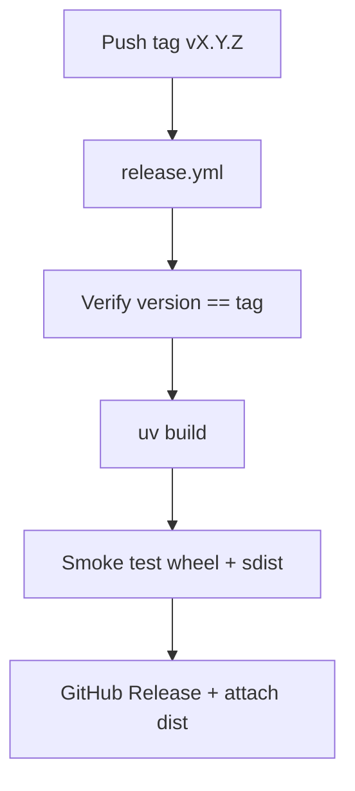

# Design Document

## Overview

Add a tag-triggered GitHub Actions workflow that builds `django-octave` with `uv`, smoke-tests the wheel and sdist, verifies tag ↔ `pyproject.toml` version alignment, and publishes a **GitHub Release** with the distribution artifacts attached. PyPI Trusted Publishing remains a future follow-up.

## Steering Document Alignment

### Technical Standards (tech.md)

- Generator is an installable Python package managed with **uv** / `uv_build`.
- Releases must ship packaged Jinja templates under `src/django_octave/templates/`.

### Project Structure (structure.md)

- Workflow lives in `.github/workflows/`.
- Smoke script lives under `tests/` (runnable against installed dist, not the editable checkout).
- Release docs belong in `README.md` (short maintainer section).

## Code Reuse Analysis

### Existing Components to Leverage

- **`uv build` / `pyproject.toml`**: Already produces wheel + sdist including templates.
- **CLI entry `django-octave`**: Smoke test invokes `--help` after installing the dist.
- **Astral `setup-uv` + GitHub Actions patterns**: Same tooling as uv’s trusted-publishing examples (build/smoke), but **publish target is GitHub Release**, not `uv publish`.

### Integration Points

- GitHub Releases API via `softprops/action-gh-release` (or `gh release create`) using `GITHUB_TOKEN`.
- No PyPI environment or OIDC for this spec.

## Architecture



### Modular Design Principles

- **One workflow file**: `.github/workflows/release.yml`.
- **One smoke script**: `tests/smoke_test.py` — no dependency on repo `src/` layout when run via `--with dist/*.whl`.
- **Single job is acceptable** for GitHub Release (artifact stay local to the job). Prefer one `release` job with `contents: write` to keep the pipeline simple; optional artifact split is unnecessary unless we later add PyPI.

## Components and Interfaces

### `tests/smoke_test.py`

- **Purpose:** Fail the release if the built distribution is incomplete.
- **Checks:**
  1. `import django_octave` succeeds.
  2. Templates package data exists (e.g. `importlib.resources` / path next to package contains `templates/project` and at least one `.j2`).
  3. Subprocess or entry-point: `django-octave --help` exits 0 (via `django_octave.main` or console script on `PATH` when installed).
- **Dependencies:** stdlib only (so it runs against isolated installed dist).
- **Reuses:** None from package internals beyond public import.

### Version check step (inline shell in workflow)

- **Purpose:** Enforce tag ↔ package version.
- **Logic:** Strip leading `v` from `GITHUB_REF_NAME`; read version from `pyproject.toml` via `uv version` / `python -c` / `tomllib`; fail if mismatch.
- Prefer: `uv version --short` if available in the setup-uv version, else parse with Python 3.14 `tomllib`.

### `.github/workflows/release.yml`

- **Trigger:**

  ```yaml
  on:
    push:
      tags:
        - "v[0-9]+.[0-9]+.[0-9]+"
        - "v[0-9]+.[0-9]+.[0-9]+rc[0-9]+"
        - "v[0-9]+.[0-9]+.[0-9]+[ab][0-9]+"
  ```

- **Job `release`:**
  1. Checkout (persist-credentials as required by gh-release).
  2. `astral-sh/setup-uv` (pin to a recent release SHA or major tag consistent with repo practice).
  3. Version assert.
  4. `uv build`.
  5. Smoke: wheel then sdist with `uv run --isolated --no-project --with dist/*.whl tests/smoke_test.py` (and same for `.tar.gz`).
  6. `softprops/action-gh-release@…` with `files: dist/*`, `generate_release_notes: true` (optional), `fail_on_unmatched_files: true`.
- **Permissions:** `contents: write` (create release + upload assets).

### README release section

- Bump `version` in `pyproject.toml` (and sync lock if required).
- `git tag -a v0.1.0 -m "v0.1.0"` → `git push origin v0.1.0`.
- Point to Actions + Releases UI.
- Note: PyPI publish not included yet.

## Data Models

### Release tag contract

```
tag: v{version}
version: matches [project].version in pyproject.toml
artifacts: django_octave-{version}-py3-none-any.whl, django_octave-{version}.tar.gz
```

## Error Handling

1. **Version mismatch** — workflow fails; no release created.
2. **Smoke failure** — workflow fails; no release (or release step not reached).
3. **Duplicate tag / existing release** — `action-gh-release` updates/uploads when configured with `overwrite` / existing release behavior; document that re-running on the same tag may update assets. Prefer fail-safe defaults of the action (typically upserts assets on existing release for the tag).
4. **Missing `dist/` files** — `fail_on_unmatched_files: true`.

## Testing Strategy

### Local

- `uv build` then run smoke against `dist/*.whl` and `dist/*.tar.gz` manually (documented).
- Unit-style: smoke script can be run in CI only against dist; optional local pytest is not required if script is not under default pytest collection — name it so pytest does not double-run awkwardly, **or** mark/exclude from normal suite. Prefer `tests/smoke_test.py` excluded via pytest `norecursedirs` / path ignore, or place as `scripts/smoke_test.py` and invoke from workflow only.

**Decision:** Put smoke at `tests/smoke_test.py` and add to `pyproject.toml`:

```toml
[tool.pytest.ini_options]
norecursedirs = …  # or
addopts / collect ignore: consider `pytest.ini` ignore pattern
```

Simplest: use `tests/packaging/smoke_test.py` and set pytest `testpaths = ["tests"]` with a note that smoke is invoked by name from CI — if pytest collects it without dist installed it may fail. Therefore smoke script must **not** be collected as a pytest test: implement as a plain `if __name__ == "__main__"` script without `test_*` functions, or name `smoke_test.py` without pytest-style tests (module-level main only). Pytest collects `test_*.py` and `*_test.py` — `smoke_test.py` matches `*_test.py`! **Rename to `tests/packaging/smoke.py`** or `scripts/smoke_dist.py` to avoid collection.

**Chosen path:** `scripts/smoke_dist.py` (not collected by pytest).

### CI

- End-to-end verified by pushing a tag on a test branch only after merge; dry-run locally with build + smoke.

## Implementation Notes

1. Pin Actions to SHAs when easy; at minimum use major version tags (`actions/checkout@v4`, `astral-sh/setup-uv@v6` or current stable).
2. Do not add PyPI `id-token` permissions in this workflow.
3. Ensure `dist/` is gitignored (already from `uv build` output).
4. After approval: implement workflow + smoke script + README; no app code changes required beyond packaging docs.
