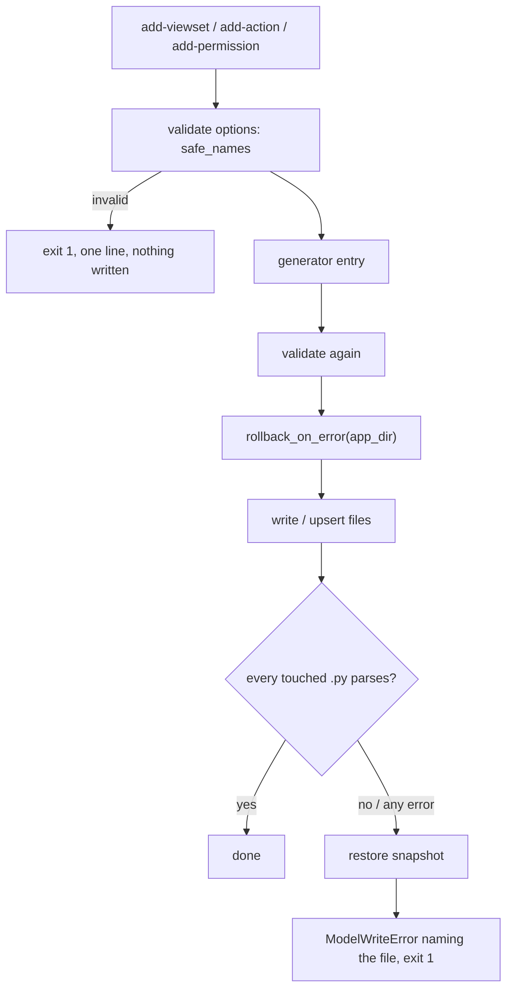
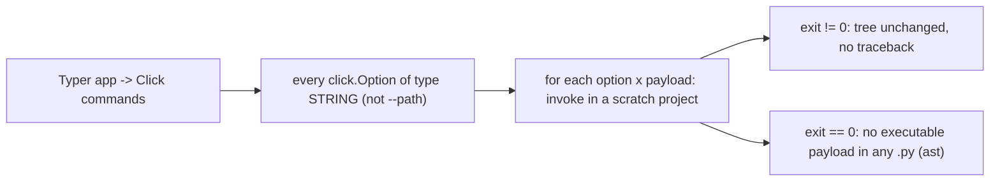

# Design Document

## Overview

Five parts, in order of importance:

1. **Validators** for the four free-text options (`--tag`, `--owner-attr`, `--url-path`, `--url-name`), in the existing leaf module `safe_names.py`, called at the command (before any work) **and** at the generator entry points (before any write).
2. **Clean failure and rollback**: parse errors from generated code become `ModelWriteError`s naming the file; the three commands that write several files (`add-viewset`, `add-action`, `add-permission`) run inside a small `rollback_on_error` context manager that restores the app directory and verifies every touched `.py` file still parses.
3. **A probe guard test** that discovers every `str` option of every command from the Typer/Click definition and fires injection payloads at it.
4. **Docs**: "Who can access what" in `security.md`, links from the generated README and two command pages.
5. **Dependency audit** workflow (`audit.yml`, `uv audit --locked`), kept out of the release gate.

## Steering Document Alignment

### Technical Standards (tech.md)
Standard library only (`re`, `keyword`, `ast`, `contextlib`); the guard uses Click's public API through Typer. The audit uses the `uv` the project already pins.

### Project Structure (structure.md)
Validators sit with the other allow-lists (`safe_names.py`). The rollback helper is a small module next to the other generator utilities. Tests mirror the package.

## Code Reuse Analysis

### Existing Components to Leverage
- **`safe_names.py`**: same style as the project-name validator (compiled pattern, `ValueError` subclass, `!r` in messages).
- **`ModelWriteError`**: already caught by every command and turned into exit 1.
- **`cst_util.upsert_class` / `upsert_method`**: the places where parse errors arise.
- **`tests/test_workflows.py`**: its glob-based checks cover `audit.yml` automatically.
- **E2E/CLI test helpers** (`CliRunner`, project-generation helpers in `tests/commands`).

### Integration Points
- **Commands**: `add_viewset.py`, `add_action.py`, `add_permission.py` (validate first, inside their existing `try`).
- **Generators**: `viewset_gen.write_viewset`, `action_gen.write_action`, `permission_gen.write_permission` (validate at entry, run inside `rollback_on_error`).
- **Docs and workflows**: `docs/concepts/security.md`, generated `README.md.j2`, `.github/workflows/`.

## Architecture





### Modular Design Principles
- **One rule, one function**: no regex duplicated in commands.
- **Rollback is generic**: it does not know about permissions or actions; it snapshots a directory and verifies Python files.
- **The guard has no option list**: new options are probed automatically.

## Components and Interfaces

### 1. `safe_names.py` (additions)
```python
class InvalidOptionError(ValueError): ...

TAG_RE        = r"^[A-Za-z0-9][A-Za-z0-9 ._-]{0,63}$"
OWNER_ATTR_RE = r"^[A-Za-z_][A-Za-z0-9_]{0,63}$"          # ASCII identifier, not a keyword
URL_PATH_RE   = r"^[A-Za-z0-9_-]+(?:/[A-Za-z0-9_-]+)*$"    # <= 64 chars, no leading/trailing/double '/'
URL_NAME_RE   = r"^[A-Za-z0-9][A-Za-z0-9_-]{0,63}$"

def validate_tag(raw: str) -> str
def validate_owner_attr(raw: str) -> str
def validate_url_path(raw: str) -> str
def validate_url_name(raw: str) -> str
```
Each strips surrounding whitespace, rejects anything off the allow-list (and, for the owner attribute, Python keywords), and raises `InvalidOptionError("Invalid --tag 'x': use ...")` with the value shown via `!r`.

### 2. Commands and generators
- `commands/add_viewset.py`, `add_action.py`, `add_permission.py`: first statements inside the existing `try`: validate the options that were given.
- `write_viewset`, `write_action`, `write_permission`: validate at the top (before `_ensure_serializer`, before any read-modify-write), so programmatic callers are covered too.
- Options keep their value after validation unchanged except for stripping, so accepted input yields exactly the previous output.

### 3. `rollback_on_error` and clean parse errors
```python
@contextmanager
def rollback_on_error(root: Path) -> Iterator[None]:
    """Snapshot ``root``'s files; on any exception restore them; on success, verify every
    changed ``.py`` file parses (``ast.parse``), else restore and raise ModelWriteError."""
```
- Snapshot: bytes of regular files under `root`, excluding `__pycache__`, `.pyc`; also records files that did not exist. Restore: rewrite changed, recreate deleted, delete created. The directories are small (an app).
- _Implementation note (from the probe guard):_ it is used at the **command level over the project root** for `add-viewset`, `add-action`, `add-permission` and `add-task`: `add-permission --viewset` wires the viewset after writing the permission and `add-task` writes the beat schedule outside the app directory, and both previously left changed files behind on exit 1. Snapshot excludes `.venv`, `node_modules`, `.git`, `__pycache__`.
- `cst_util.upsert_class`: wrap the parse of the **generated** class (`cst.parse_module(class_src)`) like the existing parse of the target file, raising `ModelWriteError(f"Could not generate {class_name} in {path}: {exc}")`. `upsert_method`: include `path` in the existing "Could not parse method source" message. This removes the traceback seen with `add-viewset --tag`.

### 4. Probe guard (`tests/commands/test_option_probe.py`)
- **Discovery**: `typer.main.get_command(app)` → for each command, every `click.Option` whose `type` is `click.STRING` and whose name is not `path`; `multiple=True` options included (`--field`, `--nested`).
- **Positional arguments** come from a fixture table keyed by argument name (`app_name→blog`, `model_name→Post`, `viewset→Post`, `action_name→probe_action`, `task_name→probe_task`, `class_name→IsProbe`). An argument missing from the table fails the test with a message asking to extend it (R3.3). `new` has no free-text option besides its name argument and is covered by the project-name tests.
- **Fixture project**: `new`, `add blog`, `add-model blog Post`, `add-celery`, rendered once per module. Each probe runs against it, then the tree is compared with the baseline snapshot and restored (no copy per probe).
- **Payloads** (marker `octave-probe`): parseable in a call-argument/list context (`x", __import__("os").system("octave-probe"), "y`), a list-breakout variant, a single-quote variant, a non-parseable `;` variant, and a newline variant.
- **Assertions per probe**: no `Traceback` in the output; if exit ≠ 0 the tree equals the baseline; if exit = 0, no `.py` under `apps/` or `config/` contains a **call** to `system` with the marker (the marker may appear inside string literals).
- **Runtime**: in-process `CliRunner`, no network, no `uv sync`; ~12 commands × ~4 options × 5 payloads, expected well under 30 seconds.
- **Before/after**: run once in a throwaway worktree of `HEAD` to show it fails for exactly the five known options.

### 5. Docs
- `security.md` gains **Who can access what** (see R4) and **Dependencies** (`uv lock`, `uv audit` for generated projects).
- Generated `README.md.j2`: one sentence linking to the section on the docs site path (relative text, no external URL baked in).
- `add-viewset.md` and `add-permission.md` link to the section.

### 6. `audit.yml`
Triggers: weekly cron, `pull_request` with `paths: [uv.lock, pyproject.toml]`, `workflow_dispatch`. One job: checkout, setup-uv (same pinned SHAs), `uv audit --locked`. `permissions: {}` at top, `contents: read` in the job, no secrets. `ci.yml` and `release.yml` are untouched. `tests/test_workflows.py` gains checks for the triggers and for "audit is not a prerequisite of the release".

## Data Models

None. Option dataclasses keep their shape.

## Error Handling

### Error Scenarios
1. **Unsafe option value**
   - **Handling:** `InvalidOptionError` before any write; commands print one red line and exit 1.
   - **User Impact:** `Invalid --tag 'x"]': use 1-64 letters, digits, spaces, '.', '-' or '_', starting with a letter or digit.`
2. **Generated code cannot be parsed or inserted (existing broken file, odd edge case)**
   - **Handling:** `ModelWriteError` naming the file; the app directory is restored.
   - **User Impact:** clear message, no traceback, tree unchanged.
3. **A write succeeds but leaves a file that does not parse**
   - **Handling:** `rollback_on_error` verification fails; restore; `ModelWriteError`.
   - **User Impact:** command reports which file would have been broken.
4. **Dependency advisory**
   - **Handling:** audit workflow fails; releases are unaffected.
   - **User Impact:** visible red scheduled run to act on.

## Testing Strategy

### Unit Testing
- `safe_names`: tables of accepted/rejected values per validator (leading/trailing slash, `//`, spaces in url-name, keywords, Unicode, control characters, 64/65 characters, the reproduced payloads).
- `rollback_on_error`: restores modified, created and deleted files on exception; verification failure restores and raises; success leaves changes; `__pycache__` ignored.
- `cst_util`: invalid generated class → `ModelWriteError` naming the path (no raw `ParserSyntaxError`).
- Generators: each validates before writing (a rejected value leaves the directory untouched, including `serializers.py` for `write_viewset`).

### Integration Testing
- CLI tests per command: valid values produce the same output as before (golden comparison with the pre-change output for typical tags/paths/names); rejected values exit 1 with the one-line message.
- **The probe guard** (above) in the default suite.
- Workflow tests for `audit.yml`.

### End-to-End Testing
- Not needed beyond the existing opt-in suites; local run of `uv audit --locked`, the full CI commands, both e2e suites once at the end.

## Alternatives Considered

- **Escape the options per context** (`json.dumps` into the templates): works for strings, but `--owner-attr` is an identifier-like value and `--url-path` feeds a regex route; allow-lists are stricter and simpler to explain.
- **Only validate in commands**: leaves programmatic callers and future commands exposed; validating at the generator entry is the real choke point.
- **A hand-maintained list of options to probe**: this is exactly how N4 was missed; discovery from the CLI definition removes the human step.
- **Make audit part of `ci.yml` / the release gate**: an unrelated advisory could block a hotfix; a scheduled, separate workflow gives the signal without the coupling.
- **Change the default permission to something stricter**: breaking and opinionated; documenting it is the proportionate step here.
