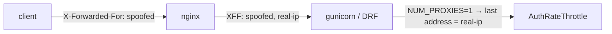
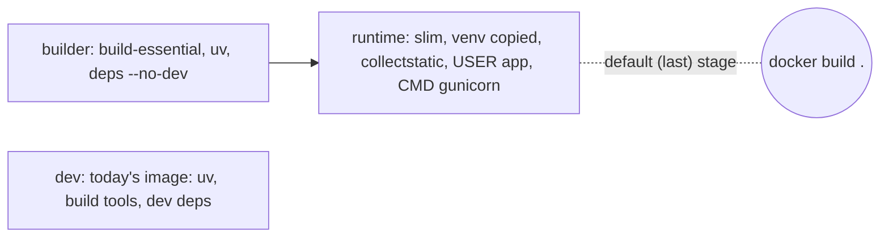

# Design Document

## Overview

Eight independent hardening changes to what the generator emits, grouped by the file they touch:

| Area | Files (all under `src/django_octave/`) | Requirements |
|------|----------------------------------------|--------------|
| Settings | `templates/project/config/settings/{base,prod}.py.j2`, `.env.example.j2` | R3, R5, R6 |
| Throttling | `templates/project/apps/core/throttling.py.j2` (new), `templates/project/config/urls.py.j2` | R3 |
| Auth API module | `frontend_gen/django_patch.py` → new template `templates/frontend_django/auth_api.py.j2` | R3, R4 |
| Tenant model | `templates/project/apps/core/models.py.j2` | R7 |
| Docker | `templates/project/Dockerfile.j2`, `docker-compose.prod.yml.j2`, `docker-compose.yml.j2`, `celery_gen/compose.py` | R1, R2 |
| SPA container | `templates/frontend/nginx.conf.j2` | R8 |
| Docs, tests | `docs/…`, `tests/…` | R9 |

Everything is a template or generator change; existing generated projects are never touched (upgrade notes go in the docs).

## Steering Document Alignment

### Technical Standards (tech.md)
No new dependencies (DRF throttles, Django settings, Docker multi-stage, nginx `add_header`). Generator code stays typed and Ruff-clean.

### Project Structure (structure.md)
Project-side code goes under `templates/project/apps/core/`; generator logic stays in `frontend_gen/`, `celery_gen/`, `rendering/`.

## Code Reuse Analysis

### Existing Components to Leverage
- **`TenantScopedMixin`** (`apps/core/tenancy.py`): reused by the user list; no new tenant code.
- **`patch_urls`** regexes: kept working by keeping the stock token views in `urls.py` and attaching throttles with `as_view(throttle_classes=…)`, plus throttle attributes on the replacement `EmailTokenObtainPairView`.
- **`frontend_gen/django_patch.py`**: a small `patch_env_proxies` step (sibling of `patch_env_cors`) appends `DJANGO_NUM_PROXIES=1` to `.env.example` for SPA projects unless already set. _(Implementation note: the marker block is not used, because `patch_env_cors` never adds it when a `CORS_ALLOWED_ORIGINS` line exists.)_
- **`render_project` / `_should_skip`**: Docker files stay gated by `use_docker`.
- **E2E harness** (`tests/e2e/`): extended, not replaced.

### Integration Points
- **drf-spectacular** settings `SERVE_PERMISSIONS` / `SERVE_AUTHENTICATION` (verified present; read when the views are imported, so `prod.py` values apply).
- **WhiteNoise** `CompressedManifestStaticFilesStorage` (needs `collectstatic`).
- **DRF `NUM_PROXIES`** for client identification behind nginx.

## Architecture

### Throttling and the proxy problem

`AnonRateThrottle` identifies clients by `REMOTE_ADDR` or `X-Forwarded-For`. In the generated SPA setup, nginx proxies `/api/` to Gunicorn, so `REMOTE_ADDR` is nginx's address: **a 10/min limit would be shared by all users** (self-inflicted lockout). With `NUM_PROXIES` unset DRF trusts the whole `X-Forwarded-For` string, which a client can vary to dodge the limit. So the design sets `NUM_PROXIES` explicitly:



- `NUM_PROXIES = env.int("DJANGO_NUM_PROXIES", default=0)`: `0` uses `REMOTE_ADDR` only (correct when Gunicorn is exposed directly, and spoof-proof).
- SPA projects get `DJANGO_NUM_PROXIES=1` appended to `.env.example` by `add-frontend` (their nginx is the one proxy).

### Docker stages



- Stage order: `dev` (unchanged behaviour), `builder`, `runtime` **last**, so a plain `docker build .` yields the secure runtime image.
- `docker-compose.yml` (dev) and the injected Celery services select `target: dev`, because they bind-mount `.:/app` (which would hide a baked-in `.venv`) and use `uv run`.
- `docker-compose.prod.yml` uses the default stage and drops its `command:` (the image `CMD` starts `gunicorn` from the venv).

### Modular Design Principles
- **One place per concern**: throttle classes in `apps/core/throttling.py`; prod-only guards in `prod.py`; image logic in the Dockerfile only.
- **Template over string**: the auth API module moves from a Python string constant to a Jinja template so it can be linted, diffed, and conditionally include tenant scoping.

## Components and Interfaces

### 1. `apps/core/throttling.py` (new, always generated)
```python
class AuthRateThrottle(AnonRateThrottle):
    scope = "auth"
```
`base.py` adds `"auth": "10/min"` to `DEFAULT_THROTTLE_RATES` and `NUM_PROXIES`. Because it extends `AnonRateThrottle`, it only counts unauthenticated callers, which is who uses these endpoints.

### 2. `config/urls.py.j2`
```python
from apps.core.throttling import AuthRateThrottle
path("api/auth/token/", TokenObtainPairView.as_view(throttle_classes=[AuthRateThrottle]), name="token_obtain_pair"),
path("api/auth/token/refresh/", TokenRefreshView.as_view(throttle_classes=[AuthRateThrottle]), name="token_refresh"),
```
`as_view(throttle_classes=…)` is valid because `throttle_classes` is an existing `APIView` attribute. `patch_urls` still matches (its second regex accepts any view expression without commas), replaces the obtain path with `EmailTokenObtainPairView.as_view()`, and leaves the refresh line untouched.

### 3. `auth_api.py.j2` (new template, replaces `AUTH_API_MODULE`)
- `EmailTokenObtainPairView` and `RegisterView` gain `throttle_classes = [AuthRateThrottle]`.
- `UserListView`:
  - `use_multitenancy`: `class UserListView(TenantScopedMixin, ListAPIView)` with
    ```python
    def get_queryset(self):
        return User.objects.filter(memberships__tenant=self.request.tenant).order_by("email")
    ```
    (membership is unique per user and tenant, so no duplicates).
  - otherwise unchanged (`queryset = User.objects.all().order_by("email")`).
- `write_auth_api(root, *, force)` renders the template with `use_multitenancy` from `detect_project(root)`. Its existing "already has `UserListView` → leave alone" behaviour stays, so edited files are not clobbered (`--force` regenerates).

### 4. `prod.py.j2`
```python
raw_hosts = os.environ.get("DJANGO_ALLOWED_HOSTS", "").strip()
if not raw_hosts:          raise ImproperlyConfigured("DJANGO_ALLOWED_HOSTS must list your host names ...")
if "*" in ALLOWED_HOSTS:   raise ImproperlyConfigured("DJANGO_ALLOWED_HOSTS must not contain '*' ...")

SPECTACULAR_SETTINGS = {
    **SPECTACULAR_SETTINGS,
    "SERVE_PERMISSIONS": ["rest_framework.permissions.IsAdminUser"],
    "SERVE_AUTHENTICATION": ["rest_framework.authentication.SessionAuthentication"],
}
```
Session authentication means an admin logged in at `/admin/` can open Swagger in the browser; anonymous or non-admin users get 401/403. `SessionAuthentication` only enforces CSRF on unsafe methods, and these views are read-only.

### 5. `models.py.j2`
`related_name="%(app_label)s_%(class)s_set"` on `TenantAwareModel.tenant`.

### 6. `Dockerfile.j2`
```dockerfile
# syntax=docker/dockerfile:1
FROM python:X-slim AS dev          # exactly today's stage (uv, build tools, dev deps, uv run)
...
FROM python:X-slim AS builder
  # build-essential (+ mariadb dev libs), uv, copy pyproject.toml uv.lock*
  # RUN if [ -f uv.lock ]; then uv sync --locked --no-dev --no-install-project; else uv sync --no-dev --no-install-project; fi
  # COPY . . then the same command without --no-install-project is unnecessary: project is not a package (tool.uv package=false)
FROM python:X-slim AS runtime
  # (mariadb only) apt-get install libmariadb3, no curl, no compilers
  # useradd app; COPY --from=builder --chown=app /app/.venv; COPY --chown=app . .
  # USER app; ENV PATH=/app/.venv/bin:$PATH
  # RUN DJANGO_SETTINGS_MODULE=config.settings.prod DJANGO_SECRET_KEY=<64 chars> \
  #     DJANGO_ALLOWED_HOSTS=build.invalid DATABASE_URL=sqlite:////tmp/build.sqlite3 \
  #     python manage.py collectstatic --noinput
  # CMD ["gunicorn", "config.wsgi:application", "--bind", "0.0.0.0:8000"]
```
- The `RUN` prefixes variables on a single command, so they are **not** persisted in `ENV` or the container environment; they do remain in image history as build commands, but are documented as non-secret placeholders. `.dockerignore` already excludes `.env`.
- The build-time `SECRET_KEY` satisfies the ≥50-char prod check and never matches a real key.
- `uv` is not installed in the runtime stage.

### 7. Compose files
- `docker-compose.yml.j2`: `build: {context: ., target: dev}`.
- `docker-compose.prod.yml.j2`: remove `command:`; `build: .` (runtime).
- `celery_gen/compose.py`: both injected services use `build: {context: ., target: dev}`.
- `frontend_gen/compose.py`: unchanged (the SPA service has its own build).

### 8. `nginx.conf.j2`
`add_header X-Content-Type-Options "nosniff" always;` plus `X-Frame-Options "DENY"` and `Referrer-Policy "same-origin"` at `server` level. Note: nginx does not inherit `add_header` into a `location` that defines its own `add_header`; the config has none, so server-level headers apply to all locations including the `/api/` proxy.

### 9. Docs and generated README
- `docs/concepts/multitenancy.md`: SPA tenant-header known gap; `related_name` upgrade note.
- `docs/concepts/docker.md`: stages, targets, `uv lock`, `collectstatic`, how to open the API docs in prod, token storage, `DJANGO_ALLOWED_HOSTS`, `DJANGO_NUM_PROXIES`.
- Generated `README.md.j2` and `.env.example.j2`: comment that hosts must be changed for production; Docker section says to run `uv lock` and commit it.

## Data Models

No schema changes. The `related_name` change produces an `AlterField` migration for tenant-aware models in **existing** projects only if they regenerate their models; a state-only change, no database alteration.

## Error Handling

### Error Scenarios
1. **`DJANGO_ALLOWED_HOSTS` unset/empty/contains `*` in prod**
   - **Handling:** `ImproperlyConfigured` at import, naming the variable.
   - **User Impact:** the container exits at start with a one-line fix instruction.
2. **`collectstatic` fails during image build**
   - **Handling:** the `RUN` step fails, so does `docker build`.
   - **User Impact:** no broken image is produced.
3. **Auth throttle exceeded**
   - **Handling:** DRF returns `429` with `Retry-After`.
   - **User Impact:** the SPA shows its normal error; documented rate is configurable.
4. **Non-admin or anonymous request to schema/Swagger/ReDoc in prod**
   - **Handling:** `SessionAuthentication` + `IsAdminUser`: 401/403.
   - **User Impact:** no schema content.
5. **Multitenancy user list without a valid tenant header**
   - **Handling:** `TenantRequired` (403), same as every tenant endpoint.
   - **User Impact:** the SPA gap documented in R9/AC 4 (SPA does not send the header yet).
6. **`uv.lock` absent**
   - **Handling:** build falls back to `uv sync --no-dev`.
   - **User Impact:** README tells them to run `uv lock` and commit it.

## Testing Strategy

### Unit Testing
- Render tests (`tests/rendering/`): `throttling.py` always present; `urls.py` passes `throttle_classes`; base settings contain the `auth` rate and `NUM_PROXIES`; prod settings contain the host guards and spectacular overrides; `related_name` string; nginx headers; Dockerfile has three stages in the right order, `--no-dev`, `collectstatic`, `USER app` before it, no `curl`, `CMD ["gunicorn"…]`, no `uv run` in runtime; dev compose and celery block use `target: dev`; prod compose has no `command:`; MariaDB variant installs the runtime lib only in `runtime`; every rendered `.py` parses.
- Frontend patch tests (`tests/frontend_gen/test_django_patch.py`): both patch paths (with/without register, fresh and re-run) still wire the views; auth module renders for MT and non-MT; MT variant contains `TenantScopedMixin` and the membership filter; throttle classes present; `.env.example` block contains `DJANGO_NUM_PROXIES=1`.
- Celery compose tests: `target: dev` in both services.

### Integration Testing
- Generated-project suites (existing e2e fixture) keep passing; scenario file clears the cache per test so auth throttling cannot interfere with unrelated scenarios.

### End-to-End Testing
- **`OCTAVE_E2E=1`** (extends `tests/e2e/`): generate a project (MT and non-MT; frontend with register), then under prod settings with documented env: `check --deploy` reports no errors, `collectstatic` succeeds, `/admin/login/` returns 200, schema returns 401/403 anonymously and 200 for a logged-in admin (session), boot without `DJANGO_ALLOWED_HOSTS` fails, the 11th token request within a minute returns 429 with `Retry-After`, two same-named models in different apps pass `manage.py check`, and the MT user list returns only the current tenant's members (and 403 without the header).
- **`OCTAVE_E2E_DOCKER=1`**: `docker build` of the default stage for SQLite, Postgres and MariaDB; assert `whoami` is `app`, `curl` and `gcc` absent, `/admin/login/` returns 200 when the container runs against SQLite, and `docker build --target dev` still works. Skips with a clear reason when Docker is unavailable.
- Manual: `nginx -t` on the generated config via the `nginx:alpine` image.

## Alternatives Considered

- **Custom throttled view subclasses in `urls.py`**: breaks the `patch_urls` import normalisation; `as_view(throttle_classes=…)` keeps it intact.
- **`ScopedRateThrottle` with `throttle_scope` per view**: needs a view subclass or attribute per view anyway.
- **Making the runtime stage the bind-mount dev image (keep one stage)**: keeps `curl`, compilers and `uv run` in production; rejected.
- **`dev` as the last stage**: preserves `docker build .` behaviour but makes the insecure image the default; rejected in favour of secure by default plus `target: dev` in the compose files we generate.
- **Removing the account-exists message from registration**: breaks the SPA's inline error; accepted residual risk with throttling.
- **Enforced CSP for the SPA**: cannot be verified without a full SPA build and manual exercise; follow-up.
