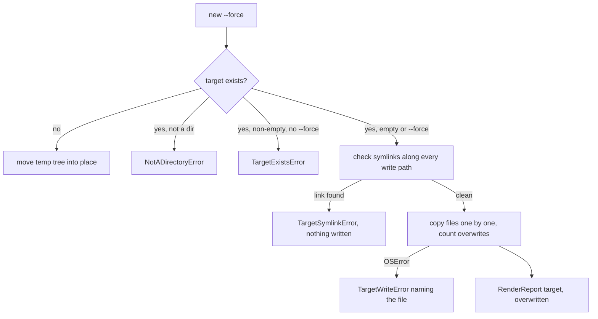
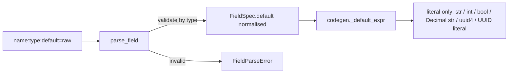

# Design Document

## Overview

Three small, independent hardening changes inside the generator:

1. **`rendering/writer.py`**: replace "delete target, move new tree in" with "render to a temp dir, then merge into the target file by file", with symlink and error handling.
2. **`fields/parser.py` + `fields/codegen.py`**: validate and normalise `default=` at parse time; make codegen only format already-validated values and never pass raw text through.
3. **`fields/parser.py`**: reject Python keywords and Django `Model` API names as field names.

No new dependencies; no change to generated project templates.

## Steering Document Alignment

### Technical Standards (tech.md)
Typed, Ruff-clean Python; custom exception types subclassing `ValueError` so existing `except` clauses in commands keep working; standard library only.

### Project Structure (structure.md)
Parsing and validation stay in `fields/parser.py`, source formatting in `fields/codegen.py`, filesystem writing in `rendering/writer.py`, CLI wiring in `commands/new.py`.

## Code Reuse Analysis

### Existing Components to Leverage
- **`FieldParseError`**: the single error type for all field input problems (R2, R3).
- **`RESERVED_FIELD_NAMES`** and `_parse_bool`: extended, not replaced.
- **`TargetExistsError`** and the render-into-`tempfile.TemporaryDirectory` flow: kept; only the final "place into target" step changes.
- **`needs_uuid_import`**: extended to cover UUID literal defaults.

### Integration Points
- **`commands/new.py`**: the only caller of `render_project`; it prints the overwritten-file count and handles the new errors.
- **`models_gen/writer.py`, `commands/add_model.py`**: consume `FieldSpec`/`field_source`; unchanged apart from receiving validated specs.
- **Tests and docs** that mention `--force` / `default=`.

## Architecture





### Modular Design Principles
- **Parse once, format dumbly**: all validation in the parser; `_default_expr` has no fall-through and raises if it ever sees an unvalidated combination (defence in depth for hand-built `FieldSpec`s).
- **Writer separates render from placement**: rendering never touches the target; placement is a small function that can be tested in isolation.

## Components and Interfaces

### 1. `rendering/writer.py` — merge placement (G1)
- **New types**
  ```python
  @dataclass(frozen=True, slots=True)
  class RenderReport:
      target: Path
      overwritten: int

  class TargetSymlinkError(ValueError): ...
  class TargetWriteError(ValueError): ...
  ```
- **New/changed functions**
  - `render_project_report(ctx) -> RenderReport`: the real implementation.
  - `render_project(ctx) -> Path`: unchanged signature, returns `render_project_report(ctx).target` (keeps existing callers and tests).
  - `_check_target(ctx) -> None`: `exists and not is_dir` → `NotADirectoryError` first (fixes the unreachable branch); non-empty without `--force` → `TargetExistsError`.
  - `_place(tmp_root, target) -> int`:
    - target missing → `shutil.move`, return 0.
    - otherwise `_assert_no_symlinks(tmp_root, target)` for every file to write (walk each path component under `target`; any `is_symlink()` → `TargetSymlinkError` naming it), then for each file `mkdir(parents=True, exist_ok=True)` + `shutil.copy2`, counting files that already existed; `OSError` → `TargetWriteError(f"Could not write {dest}: {exc}")`.
- **Removed**: `shutil.rmtree(target)`.
- **Side fix**: an existing *empty* target previously received the project as `target/<slug>` (because `shutil.move` into an existing directory nests); the merge path writes into the target directly, which is what R1.7 intends.
- **Dependencies:** stdlib only. **Reuses:** `_should_skip`, `_destination_name`, the temp-dir render loop.

### 2. `commands/new.py`
- Call `render_project_report`; catch `(ValueError, NotADirectoryError)` (new errors subclass `ValueError`; `NotADirectoryError` is an `OSError` and was uncaught).
- After success, if `report.overwritten`: print `Overwrote N existing file(s); files outside the generated tree were kept.`
- `--force` help text: "Generate into a non-empty directory: overwrites generated files, keeps everything else."

### 3. `fields/parser.py` — validation (G2, G3)
- `_validate_field_name(name)` (after the existing regex and reserved check): `keyword.iskeyword(name)` → error; name in `MODEL_API_NAMES` → error.
  `MODEL_API_NAMES = {"save", "delete", "clean", "full_clean", "validate_unique", "refresh_from_db", "from_db", "check", "serializable_value"}`.
- `_normalise_default(type_key, field_name, raw) -> str`, called when `default=` is seen:

  | type | accepted | stored in `FieldSpec.default` |
  |------|----------|-------------------------------|
  | `char`, `text`, `email`, `url`, `slug` | any string (including empty) | unchanged |
  | `int` | `int(raw)` succeeds | `str(int(raw))` |
  | `bool` | `_TRUE` or `_FALSE` tokens (via `_parse_bool`) | `"true"` / `"false"` |
  | `decimal` | `Decimal(raw)` succeeds and `is_finite()` | `raw.strip()` |
  | `uuid` | `uuid`, `uuid4`, or `uuid.UUID(raw)` succeeds | `"uuid4"` or the canonical lower-case string |
  | `date`, `datetime`, `fk`, `o2o`, `m2m` | nothing | `FieldParseError("defaults are not supported for <type>")` |

  Invalid values raise `FieldParseError(f"Invalid default {raw!r} for {name}:{type_key} ...")`; `int()`/`Decimal()`/`UUID()` exceptions are caught and chained.
- **`:` in values:** the colon split is kept. When the segment after a `default=` option is not a recognised option or flag, the "Unknown field option" error gains a hint: `values containing ':' are not supported`. Known limitation, documented: a value such as `default=a:unique` still parses `unique` as a flag (the parser cannot tell the difference); this is called out in the docs.

### 4. `fields/codegen.py` — formatting
- `_default_expr(spec)` has one branch per type and no fall-through:
  - text types: `json.dumps(raw, ensure_ascii=False)` (valid Python string literal; escapes quotes, backslashes, newlines and control characters; replaces the hand-rolled replace chain).
  - `bool` → `True`/`False`; `int` → `str(int(raw))`; `decimal` → `json.dumps(raw)` (quoted string, as today).
  - `uuid` → `uuid.uuid4` for `uuid4`, else `uuid.UUID("<canonical>")`.
  - anything else → `ValueError("unsupported default for <type>")`.
- `needs_uuid_import`: true when any `uuid` field has a default (both forms use `uuid.`).

## Data Models

`FieldSpec` is unchanged in shape. Semantics: `default` now always holds the **normalised** value described in the table (it was raw text before). Anything constructing `FieldSpec` by hand must pass a normalised value; `_default_expr` rejects what it cannot format.

## Error Handling

### Error Scenarios
1. **Target not empty, no `--force`**
   - **Handling:** `TargetExistsError` before anything is rendered or written.
   - **User Impact:** unchanged message.
2. **Target exists but is a file**
   - **Handling:** `NotADirectoryError`, now caught by `new`.
   - **User Impact:** `Target path exists and is not a directory: …` instead of a traceback.
3. **Symlink on a write path**
   - **Handling:** `TargetSymlinkError` raised before the first write.
   - **User Impact:** `Refusing to write through symlink <path>; remove it or choose another directory.` Target untouched.
4. **Write fails part-way (permissions, a directory where a file belongs)**
   - **Handling:** `TargetWriteError` naming the file; files already copied stay.
   - **User Impact:** clear message; re-running with `--force` is safe because the operation is idempotent.
5. **Template render fails**
   - **Handling:** exception before placement; temp dir cleaned up.
   - **User Impact:** target unchanged (as today).
6. **Invalid default / keyword name / API name**
   - **Handling:** `FieldParseError` at parse time, before any file is touched.
   - **User Impact:** message naming the field, the value and what is allowed.

## Testing Strategy

### Unit Testing
- **Writer** (`tests/rendering/test_render_project.py`, new `test_render_force.py`): foreign file survives `--force`; generated file with the same path is overwritten; count reported; non-empty without force still refuses; existing empty directory yields a project at the target itself (regression for the nesting bug); target is a file → `NotADirectoryError`; symlinked directory and symlinked file on a write path → `TargetSymlinkError` with nothing written; unwritable destination → `TargetWriteError` naming the file; render failure leaves the target untouched.
- **Parser/codegen** (`tests/fields/`): parametrised table of valid/invalid defaults per type (including strings with quotes, backslashes, newlines, non-ASCII, empty string); the reproduced `__import__('os')` payload is rejected for `date` and emitted only as an escaped literal for `char`; keywords (`class`, `import`, `lambda`) and API names rejected; existing valid names unchanged; every accepted case passes `ast.parse` of the emitted line.
- **CLI** (`tests/commands/test_new.py`): `--force` onto an existing tree prints the overwrite note and exit 0; symlink case exits 1 with the message.

### Integration Testing
- `add-model` with each supported default type produces a `models.py` that parses and contains `import uuid` when needed.

### End-to-End Testing
- The existing opt-in e2e (`OCTAVE_E2E=1`) is unaffected; one extra manual check during implementation: generate over an existing project directory containing a custom file and confirm it survives.

## Alternatives Considered

- **Keep delete, add backup/confirmation**: rejected by the user in favour of never deleting.
- **`shutil.copytree(..., dirs_exist_ok=True)`**: simpler, but follows symlinks in the target and gives no overwrite count or file-level error; rejected.
- **Support `default=now` for date/datetime**: needs import management in `models_gen/writer.py` and is undocumented today; rejected as scope creep (can be a follow-up).
- **Quote-aware field splitter to allow `:` in values**: more parser code for a rare case; rejected in favour of a clear error and documentation.
