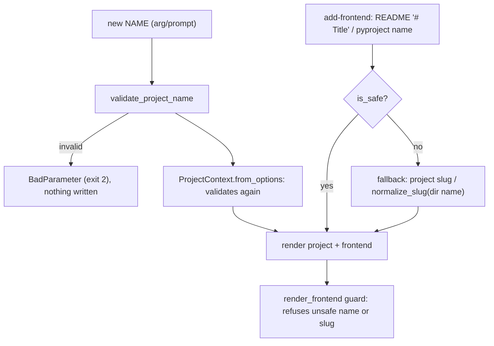
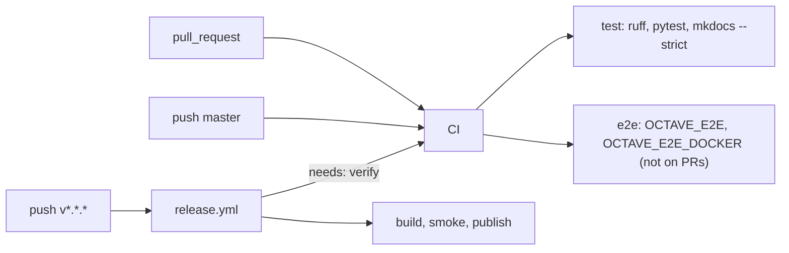

# Design Document

## Overview

Four small, independent changes:

1. **Safe names** (N1): one validator in `naming.py`; refused at the CLI, enforced where templates are rendered, and used as a *fallback test* when a name is derived from files the user may have edited (README heading, `pyproject.toml` name).
2. **Registration password check** (N2): pass an unsaved `User(email=…)` to `validate_password`, and report failures under `password`.
3. **CI and release gate** (G5): a reusable `ci.yml`, called by `release.yml` before publishing; all actions pinned by SHA; Dependabot keeps pins current; a unit test enforces the pinning rules.
4. **Docs and hygiene** (N3).

## Steering Document Alignment

### Technical Standards (tech.md)
Standard library only (`re`); GitHub Actions workflows use only actions the repo already uses. Tests keep using pytest and PyYAML (already installed through the MkDocs dev dependency) for workflow structure checks.

### Project Structure (structure.md)
Validation sits beside the existing app/model name validators in `django_octave/naming.py`. Workflows live in `.github/workflows/`.

## Code Reuse Analysis

### Existing Components to Leverage
- **`naming.py`** (`validate_app_name`, `validate_model_name`, `InvalidAppNameError`): same pattern, same file.
- **`rendering/context.py::normalize_slug`**: sanitises directory names; reused as the safe fallback for the project slug.
- **`FrontendSetupError`**: existing error that `add-frontend`/`new` already handle.
- **`docs.yml`** structure and its pinned-action list; **`release.yml`** steps stay as they are, only gated.

### Integration Points
- **`prompts/new_project.py`**: early, friendly rejection (before the remaining prompts).
- **`rendering/context.py::ProjectContext.from_options`**: the invariant for every render path.
- **`frontend_gen/detect.py`** and **`frontend_gen/setup.py::render_frontend`**: derivation fallbacks and the frontend render guard.
- **`templates/frontend_django/auth_api.py.j2`**: registration serializer.
- **E2E suite** (`tests/e2e/hardening_scenarios.py.tmpl`): extended with a password-similarity scenario.

## Architecture





### Modular Design Principles
- **One decision function, three call sites**: the CLI (UX), `from_options` / `render_frontend` (invariants), the derivation helpers (fallbacks). No per-template escaping.
- **Fail closed**: the allow-list is the only rule; there is no deny-list of dangerous characters.
- **Reusable workflow**: one definition of "verified", used by CI and by the release.

## Components and Interfaces

### 1. `safe_names.py` (new leaf module; design said `naming.py`)
_Implementation note: `naming.py` imports `rendering.context`, and `rendering.context` must call the validator, so the validators live in a dependency-free `django_octave/safe_names.py` to avoid an import cycle._
```python
PROJECT_NAME_RE = re.compile(r"^[^\W_][\w .\-]{0,63}$")   # Unicode letters/digits; space . - _
PROJECT_SLUG_RE = re.compile(r"^[A-Za-z0-9][A-Za-z0-9._-]{0,63}$")

class InvalidProjectNameError(ValueError): ...

def is_safe_project_name(raw: str) -> bool
def validate_project_name(raw: str) -> str   # strips, raises InvalidProjectNameError, returns the name
def is_safe_slug(raw: str) -> bool
```
Error text: `Invalid project name {raw!r}: use 1-64 letters, digits, spaces, '.', '-' or '_', starting with a letter or digit.` (`raw` is shown with `!r`, so control characters are escaped, never echoed raw.)

### 2. CLI and render guards
- `prompts/new_project.py`: after the name is known (argument or prompt) call `validate_project_name`; map `InvalidProjectNameError` to `typer.BadParameter` (exit 2).
- `rendering/context.py::ProjectContext.from_options`: `project_name=validate_project_name(options.name)`; `new` already maps `ValueError` to exit 1 for context construction errors (add the call inside the existing `try`).
- `frontend_gen/setup.py::render_frontend`: besides the empty check, refuse a name or slug that is not safe with `FrontendSetupError`.

### 3. `frontend_gen/detect.py` (derivation fallbacks)
- `project_display_name(root)`: use the README title only when `is_safe_project_name(title)`; else `project_slug(root)`.
- `project_slug(root)`: use the `pyproject.toml` name only when `is_safe_slug(raw)`; else `normalize_slug(root.name)`.
- No error is raised: a README titled `# My "App"` still works, and the SPA uses the slug as its title. The docs say so.

### 4. Registration (`auth_api.py.j2`)
```python
from django.core.exceptions import ValidationError as DjangoValidationError

def validate(self, attrs):
    if attrs["password"] != attrs["password_confirm"]:
        raise serializers.ValidationError({"password_confirm": "Passwords do not match."})
    try:
        validate_password(attrs["password"], user=User(email=attrs["email"]))
    except DjangoValidationError as exc:
        raise serializers.ValidationError({"password": list(exc.messages)}) from exc
    return attrs
```
`User(email=…)` is never saved. Failures now live under the `password` key (they were `non_field_errors`); the SPA's error flattening shows all keys, which is verified against the real API before and after. Mismatch and duplicate-email responses are unchanged.

### 5. Workflows
- **`ci.yml`** (new): triggers `pull_request` and `push` on `master`, `workflow_dispatch`, and `workflow_call`. `permissions: {}` at top; each job `contents: read`. Jobs:
  - `test`: checkout (no persisted credentials), `setup-uv`, `uv sync`, `uv run ruff check src tests`, `uv run pytest -q`, `uv run mkdocs build --strict`.
  - `e2e`: `if: github.event_name != 'pull_request'`; same setup; `OCTAVE_E2E=1 uv run pytest -q -m e2e` and `OCTAVE_E2E_DOCKER=1 uv run pytest -q tests/e2e/test_docker_image.py`. (A `workflow_call` from the tag-triggered release inherits the `push` event, so e2e runs there.)
- **`release.yml`**: new job `verify: uses: ./.github/workflows/ci.yml` with `permissions: contents: read`; job `release` gains `needs: verify`. Existing steps unchanged.
- **`docs.yml`**: unchanged except action pins.
- **Pinning**: every `uses:` becomes `owner/repo@<40-hex SHA> # <version>`. SHAs resolved with `git ls-remote` (recorded in the task log):

  | Action | Version | SHA |
  |--------|---------|-----|
  | actions/checkout | v7 | `3d3c42e5aac5ba805825da76410c181273ba90b1` |
  | astral-sh/setup-uv | v10.3.3 | `68559e99cc807c1eb7e9238fd43a15bba460eec2` |
  | softprops/action-gh-release | v3 | `8a0cd651e5b2365bd640854a3fa5dfc70e4875f3` |
  | actions/upload-pages-artifact | v5 | `fc324d3547104276b827a68afc52ff2a11cc49c9` |
  | actions/deploy-pages | v5 | `368f82528645a54fb793d4d04e342629a3f51346` |

- **`.github/dependabot.yml`** (new): `github-actions`, directory `/`, weekly.
- **Local validation**: `tests/test_workflows.py` loads every workflow with `yaml.safe_load` and asserts: every external `uses:` is a 40-hex SHA with a version comment, top-level `permissions` exists, no `pull_request_target`, no `secrets` in `ci.yml`, `release.release.needs` contains `verify`, and `verify` calls `ci.yml`. The exact CI commands are also run locally.

### 6. Lint fix and hygiene
- `ruff check --fix` for the remaining import-order error in `commands/add_frontend_crud.py`.
- `.gitignore`: add `.claude/settings.local.json`.

## Data Models

None. `FieldSpec`, `ProjectContext` shapes unchanged (`project_name` is now guaranteed safe).

## Error Handling

### Error Scenarios
1. **Unsafe name at `new`**
   - **Handling:** `BadParameter` before any prompt after the name, nothing written.
   - **User Impact:** one line stating the rule and the rejected value.
2. **README title or `pyproject` name unsafe in `add-frontend`**
   - **Handling:** silent fallback to the slug / sanitised directory name.
   - **User Impact:** the SPA shows the slug as title; documented.
3. **Hand-built context with an unsafe name (programmatic use)**
   - **Handling:** `from_options` / `render_frontend` raise.
   - **User Impact:** clear error, nothing rendered.
4. **Weak or similar password at registration**
   - **Handling:** HTTP 400, messages under `password`; no user created.
   - **User Impact:** the SPA displays the messages.
5. **CI failure on a release tag**
   - **Handling:** `release` never starts.
   - **User Impact:** no release is published; the failing job is visible.

## Testing Strategy

### Unit Testing
- `naming`: parametrised accepted names (ASCII, Unicode, spaces, dots, hyphens, leading digit, 64 chars) and rejected ones (quotes, backslash, `<`, `>`, `{`, `}`, `$`, backtick, newline, tab, NUL, RTL override, 65 chars, leading space/dot/hyphen, empty); the reproduced payload.
- CLI: `new` with the payload exits non-zero and creates nothing; accepted awkward names generate a project in which every `.py` parses (`ast`), `pyproject.toml` parses (`tomllib`), `package.json` parses (`json`), when `--frontend` is on.
- Fallbacks: README heading with quotes/braces → slug; safe heading → used; `pyproject` name with a quote → sanitised directory name; both with and without the README.
- `render_frontend` guard raises for unsafe name/slug.
- Registration template: `validate_password(..., user=User(email=` and the `password` key present; rendered module parses.
- Workflows: `tests/test_workflows.py` as above.

### Integration Testing
- Full unit suite and `ruff check src tests` (CI's own commands) run locally.

### End-to-End Testing
- Extend `hardening_scenarios.py.tmpl`: registering `alice@example.com` with password `alice@example` returns 400 with a `password` key and creates no user; a strong password still returns 201; mismatch and duplicate shapes unchanged. (Opt-in `OCTAVE_E2E=1`; run locally and fail-check against pre-change `HEAD` in a worktree.)
- Local run of the exact CI commands: `ruff`, `pytest`, `mkdocs --strict`, both e2e suites.
- Workflow syntax is validated by the YAML-structure test (the third-party `actionlint` image is not used).

## Alternatives Considered

- **Escape per context (`tojson`, HTML escape, Vue mustache escape)**: four formats plus Markdown, each with its own pitfalls; an allow-list is one rule and cannot be bypassed by a missed context. Rejected as primary defence.
- **Reject unsafe README titles in `add-frontend`**: would break legitimate titles like `# Bob's "Shop"`; fallback to the slug is friendlier and still safe.
- **Add pagination now**: the SPA would show only the first page; deferred until the SPA can page.
- **Format check in CI**: would force a 58-file reformat in this spec; deferred as a separate chore.
- **Separate verify jobs copy-pasted into `release.yml`**: duplicates definitions that would drift; a reusable workflow keeps one.
