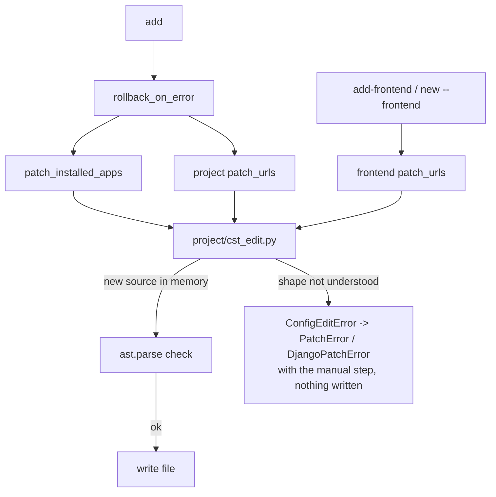

# Design Document

## Overview

One new module, `project/cst_edit.py`, holds the small libcst helpers the three patchers share: parse a config file, find a top-level list or tuple, append to it or remove from it without disturbing formatting, add and remove names in an import, and read the route of a `path()` call. The three functions (`patch_installed_apps`, `patch_urls` in `project/patch.py`, `patch_urls` in `frontend_gen/django_patch.py`) are rewritten on top of it, and `add` is wrapped in `rollback_on_error`.

The rule for every patch: compute the whole new source in memory, parse it again, and only then write. A shape that cannot be understood raises an error that says what to add by hand; nothing is written.

Generated files must come out **byte-identical** to today's, with one deliberate exception decided during implementation: `add` no longer leaves the stray blank line before the closing `]` of `INSTALLED_APPS`. That is enforced by golden files captured from the current code before anything changes (task 1.1).

## Steering Document Alignment

### Technical Standards (tech.md)
libcst (existing dependency, 1.9.0), `OctaveError` subclasses, fully annotated functions, ruff and pytest.

### Project Structure (structure.md)
`project/` already holds the detection and patching code; the new module sits next to `patch.py`. Tests mirror the package under `tests/project/` and `tests/frontend_gen/`; command-level tests under `tests/commands/`.

## Code Reuse Analysis

### Existing Components to Leverage
- **libcst** and the conventions in `models_gen/cst_util.py` (`parse_module` with a named-file error, `CSTTransformer` classes, `module.code`).
- **`PatchError`** (`project/patch.py`) and **`DjangoPatchError`** (`frontend_gen/django_patch.py`): stay the public exception types; the helpers raise `ConfigEditError` and each patcher re-raises it as its own type with the same text.
- **`rollback_on_error`** (`rollback.py`): wraps `add`; its parse check is a second safety net.
- **`handle_errors`** (`commands/_common.py`): prints the refusal in red and exits 1.
- **The managed import block markers** (`_URLS_IMPORT_BEGIN/END` in `django_patch.py`): kept as they are, so output and old projects stay compatible.

### Integration Points
- **`commands/add.py`**: the render and the two patches move into one `rollback_on_error` block.
- **`ensure_user_list_api` and `patch_django_for_frontend`**: keep calling `patch_urls`; signatures unchanged.
- **`register_endpoint_present` / `users_list_endpoint_present`**: now read the routes with libcst instead of searching the text.

## Architecture



### Modular Design Principles
- **Single File Responsibility**: `cst_edit.py` knows how to edit sequences and imports; each patcher knows only which names and routes it wants.
- **Component Isolation**: the helpers take and return libcst nodes or source strings; they never touch the disk.
- **Utility Modularity**: one function per operation, each tested on strings with a matrix of formatting shapes.

## Components and Interfaces

### `project/cst_edit.py` (new)
- **Purpose:** structure-aware edits of Python config files.
- **Interfaces (all fully annotated; raise `ConfigEditError`, an `OctaveError`/`ValueError`):**
  ```python
  def parse_source(source: str, path: Path) -> cst.Module                 # error names the file and the syntax problem
  def check_result(source: str, path: Path) -> str                         # ast.parse; returns source or raises
  def find_sequence(module, name) -> SequenceRef | None                    # top-level NAME = [...]/(...), annotated or not; falls back to NAME += [...]
  def string_value(node) -> str | None                                     # evaluated value of a plain string literal, else None
  def sequence_strings(module) -> set[str]                                 # every string that is an element of any list/tuple in the file
  def dominant_quote(node) -> str                                          # quote char of the first string in node, '"' by default
  def append_item(seq, value: cst.BaseExpression) -> cst.List | cst.Tuple # keeps comments, indentation, trailing-comma style
  def remove_items(seq, predicate) -> cst.List | cst.Tuple
  def route_of(element) -> str | None                                      # first string argument of path(...)
  def call_args(call) -> ...                                               # positional view argument etc.
  def add_import_names(module, from_module, names, *, append=True) -> cst.Module
  def remove_import_name(module, from_module, name) -> cst.Module
  def name_is_used(module, name) -> bool
  ```
- **`append_item` whitespace rules:** copy the comma that follows the last item for the new last item; give the former last item the comma that separates ordinary items (taken from the first non-last item, or from the whitespace after the opening bracket for a one-item list, or `", "` for a one-line list). A trailing comment on the former last item stays on its line. A list without a trailing comma keeps having none. An empty list gets one item on one line.
- **`ImportFrom` lists** (`from django.urls import (…)`) use the same routine, because their names carry a `comma` the same way list elements do.
- **Dependencies:** libcst, `ast`, `errors`.

### `project/patch.py` (rewritten on top of the helpers)
- `patch_installed_apps(settings_path, dotted_app) -> bool`:
  1. parse; if `dotted_app` is in `sequence_strings(module)` return `False` (a mention in a comment or in another kind of string does not count);
  2. `find_sequence(module, "INSTALLED_APPS")`; none, or its value is not a literal list/tuple, raises `PatchError('Add "apps.blog" to INSTALLED_APPS in config/settings/base.py yourself (it is built in a way django-octave cannot edit).')`;
  3. append a string in the quote style of the existing entries; write after `check_result`.
- `patch_urls(urls_path, app_name) -> bool`:
  1. parse; any `include("apps.<app>.urls")` call (any quote style) anywhere means already wired: return `False`;
  2. `find_sequence(module, "urlpatterns")`; none raises `PatchError` giving the exact `path("api/", include("apps.blog.urls")),` line and the import it needs;
  3. make sure `include` is imported from `django.urls`: append the name to an existing `from django.urls import …` (one line or parenthesized), or add `from django.urls import include, path` after the last top-level import when the file has none;
  4. append `path("api/", include("apps.<app>.urls"))` as the last element of `urlpatterns`; write after `check_result`.
- `PatchError` is unchanged.

### `frontend_gen/django_patch.py::patch_urls` (rewritten)
In one pass over the parsed module, with the same observable result as today for generated files:
1. **Managed import block:** if the begin marker comment is present, remove the statements between the begin and the end marker comments and the two marker lines (the begin marker is a leading line of the first block statement, the end marker a leading line of the statement after it); an unbalanced marker raises `DjangoPatchError` naming the marker.
2. **simplejwt import:** after the obtain route is replaced, remove `TokenObtainPairView` from `from rest_framework_simplejwt.views import …` when nothing else in the file uses it, and keep `TokenRefreshView`. (Today the line is rewritten blindly; this is the safer equivalent.)
3. **Obtain route:** the `path()` element whose first argument is `"api/auth/token/"` (either quote style, any wrapping) gets its view argument replaced by `EmailTokenObtainPairView.as_view()`; its name argument and formatting stay as the user has them. Not found raises `DjangoPatchError('Could not find the "api/auth/token/" route in urlpatterns; add-frontend replaces its view with EmailTokenObtainPairView.as_view()')`.
4. **Routes after the refresh route** (`"api/auth/token/refresh/"`, not found raises the same kind of error): the users route (`"api/users/"`, view `UserListView.as_view()`) and, when register is wanted, the register route (`"api/auth/register/"`, view `RegisterView.as_view()`) are inserted right after the refresh route in that order if they are missing, and left where they are if present. When register is not wanted, a register route of exactly that shape is removed.
5. **Imports:** a new managed block (begin marker, `from apps.users.auth_api import EmailTokenObtainPairView, UserListView`, and `from apps.users.auth_api import RegisterView` when register is wired, end marker) is inserted right after the `apps.core.throttling` import, or after the simplejwt views import when there is none; neither found raises `DjangoPatchError` saying which imports to add. Names that are already imported from `apps.users.auth_api` by hand are not added again.
6. `register_endpoint_present` / `users_list_endpoint_present` return whether a `path()` element in `urlpatterns` has a route starting with `api/auth/register` / `api/users/`; a file that does not parse gives `False` (the patch itself reports the syntax error).
7. `skip_register` keeps its meaning: register wanted, a register route exists, and the managed block is not there (the user wired it by hand), so the managed route and import are not added.

### `commands/add.py` (changed)
`render_app`, `patch_installed_apps` and `patch_urls` run inside `with rollback_on_error(project.root):` inside `handle_errors()`. A refused patch restores the tree (no app directory, no settings or urls change), prints the message, exits 1.

## Data Models
No new persistent data. `SequenceRef` is a small frozen dataclass (index of the statement in `module.body`, kind: assign / annotated / augmented) used only inside `cst_edit.py`.

## Error Handling

### Error Scenarios
1. **`urlpatterns` missing or not a literal list:** `PatchError` with the exact line and import to add; nothing written; `add` exits 1 and the project is restored.
2. **`INSTALLED_APPS` not editable and the app not listed anywhere:** `PatchError` with the line to add; nothing written.
3. **Token or refresh route missing (add-frontend):** `DjangoPatchError` naming the route and what the command wanted to do with it.
4. **File does not parse:** error naming the file and the syntax problem; file untouched.
5. **A patch result that does not parse** (a bug): `check_result` raises before anything is written.
6. **Unbalanced managed-block markers:** `DjangoPatchError` naming the marker; the user can delete the marker lines.

## Testing Strategy

### Unit Testing
- `tests/project/test_cst_edit.py` (new): `append_item` / `remove_items` on a matrix of shapes: multi-line with and without trailing comma, one line, empty, tuple, annotated target, `+=`, a trailing comment on the last item, comment lines between items, brackets and quotes inside strings and comments; every result parses and equals an expected string byte for byte. Import helpers on one-line, parenthesized, aliased and missing imports. `sequence_strings` ignores comments and non-sequence strings.
- `tests/project/test_patch_shapes.py` (new): the table from the requirements as parametrized edits of a generated project: wrapped lines, parenthesized imports, single quotes, `urlpatterns: list`, `]` inside a string, `+=` blocks, one-line `INSTALLED_APPS`, tuple `INSTALLED_APPS`, other lists present (the regression for the `MIDDLEWARE` edit), comments. For each: it succeeds, the result parses, the intended route or app is present exactly once, every original line that did not need to change is still there, and a second run changes nothing.
- Unsupported shapes: computed `urlpatterns`, missing token and refresh routes, `INSTALLED_APPS = DJANGO_APPS + LOCAL_APPS` with the app not listed (error) and listed (no error, `False`), unparsable file, unbalanced markers: the error names the file and the manual step, and the file bytes are unchanged.

### Integration Testing
- **Golden files, captured first from the current code** (`tests/project/golden/`): `config/urls.py` and `settings/base.py` after `add blog`; `config/urls.py` after `add-frontend` with register, without register, run twice, with register turned off afterwards, and on a project that an earlier version patched. The new code must reproduce them byte for byte.
- `tests/commands/test_add_rollback.py` (new): with an unsupported `urls.py`, `add blog` exits 1, prints the manual step, creates no `apps/blog`, and leaves settings and urls byte-identical; a bracket-in-string `urls.py` no longer ends in an unparseable file.
- Existing tests (`test_detect_patch.py`, `test_django_patch.py`, `test_frontend_setup.py`, the commands tests) pass unchanged.

### End-to-End Testing
- The existing opt-in suites must pass unchanged (they run `new`, `add`, `add-frontend` on real projects).
- Reference project from `HEAD` and from the new code (same launch method, `ruff` on `PATH` for both): `diff -r` must be empty.

## Task Ordering (for the tasks phase)
1. Golden files and the failing shape and rollback tests, written against the current code.
2. `cst_edit.py` with its unit tests.
3. `patch_installed_apps`, `add`'s `patch_urls` and the `add` rollback.
4. The frontend `patch_urls` and the two predicates.
5. Docs and audit; final verification.
