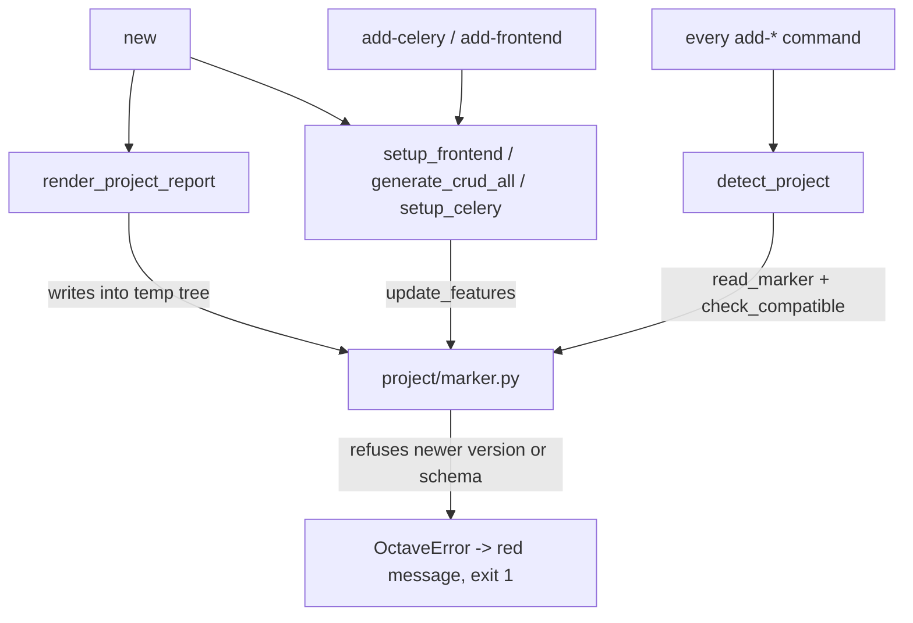

# Design Document

## Overview

One small module, `project/marker.py`, reads, writes, updates and checks `.octave.toml`. Four existing places use it:

1. **`render_project_report`** (`rendering/writer.py`) puts the marker into the temporary project tree before the tree is placed, so it is created atomically with the rest of the project by `new`.
2. **`detect_project`** (`project/detect.py`) reads it and refuses a project from a newer django-octave; every `add-*` command already calls `detect_project` first, so none of them changes.
3. **`setup_frontend`, `generate_crud_all` and `setup_celery`** record the feature flags after they succeed. Both `new` and the `add-*` commands call these functions, so the marker stays in step on every path with one change each.
4. **`add-celery` and `add-frontend`** run inside `rollback_on_error` (Requirement 3.4), as the other mutating commands already do.

File detection of multitenancy, Celery and the frontend is unchanged.

## Steering Document Alignment

### Technical Standards (tech.md)
Python 3.14, frozen slotted dataclasses, `OctaveError` subclasses for user-facing failures, stdlib `tomllib` for reading, no new dependency, ruff and pytest.

### Project Structure (structure.md)
Project-level helpers live in `src/django_octave/project/` next to `detect.py` and `patch.py`; tests mirror the package under `tests/project/`; command-level tests under `tests/commands/`.

## Code Reuse Analysis

### Existing Components to Leverage
- **`detect_project` / `OctaveProject`** (`project/detect.py`): gains a `marker` field and the compatibility check.
- **`render_project_report`** (`rendering/writer.py`): already renders into a temp directory and places it atomically; the marker file is added to that directory.
- **`rollback_on_error`** (`rollback.py`): wraps `add-celery` and `add-frontend`.
- **`handle_errors` / `OctaveError`** (`commands/_common.py`, `errors.py`): a marker problem is an `OctaveError`, so every command already prints it in red and exits 1.
- **`DatabaseChoice`** (`options.py`): the allowed database names.
- **`tests/commands/test_option_probe.py`'s discovery idea**: a test that enumerates every command and fails if a new one is not covered.

### Integration Points
- **`ProjectContext`** (`rendering/context.py`): supplies `database`, `use_docker`, `use_multitenancy` for the marker; nothing is added to the Jinja context (the file is not a template).
- **Generated `.gitignore` / `.dockerignore`**: unchanged; neither has a rule that matches `.octave.toml` (a test proves it).

## Architecture



### Modular Design Principles
- **Single File Responsibility**: `marker.py` is the only code that knows the file's format.
- **Component Isolation**: `marker.py` imports only `errors`, the standard library and `options`; it does no command or generator work.
- **Utility Modularity**: reading, writing, updating and checking are separate small functions, each unit-testable on a temp directory or a string.

## Components and Interfaces

### `project/marker.py` (new)
- **Purpose:** the marker file.
- **Constants:** `FILENAME = ".octave.toml"`, `SCHEMA = 1`.
- **Types:**
  ```python
  class MarkerError(OctaveError, ValueError): ...

  @dataclass(frozen=True, slots=True)
  class Marker:
      schema: int
      generator_version: str
      database: str          # "sqlite" | "postgres" | "mariadb"
      docker: bool
      multitenancy: bool
      frontend: bool
      register: bool
      crud: bool
      celery: bool
  ```
- **Interface:**
  ```python
  def current_version() -> str: ...                      # importlib.metadata, "unknown" if unavailable or fails the pattern
  def new_marker(*, database: str, docker: bool, multitenancy: bool) -> Marker: ...   # features all False
  def render_marker(marker: Marker) -> str: ...          # TOML text with a header comment
  def write_marker(root: Path, marker: Marker) -> Path: ...
  def read_marker(root: Path) -> Marker | None: ...      # None when the file is absent
  def update_features(root: Path, **changes: bool) -> bool: ...   # False (and no file) when there is no marker
  def check_compatible(marker: Marker, *, running: str | None = None) -> None: ...
  ```
- **File format** (flat, written by hand, `tomllib` reads it back):
  ```toml
  # Written by django-octave. Commit this file; the add-* commands read it.
  schema = 1
  generator_version = "0.3.0"

  [project]
  database = "postgres"
  docker = true
  multitenancy = true

  [features]
  frontend = true
  register = true
  crud = true
  celery = false
  ```
- **Reading (`read_marker`):** `tomllib.loads`; a `tomllib.TOMLDecodeError`, a missing `schema` or `generator_version`, a wrong type, an unknown database name or a version that fails the pattern raises `MarkerError("<root>/.octave.toml: <problem>; fix or delete the file")`. Missing `[project]` or `[features]` keys are a problem too, except that unknown extra keys are ignored (forward compatibility within one schema).
- **Version pattern:** `^[0-9]+(\.[0-9]+){0,3}[A-Za-z0-9.+-]{0,32}$`, or the literal `unknown`. The writer applies the same check to `current_version()`, so only validated text is written; the project name and every other free text never reach the file.
- **`check_compatible`:** raises `MarkerError` when `marker.schema > SCHEMA` ("written by a newer django-octave (marker schema N, this version reads up to 1); upgrade django-octave") or when the numeric release of `marker.generator_version` is greater than that of `running` ("generated by django-octave X, you are running Y; upgrade django-octave"). The release is the leading integers (`0.4.0.dev1` → `(0, 4, 0)`); tuples are zero-padded to the same length, so `0.3` equals `0.3.0`. It does nothing when either version is `unknown`.
- **`update_features`:** reads the marker (none → return `False`, create nothing), applies the keyword changes with `dataclasses.replace`, writes the whole file again. Unknown keyword names raise `TypeError` (programmer error). The version and every other key stay as they were. Hand-added comments are not preserved; the file's header says it is managed by the tool.

### `rendering/writer.py` (extended)
- In `render_project_report`, before `_place`: write `render_marker(new_marker(database=ctx.database.value, docker=ctx.use_docker, multitenancy=ctx.use_multitenancy))` to `tmp_root / FILENAME`. It goes through `_place` like any generated file (merge with `--force`, no deletion). The report's `overwritten` count includes it when a marker was replaced.

### `project/detect.py` (extended)
- `OctaveProject` gets `marker: Marker | None = None` (last field, default). After the existing structure checks and before returning: `marker = read_marker(root)`; `if marker: check_compatible(marker)`. Multitenancy detection is untouched.

### Feature updates
- `frontend_gen/setup.py::setup_frontend`: at the end `update_features(root, frontend=True, register=include_register)`. `register` mirrors the run, because the URL patching removes the register route when it is turned off.
- `frontend_gen/crud_setup.py::generate_crud_all`: at the end `update_features(root, crud=True)`. `crud` only ever turns on; the generated pages stay.
- `celery_gen/setup.py::setup_celery`: at the end `update_features(root, celery=True)`.
- All three are no-ops without a marker. `new` calls them after the marker exists, so its marker ends up with the features it actually set up.

### `commands/add_celery.py`, `commands/add_frontend.py` (extended)
- The generator calls run inside `with rollback_on_error(project.root):` (inside `handle_errors()`), like `add-task` and `add-viewset`. A failing marker update therefore leaves the project unchanged. (`new` is not wrapped, as today.)

## Data Models

### `Marker`
```
- schema: int                 # 1
- generator_version: str      # "0.3.0" or "unknown"; version of the generator that created the project
- database: str               # sqlite | postgres | mariadb
- docker, multitenancy: bool  # chosen at creation; cannot be added later
- frontend, register, crud, celery: bool   # kept in step by the feature commands
```

## Error Handling

### Error Scenarios
1. **Marker from a newer version:**
   - **Handling:** `MarkerError` from `detect_project`, before any write.
   - **User Impact:** red message with both versions and "upgrade django-octave", exit 1.
2. **Newer marker schema:** same, with the schema wording.
3. **Invalid marker (bad TOML, missing or mistyped keys, unknown database, bad version):**
   - **Handling:** `MarkerError` naming the file and the problem.
   - **User Impact:** exit 1; "fix or delete the file". A project without a marker is not an error.
4. **Marker update fails after a feature setup:**
   - **Handling:** the exception propagates; `rollback_on_error` restores the tree for `add-celery` and `add-frontend`.
   - **User Impact:** exit 1, project unchanged.
5. **Version of the running tool unknown:**
   - **Handling:** `current_version()` returns `"unknown"`; the check is skipped; `new` writes `generator_version = "unknown"`.
   - **User Impact:** none.

## Testing Strategy

### Unit Testing
- `tests/project/test_marker.py` (new): render/read round trip for every database and boolean combination; the file starts with the comment and `tomllib` agrees with it; invalid inputs table (bad TOML, missing `schema`, missing version, wrong types, unknown database, bad version string, 65-character junk); version comparison table (equal, older and newer patch, minor, major, dev suffix, `0.3` vs `0.3.0`, `unknown` on either side, a different release length); newer schema refused; `current_version()` falls back to `unknown` when metadata is missing (monkeypatched); `update_features` without a marker returns `False` and creates no file; with a marker it changes only the named keys and keeps `generator_version`; unknown key raises.
- `tests/project/test_detect_marker.py` (new): `detect_project` returns `marker=None` without a file, the marker when equal or older, refuses newer; multitenancy detection ignores a marker that disagrees.

### Integration Testing
- `tests/commands/test_marker_refusal.py` (new): enumerate every command except `new` from the Typer definition; each needs an entry in a table of arguments (the test fails when a command is missing, like the option probe). With a newer marker every command exits 1, prints both versions and leaves the tree byte-identical (snapshot); with an equal or older marker, or none, `add-model` still works.
- `tests/commands/test_new_marker.py` (new): `new` writes the marker with the chosen database, Docker and multitenancy; with `--frontend --register --crud --celery` the features are `true`, with `--frontend --no-register --no-crud` register and crud are `false`, with `--no-frontend` all three are `false`; `tomllib` reads the values back; `new --force` over a directory with a newer marker overwrites it without refusing and deletes nothing else; `git check-ignore -q .octave.toml` reports "not ignored" in the generated tree (skipped when `git` is missing).
- Feature commands: `add-celery` sets `celery`, `add-frontend` sets `frontend` and mirrors `register`, `--crud` sets `crud`, `generator_version` keeps an older value, a project without a marker stays without one; with `update_features` monkeypatched to raise, `add-celery` and `add-frontend` exit 1 and the tree is unchanged.
- `tests/commands/test_option_probe.py` keeps passing (the marker takes no free text).

### End-to-End Testing
- The existing opt-in suites must pass unchanged (they run `new` and many `add-*` commands against real projects).
- Reference project generated from `HEAD` and from the new code with the same launch method (`ruff` on `PATH` for both): the trees differ only by the new `.octave.toml`.

## Task Ordering (for the tasks phase)
1. `marker.py` with its unit tests (tests first).
2. `detect_project` and the refusal tests over every command.
3. `new` writes the marker (`render_project_report`), with the `new` tests.
4. Feature updates and the rollback wrapping, with their tests.
5. Docs page, roadmap and audit; final verification.
