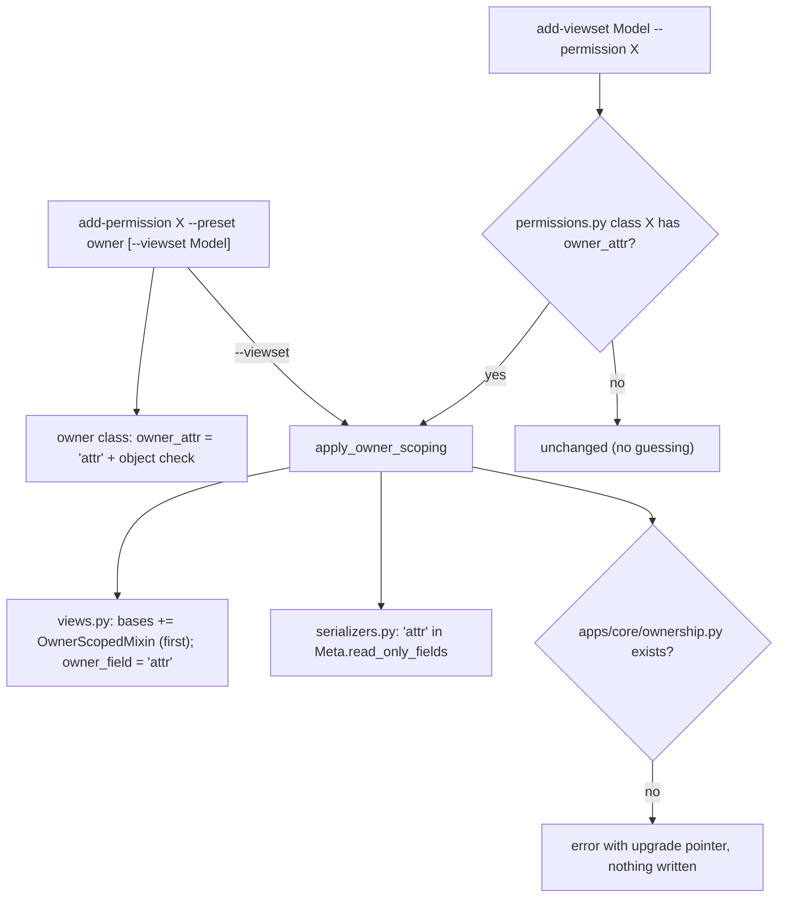

# Design Document

## Overview

The owner preset becomes a complete access model by adding one thing to generated projects and one operation to the generator:

- **Generated project:** `apps/core/ownership.py` with `OwnerScopedMixin` (always generated, inert unless a viewset uses it). Like `TenantScopedMixin`, it is a small, readable class the developer owns.
- **Generator:** one function, `apply_owner_scoping`, that makes a viewset/serializer pair owner-scoped. It is called by both wiring paths (`add-permission --preset owner --viewset`, `add-viewset --permission <owner class>`), so they cannot diverge.
- **Contract:** the generated owner permission class declares `owner_attr = "<attr>"`; a viewset declares `owner_field = "<attr>"`. Nothing is inferred from field names.

## Steering Document Alignment

### Technical Standards (tech.md)
No new dependencies. Source edits use `libcst` (already a dependency and the project's pattern in `cst_util.py`). Generated code is plain DRF.

### Project Structure (structure.md)
Project-side code sits in `templates/project/apps/core/` next to `tenancy.py` and `throttling.py`. Generator logic is a new `api_parts/ownership_gen.py`; CST primitives go into `models_gen/cst_util.py`.

## Code Reuse Analysis

### Existing Components to Leverage
- **`TenantScopedMixin` / `ensure_tenancy_module` / `viewset_bases`** (`tenancy.py`): same shape and the same "project lacks the module" error pattern; `viewset_bases` is extended, not duplicated.
- **`cst_util`** (`class_exists`, `add_to_import`, `ensure_import_lines`, `upsert_class`): new helpers follow its conventions.
- **`rollback_on_error`**: already wraps `add-permission` and `add-viewset`; the new steps run inside it, so failures leave the tree untouched.
- **`write_tests` / `build_api_test_source`**: extended the same way the tenant tests were.
- **CRUD discovery** (`crud_discover`, `crud_fields`, `ResourceSpec`): the existing `readonly` field kind is reused for the owner attribute.
- **Probe guard** (`tests/commands/test_option_probe.py`): covers any new free-text option automatically (none are added).

### Integration Points
- `permission_gen.build_permission_class` (owner preset template), `write_permission`, `wire_permission_to_viewset`.
- `viewset_gen.write_viewset` and `build_viewset_class`.
- `commands/add_permission.py` (wiring step and next-steps text).
- `frontend_gen/crud_discover.py`, `crud_fields.py`, `crud_types.py`.
- `api_parts/test_gen.py::write_tests`.
- e2e harness (`tests/e2e/helpers.py`).

## Architecture



### Request flow in an owner-scoped viewset

```mermaid
sequenceDiagram
    participant C as Client (user A)
    participant V as ViewSet(OwnerScopedMixin, [TenantScopedMixin,] ModelViewSet)
    C->>V: GET /api/notes/
    V->>V: get_queryset: super() (tenant scoped if any) .filter(owner=A)
    V-->>C: only A's rows
    C->>V: GET /api/notes/<B's id>/
    V-->>C: 404 (not in A's queryset)
    C->>V: POST {"title": "x", "owner": B}
    V->>V: owner is read-only in the serializer; perform_create saves owner=A
    V-->>C: 201, owner = A
```

### Modular Design Principles
- **One mixin, one function**: scoping lives in the mixin; wiring lives in `apply_owner_scoping`.
- **Order matters and is explicit**: `OwnerScopedMixin` precedes `TenantScopedMixin` because the tenant mixin's `get_queryset` does not call `super()`; the owner mixin calls `super()` and filters the result.
- **No inference**: the owner attribute comes from the permission class the developer generated.

## Components and Interfaces

### 1. `apps/core/ownership.py` (new generated file, always)
```python
class OwnerScopedMixin:
    owner_field = "owner"

    def get_queryset(self):
        queryset = super().get_queryset()
        user = self.request.user
        if not user.is_authenticated:
            return queryset.none()
        return queryset.filter(**{self.owner_field: user})

    def perform_create(self, serializer):
        serializer.save(**{self.owner_field: self.request.user})

    def perform_update(self, serializer):
        serializer.save(**{self.owner_field: self.request.user})
```
`perform_update` is defence in depth for serializers that predate the read-only field; with the field read-only it changes nothing.

### 2. Owner permission template (`permission_gen.build_permission_class`, preset `owner`)
```python
class IsOwner(BasePermission):
    """Allow access only to the object's owner (owner)."""
    owner_attr = "owner"
    def has_permission(...): unchanged
    def has_object_permission(self, request, view, obj):
        owner = getattr(obj, self.owner_attr, None) ...  # same behaviour
```

### 3. `api_parts/ownership_gen.py` (new)
```python
OWNER_IMPORT = "from apps.core.ownership import OwnerScopedMixin\n"
class OwnershipModuleMissingError(ValueError): ...
class OwnershipWireError(ValueError): ...

def ensure_ownership_module(apps_dir: Path) -> None
def owner_attr_of_permission(permissions_path: Path, class_name: str) -> str | None   # reads `owner_attr = "..."`
def viewset_owner_field(views_source: str, viewset_class: str) -> str | None          # reads `owner_field = "..."`
def apply_owner_scoping(app_dir: Path, *, viewset_class: str, owner_attr: str) -> list[str]
```
`apply_owner_scoping` (idempotent; returns human-readable notes for the command output):
1. `ensure_ownership_module(app_dir.parent)`.
2. `views.py`: add `OWNER_IMPORT`; `ensure_class_base(views, viewset, "OwnerScopedMixin", first=True)`; `set_class_attribute(views, viewset, "owner_field", '"<attr>"')`.
3. Resolve the model from the viewset (`queryset = Model.objects…`, else the class name without `ViewSet`) and `ensure_read_only_field(serializers, f"{Model}Serializer", attr)`. If the serializer class is missing or the attribute is not among its fields, say so in the notes and change nothing there.
Validation: `owner_attr` goes through `validate_owner_attr` (it already comes from a validated option, but a value read from a file is untrusted).

### 4. `cst_util` additions
```python
def ensure_class_base(path, class_name, base, *, first=True) -> bool
def set_class_attribute(path, class_name, attr, value_source) -> bool       # replace or insert before `queryset =`
def ensure_read_only_field(path, class_name, field) -> bool                  # Meta.read_only_fields tuple/list; creates it if absent
```
All use libcst, return whether the file changed, are idempotent, and raise `ModelWriteError` naming the path for unparsable files.

### 5. Wiring paths
- **`add-permission`**: when `preset == "owner"` and `--viewset` is given, call `apply_owner_scoping` after `wire_permission_to_viewset` (same rollback scope). Print each note. Without `--viewset`, print the exact commands (`add-viewset <app> <Model> --permission <Class> --force`, or add the mixin by hand).
- **`add-viewset`**: after `resolve_permission`, if the module is the app's `permissions.py` and `owner_attr_of_permission` returns a value, build the viewset with `viewset_bases(scoped=…, owned=True)` plus `owner_field`, then ensure the serializer read-only field. `viewset_bases` becomes `viewset_bases(*, scoped: bool, owned: bool = False)` returning `OwnerScopedMixin, TenantScopedMixin, viewsets.ModelViewSet` in that order.
- **`add-action --permission`**: unchanged (the per-action permission does not change scoping of the viewset).

### 6. Frontend CRUD
- `ResourceSpec` gains `owner_field: str | None = None`.
- `crud_discover` reads `owner_field = "<x>"` from the viewset class body (regex, like the existing `queryset` regex).
- `build_crud_fields(..., owner_field=...)` emits the matching field as `CrudField(kind="readonly")`, so forms skip it and the detail view shows it. Everything else is unchanged.

### 7. Generated tests
`write_tests` detects `owner_field` on `{Model}ViewSet`. `build_api_test_source(..., owner_field=...)` adds, next to the existing smoke tests (and combined with tenant fixtures when the project is multitenant):
- `test_list_only_returns_own_rows`
- `test_other_users_row_is_not_found` (404)
- `test_create_sets_owner_to_the_requester_and_ignores_the_payload`: payload from `factory.build(dict, ...)` without owner/tenant; skipped with a clear reason only if the model needs other related objects the factory cannot express as ids
- `test_update_cannot_change_the_owner`
Non-owner-scoped output is unchanged.

### 8. Upgrade path for existing projects
Copy `apps/core/ownership.py` from a freshly generated project; regenerate owner permission classes (or add `owner_attr = "..."` by hand); re-run `add-permission ... --preset owner --viewset <Model> --force`. Documented in `security.md`. Generators refuse with a pointer when `ownership.py` is missing and scoping is requested.

## Data Models

No schema or migration changes. New contract attributes only: `owner_attr` (permission class) and `owner_field` (viewset).

## Error Handling

### Error Scenarios
1. **`apps/core/ownership.py` missing (project generated earlier)**
   - **Handling:** `OwnershipModuleMissingError` before anything is written.
   - **User Impact:** one line naming the file and the docs section; tree unchanged.
2. **Viewset class not found / views.py unparsable**
   - **Handling:** `OwnershipWireError`/`ModelWriteError` naming the file; rollback restores.
   - **User Impact:** clear message, no traceback.
3. **Serializer class missing, or owner attribute not in its fields**
   - **Handling:** note in the output; viewset scoping still applied (the mixin also overrides the owner on save).
   - **User Impact:** told what was and was not changed.
4. **Permission class has no `owner_attr`** (hand-written / older)
   - **Handling:** no scoping, no guessing; unchanged generation.
   - **User Impact:** none; docs explain how to opt in.
5. **Anonymous request to an owner-scoped viewset**
   - **Handling:** permission class rejects it; the queryset is also empty.
   - **User Impact:** 401/403 as before.

## Testing Strategy

### Unit Testing
- `cst_util`: base insertion (first position, idempotent, existing multiple bases, comments preserved), attribute set/replace/insert position, `read_only_fields` (tuple, list, absent, already present, not in `fields`, `__all__`), unparsable file → `ModelWriteError` with path.
- `ownership_gen`: attribute readers; `apply_owner_scoping` end-to-end on a fixture app (viewset only, viewset+tenant mixin, missing serializer, missing module, idempotent re-run, `--force`).
- `viewset_bases` ordering table (plain, tenant, owner, both).
- Permission template: `owner_attr` present, check behaviour unchanged; other presets byte-identical.
- Frontend discovery/fields: owner attribute becomes `readonly`; non-owner unchanged; rendered pages parse.
- Test generator: owner-scoped output contains the four tests (plain and tenant), others unchanged.

### Integration Testing
- CLI tests for both wiring paths and the no-`--viewset` next-steps text; tree unchanged on failure; byte-identical generation for projects that never use the owner preset (compared against a worktree of `HEAD`).
- The probe guard and the full suite stay green.

### End-to-End Testing
- New opt-in e2e (`OCTAVE_E2E=1`): real generated projects, plain and multitenant, with a model that has an `owner` FK and an `assignee` FK to the user; `add-permission --preset owner --viewset`; scenario file proves R1, R2, R4 over real DRF (own rows only, 404 for others, create ignores owner, PATCH cannot change owner, `assignee` still writable, schema marks owner `readOnly`, tenant isolation combined). The same scenarios run against a worktree of the previous commit and must fail.
- The generated project's own `pytest` (including the generated owner tests) runs inside that e2e.

## Alternatives Considered

- **Filter backend instead of a mixin**: scoping would not set the owner on create, so two mechanisms would be needed.
- **Detect owner fields by name (`owner`, `author`, `created_by`)**: wrong for `assignee`-style fields and invisible to the developer; the explicit `--owner-attr` is already the developer's statement of intent.
- **Make all user foreign keys read-only**: breaks legitimate assignment (`assignee`, `reviewer`).
- **Put the logic into the permission class** (it cannot filter querysets in DRF).
- **Regenerate the serializer with `add-serializer --force`**: would overwrite the developer's edits; a targeted CST edit changes one tuple.
- **Staff bypass**: rejected for now; a bypass is an explicit decision the developer can add in `get_queryset`.
