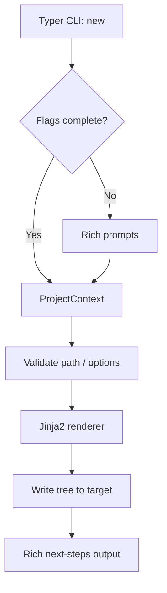

# Design Document

## Overview

Implement `django-octave new` as a Typer/Rich CLI that builds a typed `ProjectContext`, then renders an in-package Jinja2 template tree into a target directory. The generated project is a standalone Django REST API (no runtime dependency on django-octave) with opinionated deps, `config/` + `apps/core`, env-based settings, JWT + Spectacular, and optional Docker / first-party row-level multitenancy.

This replaces the current stub `main()` hello-world entry with a real package layout matching steering.

## Steering Document Alignment

### Technical Standards (tech.md)

- Generator: Typer + Rich + Jinja2; uv; Python 3.14+.
- Generated: latest stable Django + newest Python Django supports; DRF, Spectacular (+ sidecar), SimpleJWT, django-filter, cors-headers, django-environ, WhiteNoise, Gunicorn; pytest stack; Ruff; uv.
- DB: SQLite | PostgreSQL (`psycopg`) | MariaDB (`mysqlclient`).
- Docker optional: Dockerfile + `docker-compose.yml` (dev) + `docker-compose.prod.yml` (prod), uv in images.
- Multitenancy: first-party row-level only; create-time opt-in.
- No GraphQL, admin themes, or cloud deploy generators.

### Project Structure (structure.md)

- Package: `src/django_octave/{cli,commands,prompts,rendering,templates/…}`.
- Generated: `manage.py`, `config/settings/{base,local,prod}.py`, `apps/core`, tests, optional Docker files.
- Templates mirror destination paths; `.j2` suffix where helpful.
- Generated apps imported as `apps.core`; `INSTALLED_APPS` uses full paths.

## Code Reuse Analysis

### Existing Components to Leverage

- **`pyproject.toml` / `[project.scripts]`**: Keep `django-octave` entry; point at Typer app (`django_octave.cli:app` or `django_octave:main` wrapping Typer).
- **`src/django_octave/`**: Replace stub `main()` with real modules; no Cookiecutter external project.
- **Cursor rules (python/django/testing)**: Apply to generator code and shape generated Django conventions (`services`/`selectors` stubs optional; `core` models follow field-order rules).

### Integration Points

- **Generated project**: Fully standalone after write; user runs `uv sync` / Docker themselves.
- **Dashboard/MCP**: Not part of runtime; specs only.

## Architecture



### Modular Design Principles

- **CLI** (`cli.py`, `commands/new.py`): parse args, orchestrate; no template logic.
- **Prompts** (`prompts/new_project.py`): interactive only; returns partials merged into context.
- **Context** (`rendering/context.py`): dataclass / pydantic-style typed model; single source of truth for Jinja.
- **Renderer** (`rendering/engine.py`, `writer.py`): load templates from package, render, write; support atomic write (temp dir + rename) when feasible.
- **Templates** (`templates/project/`): one tree with `` for docker / database / multitenancy.

## Components and Interfaces

### Typer application (`cli.py`)

- **Purpose:** Root Typer app; register `new` (and future `add` stub-free—out of scope).
- **Interfaces:** `app = typer.Typer(...)`; entry `main()` → `app()`.
- **Dependencies:** Typer, commands package.

### `new` command (`commands/new.py`)

- **Purpose:** `django-octave new` dual UX.
- **Flags (illustrative names; finalize in implementation):**
  - `name` / path: project directory name
  - `--database` / `-d`: `sqlite` | `postgres` | `mariadb` (default `sqlite`)
  - `--docker` / `--no-docker` (default off)
  - `--multitenancy` / `--no-multitenancy` (default off)
  - `--force`: allow non-empty target
  - `--path`: optional parent/output path (default cwd)
- **Non-interactive:** if any of the interactive fields are omitted *and* stdin is not a TTY (or `--yes`/CI mode), require flags; else prompt for missing values only.
- **Dependencies:** prompts, context builder, renderer, Rich console.

### Prompt flow (`prompts/`)

- **Purpose:** Ask for name, database, docker, multitenancy with Rich.
- **Interfaces:** `prompt_new_project(partial: ProjectContext) -> ProjectContext`.

### `ProjectContext` (`rendering/context.py`)

- **Purpose:** Typed generation inputs + derived fields (module names, compose services, driver packages).
- **Key fields:**
  - `project_name: str` (directory / display)
  - `project_slug: str` (normalized filesystem/python-safe)
  - `database: Literal["sqlite","postgres","mariadb"]`
  - `use_docker: bool`
  - `use_multitenancy: bool`
  - `python_version: str` (for `.python-version` / pyproject)
  - `django_version_pin: str` (constraint string resolved at generator release)
  - derived: `db_url_example`, `db_engine`, `db_deps: list[str]`, `include_db_service: bool`

### Jinja engine + writer (`rendering/`)

- **Purpose:** `files()` from `importlib.resources` / package path; render to target.
- **Interfaces:** `render_project(ctx: ProjectContext, target: Path, *, force: bool) -> None`.
- **Behavior:** Refuse non-empty target unless `force`; prefer write-to-temp-then-move for cleanliness; skip Docker template files when `use_docker` is false (or render empty—prefer omit files).

### Template tree (`templates/project/`)

Destination layout (from structure steering), with conditionals:

| Area | Notes |
|------|--------|
| `pyproject.toml.j2` | uv project; optional deps by DB; always-on stack |
| `config/settings/base.py.j2` | INSTALLED_APPS, DRF, Spectacular, JWT, CORS, filters, WhiteNoise, custom user, env |
| `config/settings/local.py.j2` / `prod.py.j2` | DEBUG, security, DB from env |
| `config/urls.py.j2` | admin, api auth JWT, schema/swagger/redoc |
| `apps/core/models.py.j2` | `TimeStampedModel`; if multitenancy: `Tenant`, `TenantAwareModel`, managers |
| `apps/core/middleware.py.j2` | only if multitenancy |
| `apps/users/` or user under `core` | **Decision:** custom user in `apps.users` (clean AUTH_USER_MODEL) with `TimeStampedModel` from core — prefer **`apps.users.User`** for clarity |
| Docker files | only if `use_docker` |
| `tests/`, Ruff/pytest config, `.env.example`, README | always |

**AUTH_USER_MODEL decision:** Generate `apps.users` with a custom `User` (email or username—**email as USERNAME_FIELD** for API-first) always, not only when multitenancy is on. Keeps AUTH_USER_MODEL stable.

### Multitenancy design (generated)

- **`Tenant`**: `id`, `name`, `slug`, timestamps (via `TimeStampedModel`).
- **`TenantAwareModel`**: abstract; `tenant` FK; default manager filters by current tenant from contextvars/middleware.
- **Middleware:** resolve tenant from request header `X-Tenant-ID` (UUID/slug—**design choice: UUID header `X-Tenant-ID`**) after JWT auth; attach to `request.tenant`; set contextvar for managers.
- **User↔tenant:** `Membership` (user, tenant, role) for future authz; v1 can keep simple FK or M2M—**Membership model** with roles `owner`/`member`.
- Domain models subclass `TenantAwareModel` to opt in; unscoped `all_objects` manager for admin/migrations only.
- Fail closed: if no tenant on request, tenant-scoped querysets return empty / raise permission denied for unsafe ops (document: **raise** on write without tenant; **empty** on read).

### Docker design (generated)

- **Dockerfile:** multi-stage optional; `uv sync --frozen` (or sync without lock if first generate creates lock via documented `uv lock` step—**generator emits `pyproject.toml`; README says `uv lock && uv sync`**).
- **`docker-compose.yml`:** `web` + `db` when postgres/mariadb; sqlite: `web` only; bind-mount for dev; runserver or uvicorn-not—**`manage.py runserver`** for dev.
- **`docker-compose.prod.yml`:** `web` (Gunicorn), `db` if needed; env_file; no bind-mount source.

## Data Models

### Generator: `ProjectContext`

```
ProjectContext
- project_name: str
- project_slug: str
- target_dir: Path
- database: sqlite | postgres | mariadb
- use_docker: bool
- use_multitenancy: bool
- force: bool
- python_version: str
- packages: list[str]          # computed
- include_db_service: bool     # docker && database != sqlite
```

### Generated: `TimeStampedModel`

```
TimeStampedModel (abstract)
- created_at: DateTimeField(auto_now_add=True)
- updated_at: DateTimeField(auto_now=True)
```

### Generated: `User` (`apps.users`)

```
User (AbstractUser or AbstractBaseUser + PermissionsMixin)
- email as USERNAME_FIELD
- timestamps via TimeStampedModel if compatible with AbstractUser
```

### Generated (multitenancy): `Tenant`, `Membership`, `TenantAwareModel`

```
Tenant
- id: UUID
- name: str
- slug: slug (unique)
- created_at / updated_at

Membership
- user: FK User
- tenant: FK Tenant
- role: owner | member
- unique(user, tenant)

TenantAwareModel (abstract)
- tenant: FK Tenant
- objects: TenantManager (scoped)
- all_objects: Manager (unscoped)
```

## Error Handling

### Error Scenarios

1. **Target exists and non-empty without `--force`**
   - **Handling:** Exit code 1; message listing path.
   - **User Impact:** No files written.

2. **Invalid project name / slug**
   - **Handling:** Validate before render; suggest normalized slug.
   - **User Impact:** Clear validation error.

3. **Missing flags in non-interactive mode**
   - **Handling:** Exit 2; list missing options.
   - **User Impact:** No prompts hang in CI.

4. **Template/render failure mid-write**
   - **Handling:** Prefer temp directory; on failure remove temp and leave destination untouched; if partial write unavoidable, print recovery hint.
   - **User Impact:** No half-broken project presented as success.

5. **Unsupported database value**
   - **Handling:** Typer enum validation.
   - **User Impact:** Usage error from Typer.

## Testing Strategy

### Unit Testing (generator)

- Context derivation: DB deps, `include_db_service`, slug normalization.
- Renderer: generate into `tmp_path` for matrices:
  - sqlite / postgres / mariadb
  - docker on/off
  - multitenancy on/off
- Assert file presence/absence (Dockerfile, middleware, psycopg in pyproject, etc.).
- Snapshot or substring checks for `AUTH_USER_MODEL`, Spectacular urls, JWT routes.

### Integration Testing

- Run `CliRunner` / Typer testing on `new` with flags; verify exit codes and output next-steps.
- Optional: `uv sync` + `manage.py check` on one generated fixture (slow; mark and run in CI selectively).

### End-to-End Testing

- Manual/CI smoke: generate sqlite no-docker project → `uv sync` → `migrate` → `manage.py check` → schema endpoint imports.
- Docker smoke optional behind marker when Docker available.

## Implementation Notes

1. Add generator deps to this package: `typer`, `rich`, `jinja2`; dev: `pytest`, `ruff`.
2. Pin generated Django/DRF versions in template constants module so releases bump in one place.
3. MariaDB: use `mysqlclient` with `django.db.backends.mysql` and document MariaDB server; set `OPTIONS` if needed.
4. Settings module env: `DJANGO_SETTINGS_MODULE=config.settings.local` by default in manage/Dockerfile prod → `config.settings.prod`.
5. License: generator GPL-3.0; generated tree gets a short note that user owns their code (no GPL infection claim in README—user responsibility); do not copy GPL into generated projects by default.
6. `django-octave add` remains unimplemented (help can say “coming later” or omit).
