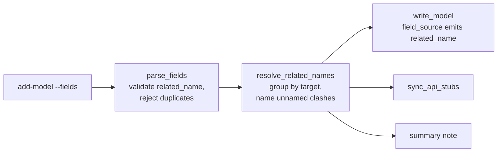

# Design Document

## Overview

Three small changes along the path a field declaration already takes (`parse_field` → `parse_fields` → `field_source` → `write_model`):

1. **Parse:** `fields/parser.py` accepts and validates `related_name=`, and `parse_fields` rejects two fields with the same explicit name.
2. **Resolve:** a new `fields/related.py` finds relations that would clash and gives each unnamed one a distinct, deterministic name. The `add-model` command calls it once, after parsing.
3. **Emit:** `fields/codegen.py` writes `related_name="…"` when a spec has one.

Models without a clash produce the same source as today.

## Steering Document Alignment

### Technical Standards (tech.md)
Python 3.14, frozen dataclasses with `slots=True`, `OctaveError` subclasses for user-facing failures, allow-list validation before anything reaches generated source (as for `default=`, `safe_names` and the option probe), Ruff and pytest.

### Project Structure (structure.md)
The field DSL lives in `src/django_octave/fields/`; command orchestration stays in `commands/`; tests mirror the package under `tests/`; e2e tests are opt-in under `tests/e2e/`.

## Code Reuse Analysis

### Existing Components to Leverage
- **`FieldSpec`, `parse_field`, `parse_fields`** (`fields/parser.py`): extended with one attribute and one option branch; the "option only valid for …" message style of `to=` and `on_delete=` is reused.
- **`FieldParseError`**: used for every new validation failure (it is an `OctaveError`, so `handle_errors()` already prints it and exits 1).
- **`field_source`** (`fields/codegen.py`): gains one argument line.
- **`naming.pascal_to_snake`**: turns the model name into the first part of a generated name.
- **`handle_errors`, `console`** (`commands/_common.py`): the new note is printed in `add_model`'s existing summary.
- **`models_gen/writer.py`**: unchanged; it receives the resolved `list[FieldSpec]`.
- **`models_gen/api_sync.py`**: receives the resolved specs too; its `_admin_class` gets the m2m fix below.
- **`inspect/model_fields.py`**: already reads only the arguments it needs, so `related_name` is ignored (a test locks this in).

### Integration Points
- **`commands/add_model.py`**: `fields = parse_fields(...)` is followed by `resolved = resolve_related_names(fields, app=app, model=model)`; the resolved specs go to `write_model` and `sync_api_stubs`, and `resolved.generated` feeds the summary.
- **Docs**: `docs/commands/add-model.md`, `docs/roadmap.md` item 11, the audit notes.

## Architecture



### Modular Design Principles
- **Single File Responsibility**: the option's syntax rule is in the parser; the "which fields clash and what to call them" logic is in `fields/related.py`; emission stays in `codegen.py`.
- **Component Isolation**: `resolve_related_names` is a pure function from specs to specs (no files, no Django), so it is unit-testable without a project.
- **Service Layer Separation**: the command only wires the pieces together.

## Components and Interfaces

### `fields/parser.py` (extended)
- **Purpose:** accept `related_name=` on `fk`/`o2o`/`m2m` and validate it.
- **Interfaces:**
  - `FieldSpec.related_name: str | None = None` (new attribute, last field, so existing positional construction is unaffected).
  - New option branch in `parse_field`: `elif key == "related_name"`: reject non-relation types with `Option related_name= is only valid for fk/o2o/m2m (got char)`, then validate with `_validate_related_name(value)`.
  - `_validate_related_name(raw) -> str`: returns `"+"` unchanged; otherwise requires `^[A-Za-z_][A-Za-z0-9_]{0,63}$`, not a Python keyword, **not ending in `_` and not containing `__`** (Django rejects both for reverse query names: `fields.E308`, `fields.E309`). The message states the rule. Because the regex excludes `%`, Django's `%(class)s` interpolation cannot be requested.
  - `parse_fields`: after parsing, if two fields share an explicit name other than `+`, raise `FieldParseError("related_name 'x' is used by both 'a' and 'b'")`.
- **Dependencies:** `keyword`, `re` (already imported).
- **Reuses:** the existing option loop and error style.

### `fields/related.py` (new)
- **Purpose:** make relations that would clash distinct.
- **Interfaces:**
  ```python
  @dataclass(frozen=True, slots=True)
  class ResolvedFields:
      fields: list[FieldSpec]            # same order, related_name filled where generated
      generated: dict[str, str]          # field name -> generated related_name

  def resolve_related_names(fields: Sequence[FieldSpec], *, app: str, model: str) -> ResolvedFields: ...
  ```
- **Algorithm:**
  1. Normalise each relation's target: a bare `Model` becomes `<app>.Model` (Django resolves a bare name in the model's own app); `app.Model` is kept. Comparison is exact on the normalised string. A self-relation to the model itself therefore groups like any other target.
  2. Group relation fields (`fk`, `o2o`, `m2m` together, because they share the target's reverse accessor and query-name namespace) by target. Only fields **without** an explicit `related_name` take part.
  3. A group with two or more members is a clash. Every member gets `f"{pascal_to_snake(model)}_{field}"`, cleaned so the result is a valid reverse query name (`__` collapsed to `_`, trailing `_` stripped).
  4. If a generated name equals any explicit name or an earlier generated name in the model, append `_2`, `_3`, … until unique, so the result is deterministic and distinct.
  5. A group of one, explicit names (including `+`) and non-relations are returned untouched.
- **Dependencies:** `fields.parser.FieldSpec`, `RELATION_TYPES`, `naming.pascal_to_snake`.
- **Why the app is not part of the name:** `note_owner` stays readable (`user.note_owner.all()`). Two apps that each define a `Note` model with the same field names pointing at the same target would collide, but the generator already has that exposure for a single relation (default accessor `note_set`), so this spec does not change it; an explicit `related_name=` is the escape hatch. It is called out in the docs.

### `fields/codegen.py` (extended)
- **Purpose:** emit the argument.
- **Change:** in the relation branch, after `on_delete`: `if spec.related_name is not None: args.append(f'related_name="{spec.related_name}"')`. The value has passed the allow-list (parsed) or was built from validated names (generated), so it is safe inside quotes.

### `commands/add_model.py` (extended)
- **Change:** after `parse_fields`, call `resolve_related_names`; use `resolved.fields` for `write_model` and `sync_api_stubs`; add a summary section when `resolved.generated` is not empty:
  ```
  ## related_name
  Several relations point at the same model, so each got its own reverse name:
  - `owner` → `note_owner`
  - `assignee` → `note_assignee`
  Set `related_name=` on a field to choose another name (`+` turns the reverse relation off).
  ```
- Order inside `handle_errors()` and the rollback behavior are unchanged.

### `models_gen/api_sync.py` (extended, Requirement 7)
- **Purpose:** stop `add-model` from putting many-to-many fields into the admin's `list_display`.
- **Cause:** `_admin_class` builds `display_names = ["id", *[f.name for f in fields], "created_at", "updated_at"]`, so every declared field is listed. Django rejects a many-to-many field there (`admin.E109`). `add-admin` is not affected: its `default_list_display` already skips m2m.
- **Change:** build the list from `fields` with `f.type_key != "m2m"`. Nothing else changes: `search_fields`, the serializer and the viewset keep using all fields (DRF serializes m2m fine).
- **Reuses:** `FieldSpec.type_key`. Output for models without m2m fields is byte-identical.

## Data Models

### `FieldSpec` (one new attribute)
```
- related_name: str | None   # None = not set; "+" = hidden; otherwise a validated identifier
```

### `ResolvedFields`
```
- fields: list[FieldSpec]
- generated: dict[str, str]  # field name -> chosen related_name, in declaration order
```

## Error Handling

### Error Scenarios
1. **`related_name=` on a scalar field** (`title:char:related_name=x`):
   - **Handling:** `FieldParseError`, "Option related_name= is only valid for fk/o2o/m2m (got char)".
   - **User Impact:** red message, exit 1, project untouched.
2. **Invalid value** (`class`, `a-b`, `x%(class)s`, `x_`, `a__b`, 65 characters, empty):
   - **Handling:** `FieldParseError` stating the rule.
   - **User Impact:** same.
3. **Duplicate explicit name in one model:**
   - **Handling:** `FieldParseError` naming both fields.
   - **User Impact:** same.
4. **Generated name collides with an explicit one:**
   - **Handling:** numeric suffix (`_2`); not an error.
   - **User Impact:** the summary shows the final name.
5. **Hand-chosen explicit names that still clash with Django's default accessors** (for example an explicit `note_set` on one field and an unnamed second relation):
   - **Handling:** not detected by the generator; Django's system check reports it.
   - **User Impact:** `manage.py check` error, as for any hand-written model.

## Testing Strategy

### Unit Testing
- `tests/fields/test_parser.py`: valid identifiers and `+` on fk/o2o/m2m; rejection on every other type; invalid values table (keyword, hyphen, `%`, trailing `_`, `__`, empty, 65 chars, injection payloads such as `x", y="`); duplicate explicit names; field syntax unchanged for existing declarations.
- `tests/fields/test_related.py` (new): table-driven cases for `resolve_related_names`: two fk to one target; fk+m2m; fk+o2o; bare vs app-qualified target; self-relation twice; single relation untouched; different targets untouched; explicit name untouched and not counted; one explicit plus one unnamed untouched; three unnamed; generated name collides with explicit (suffix); CamelCase and acronym model names; field names that would produce `__` or a trailing `_`; determinism (same input, same output).
- `tests/fields/test_codegen.py`: `related_name` line and its position after `on_delete`; absent when `None`; output for existing specs unchanged.
- `tests/inspect`: a model with `related_name` still inspects (relations and field kinds unchanged).
- `tests/models_gen` (api_sync): `_admin_class` leaves m2m fields out of `list_display`, keeps order and the timestamp fields, handles an m2m-only model, and is unchanged for models without m2m.

### Integration Testing
- `tests/commands/test_add_model.py`: the motivating command writes distinct names, prints the `## related_name` section, and re-running with `--force` gives identical bytes; explicit names are written as given with no section; invalid options exit 1 and leave `models.py` unchanged; the serializer, viewset and admin stubs are the same as for the equivalent model without clashes.
- `tests/commands/test_option_probe.py` keeps passing; add a payload case for the new option.

### End-to-End Testing
- New opt-in `tests/e2e/test_related_names.py`: generate a project, run `add-model` for each case (fk+fk, m2m+m2m, o2o+o2o, fk+o2o, self-relation twice, explicit plus unnamed), run `manage.py check`, then `makemigrations --check --dry-run` and the generated project's pytest for the motivating model.
- `tests/e2e/test_owner_scoping.py`: delete the hand patch of `assignee` so the owner/assignee model is used exactly as generated (Requirement 4.3).
- Reference-project diff against `HEAD` for byte-identical output when no clash exists (Requirement 6.3).

## Task Ordering (for the tasks phase)
1. Baseline: reproduce the failure (e2e check on the motivating model fails on current code).
2. Parser: `FieldSpec.related_name`, option, validation, duplicate check, with tests.
3. Codegen emission with tests.
4. `fields/related.py` with tests.
5. Wire into `add_model.py` with the summary note and command tests.
6. E2E: new suite, remove the owner-scoping workaround.
7. Admin `list_display` without m2m fields (Requirement 7), before the e2e is re-run.
8. Docs, roadmap item 11, audit note; final verification (ruff, suite, e2e, reference diff).
