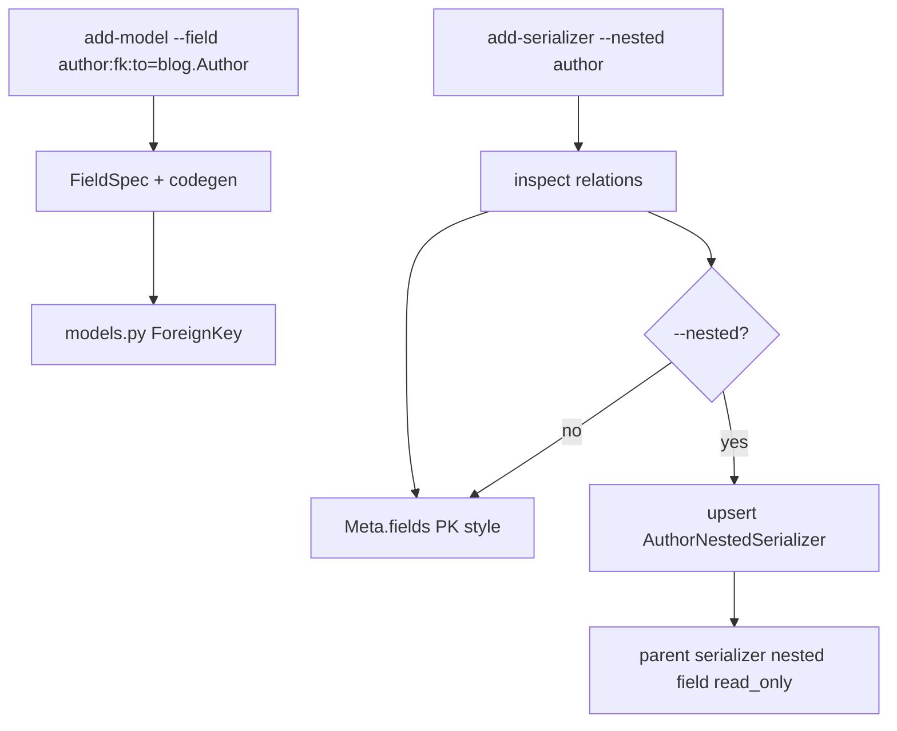

# Design Document

## Overview

Extend the field DSL and serializer generator so octave projects can declare **FK / O2O / M2M** on models and expose them on APIs as **primary keys by default**, with optional **one-level read-only nesting** via `add-serializer --nested`.

## Steering Document Alignment

### Technical Standards (tech.md)

- Typer/Rich CLI; libcst for `models.py` / `serializers.py`; no Django runtime import of the target project.

### Project Structure (structure.md)

- Relations live on domain models under `apps/<app>/models.py`; serializers under `serializers.py`.

## Code Reuse Analysis

### Existing Components to Leverage

- **`fields/parser.py` / `codegen.py`**: extend `ALLOWED_TYPES` + `FieldSpec` + `field_source`.
- **`inspect/model_fields.py`**: already detects `ForeignKey` / `OneToOneField` / `ManyToManyField`; extend to capture **relation target** from AST call args when possible.
- **`api_parts/serializer_gen.py`**: extend options + class builder for nested fields.
- **`models_gen/cst_util.py`**: upsert nested helper classes + imports.
- **`add-model` / `add-serializer` commands**: thin CLI flag wiring.

### Integration Points

- `add-model` API stub sync continues to list relation names in Meta.fields (PK style via ModelSerializer defaults).
- `add-viewset` unchanged except relation names may appear in filters only if still filterable (FK PKs are filterable integers — keep AST heuristic: treat ForeignKey as filterable).

## Architecture



### Modular Design Principles

- Relation parsing stays in `fields/`; inspection metadata in `inspect/`; serializer emission in `api_parts/`.
- Nested helper class naming: `{RelatedModel}NestedSerializer` (stable, force-replaceable).

## Components and Interfaces

### Field DSL

**New type keys:** `fk`, `o2o`, `m2m`.

**Syntax:**

```text
name:fk:to=AppLabel.Model[:on_delete=cascade|protect|set_null|set_default|do_nothing]
name:o2o:to=AppLabel.Model[:on_delete=…]
name:m2m:to=AppLabel.Model[:blank=true]
```

Same-app shorthand: `to=Author` → `"Author"` string ref (Django lazy same-app). Cross-app: `to=blog.Author` → `"blog.Author"`.

**`FieldSpec` extensions:**

```
related_to: str | None      # "blog.Author" or "Author"
on_delete: str | None       # cascade|protect|… (fk/o2o only)
```

**Codegen:**

```python
author = models.ForeignKey(
    "blog.Author",
    on_delete=models.CASCADE,
)
# set_null → null=True, blank=True implied for FK
tags = models.ManyToManyField("blog.Tag", blank=True)  # blank default True for m2m
```

Map `on_delete` tokens → `models.CASCADE` etc. Default `cascade`. `set_null` forces `null=True`.

### Inspection

Extend `ModelFieldInfo.fields` values or add parallel map:

```
relations: dict[str, RelationInfo]
# RelationInfo: kind: fk|o2o|m2m, to: str | None  # from first positional / to= kwarg if string literal
```

Parse `models.ForeignKey("blog.Author", …)` and `ForeignKey(Author, …)` (Name → `Author`).

Helpers: `relation_names(info)`, `is_relation(name)`.

Filterable heuristic: include FK/O2O names (not M2M) in filterable set.

### Serializer generation

**Default (no `--nested`):** rely on ModelSerializer PK behavior for relation names in `Meta.fields` — no explicit field declarations required. Document that M2M appears as list of PKs.

**With `--nested`:**

CLI:

```text
--nested author
--nested author=AuthorSerializer   # optional explicit class; else AuthorNestedSerializer
```

Repeatable or comma-separated: design uses **repeatable `--nested`** matching `--field` style for clarity; also accept comma-separated single option if easier in Typer — **prefer repeatable `--nested`**.

Rules:

1. Each nested name must be a known relation field.
2. Parent serializer declares:

   ```python
   author = AuthorNestedSerializer(read_only=True)
   ```

   And keeps `author_id` **or** omit write of `author` — **chosen rule:** nested field is read-only under the relation name; for writes, also include the FK attname in fields as writable PK when present (`author` nested read + Django’s `author_id` if we add it). Simpler opinionated rule:

   **Chosen rule (clearer for clients):**
   - Nested mode: emit `author = AuthorNestedSerializer(read_only=True)`.
   - Keep `"author"` in `Meta.fields` (nested takes precedence for output).
   - Add `"author_id"` to `Meta.fields` for FK/O2O writes when nesting that relation (DRF standard split). For M2M, nested is read-only only; writes use the relation name as PK list **unless** nested — if nested, M2M write is omitted from writable surface (read-only nest only). Document that M2M nested is read-only; use non-nested for writable PK lists.

3. **Slim nested serializer** auto-create for related model:

   - Class `{Model}NestedSerializer`.
   - Fields: `id` + first of `name`/`title`/`slug`/`email` from related model inspect, else just `id`.
   - `read_only_fields` = all of them.
   - Ensure import of related model; if related model is in another app, import from `apps.<app>.models`.
   - Target app resolution: from `to` string `blog.Author` → app `blog`; bare `Author` → same app as parent.

4. If related model class cannot be found in expected `models.py`, fail with hint.

### `SerializerOptions` additions

```
nested: list[str]  # relation field names to nest (optional explicit class via NestedRef)
```

Optional richer type:

```
@dataclass
class NestedRef:
    field_name: str
    serializer_class: str | None  # None → auto NestedSerializer name
```

### CLI

- `add-model`: no new top-level flags; relation types via `--field`.
- `add-serializer`: `--nested` repeatable.

### README

Document relation DSL table + nested example after existing add-model / add-serializer sections.

## Data Models

### RelationInfo

```
kind: Literal["fk", "o2o", "m2m"]
to: str | None
```

### NestedRef

```
field_name: str
serializer_class: str | None
```

## Error Handling

1. Bad `to=` / unknown `on_delete` → `FieldParseError`.
2. Nest on non-relation or unknown field → `SerializerFieldError`.
3. Related model missing for nest → exit 1 with path hint.
4. Duplicate serializer without `--force` → existing `SerializerExistsError` (nested helpers replaced when parent forced).

## Testing Strategy

### Unit

- Parser: fk/o2o/m2m happy + errors.
- Codegen: ForeignKey/M2M snippets.
- Inspect: relation kind + `to` from sample models.py.
- `build_serializer_class` / write path with nested refs.

### Integration (CliRunner)

- `new` → `add` → `add-model Author` → `add-model Post --field title:char --field author:fk:to=Author` → `add-serializer Post --nested author --force`.
- Assert PostSerializer has NestedSerializer field; AuthorNestedSerializer exists.
- Bad nest field fails.

## Implementation Notes

1. Do not change viewset CLI in this spec beyond filterable heuristic if trivial.
2. Writable nested create/update explicitly out of scope.
3. Nesting depth = 1 (nested serializers never get `--nested` recursively in generation).
4. Update `docs/roadmap.md` status when tasks complete.
