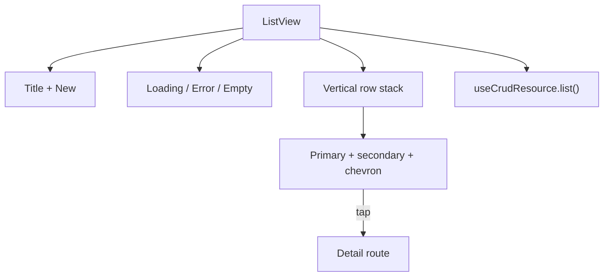

# Design Document

## Overview

Replace generated CRUD `ListView` **tables** with a **Gmail-style vertical list**: full-width tappable rows showing a primary title and muted secondary line. One pattern for phone and desktop. Implementation is mostly Jinja template + small generator context for primary/secondary fields; no new APIs or npm packages.

## Steering Document Alignment

### Technical Standards (tech.md)

- Stay in the existing Vue 3 + Vite + Nuxt UI SPA templates; prefer Nuxt UI primitives and Tailwind utility classes already used by the shell.
- Generator remains Python + Jinja under `frontend_gen/` / `templates/frontend_crud/`.

### Project Structure (structure.md)

- Primary change: `templates/frontend_crud/pages/ListView.vue.j2`
- Context selection: `frontend_gen/crud_pages.py` (`list_fields` → primary + secondary)
- Tests: `tests/frontend_gen/test_crud_pages.py` (+ docs under `docs/commands/add-frontend-crud.md`)

## Code Reuse Analysis

### Existing Components to Leverage

- **`useCrudResource().list()`**: unchanged data load.
- **`ResourceSpec.label_field`**: already resolved in `enrich_resource` / `resolve_label_field` — use as primary row text key (with runtime `row.label` preferred when serializers expose it).
- **`humanize_field_label`**: keep for any visible field captions if needed (prefer no per-field captions on secondary line for density).
- **Nuxt UI**: `UButton` (header New), `UAlert`, `UIcon` (trailing chevron); optional thin dividers via border utilities — avoid `UTable`.
- **Vue Router**: `router.push` / `:to` to `{ name: '<plural>-detail', params: { id } }`.

### Integration Points

- List pages remain children of `AppLayout` `RouterView` (content-only).
- Detail page already has Edit/Delete — list does not need per-row Edit.
- `--force` CRUD regen updates list templates for existing projects.

## Architecture



### Modular Design Principles

- Presentation-only change in ListView; keep fetch logic identical.
- Field role selection (primary vs secondary) computed once in `crud_pages._template_context`, not duplicated in Jinja conditionals beyond looping secondary fields.
- No shared Vue component file required for v1 (inline list in ListView keeps generator surface small). Optional later: extract `CrudListRow` if duplication appears.

### Row layout (illustrative)

```vue
<button
  type="button"
  class="flex w-full items-center gap-3 px-3 py-3 text-left
         hover:bg-elevated/50 active:bg-elevated border-b border-default
         min-h-14"
  @click="router.push({ name: '…-detail', params: { id: String(row.id) } })"
>
  <div class="min-w-0 flex-1">
    <div class="truncate font-medium text-highlighted">
      {{ primaryLabel(row) }}
    </div>
    <div v-if="secondaryText(row)" class="truncate text-sm text-muted">
      {{ secondaryText(row) }}
    </div>
  </div>
  <UIcon name="i-lucide-chevron-right" class="size-5 shrink-0 text-dimmed" />
</button>
```

Use a semantic `<button>` (or `RouterLink` with the same classes) for accessibility and full-row hit target. Nesting interactive controls inside the row is out of scope for v1.

### Primary / secondary field selection

In `_template_context`:

1. **`primary_field`**: `spec.label_field` if that field exists on the resource; else first of `list_fields` / writable; else `"id"`.
2. **`secondary_fields`**: from current `list_fields` (writable[:6]), **excluding** the primary field name, take **up to 2** fields.
3. Pass `primary_field` + `secondary_fields` into the template (keep `list_fields` only if still useful; otherwise replace usages).

Runtime primary display helper in the generated page:

```ts
function primaryLabel(row: CrudRecord): string {
  const fromApi = row.label
  if (fromApi != null && String(fromApi).trim() !== '') return String(fromApi)
  const v = row['{{ primary_field }}']
  if (v != null && String(v).trim() !== '') return String(v)
  return row.id != null ? `#${row.id}` : '—'
}
```

Secondary line: join non-empty stringified values with `" · "` (middot), truncate via CSS.

### Container

- Drop wrapping `UCard` around a table; use a simple bordered list surface (`divide-y` / per-row `border-b`) so rows feel edge-to-edge like mail apps inside the dashboard panel.
- Header (title + New) stays above the list.

### Empty / loading

- Loading: muted “Loading…” (existing).
- Empty: short copy e.g. `No {{ model_name }} yet.` plus optional hint to use New.
- Error: existing `UAlert`.

## Components and Interfaces

### ListView.vue (generated)

- **Purpose:** Collection browser as inbox-style list.
- **Interfaces:** Internal helpers `primaryLabel` / `secondaryText`; navigates to detail.
- **Dependencies:** `useCrudResource`, vue-router, Nuxt UI icon/button/alert.
- **Reuses:** Existing list fetch + route names.

### crud_pages._template_context

- **Purpose:** Expose `primary_field` and `secondary_fields` for the list template.
- **Interfaces:** Context keys consumed by Jinja.
- **Dependencies:** `ResourceSpec.label_field`, field lists.

## Data Models

No Django model changes. Template context additions:

```
primary_field: str          # e.g. "title", "name", "email"
secondary_fields: list[{ name, label, kind, ... }]  # 0–2 items
```

API rows still `CrudRecord` (`id` + fields; optional `label`).

## Error Handling

1. **List fetch fails:** `UAlert` with message; no rows.
2. **Missing primary value:** fall back to `#id` / `—`.
3. **All secondary empty:** omit secondary line (`v-if`).
4. **Jinja StrictUndefined:** ensure new context keys always set (empty list OK).

## Testing Strategy

### Unit Testing

- `test_crud_pages`: assert ListView contains list-row markers (`chevron-right` or `primaryLabel`, no `UTable` / no `columns` / no `header: 'Title'` table columns).
- Assert primary field appears in generated helper or template (e.g. `label_field` name).
- Keep create/edit/detail assertions unchanged.

### Integration Testing

- Existing CliRunner CRUD tests should still pass (they mostly check files exist / wire); update any string asserts on table markup if present.

### End-to-End Testing

- Manual: regenerate `support_desk` / `recipe_site` list pages; verify phone-width list + tap → detail.

## Implementation notes

- Prefer `RouterLink` **or** button+push — pick one; avoid nested anchors.
- Truncation: `min-w-0` + `truncate` on text columns is required for flex rows.
- Do not introduce desktop `UTable` breakpoint dual UI in v1 (requirements).
- Docs: one short bullet under add-frontend-crud “What it writes” / list UX.
- Roadmap: optional one-line under Frontend shipped (list UX) — only if already documenting shell upgrades there.
