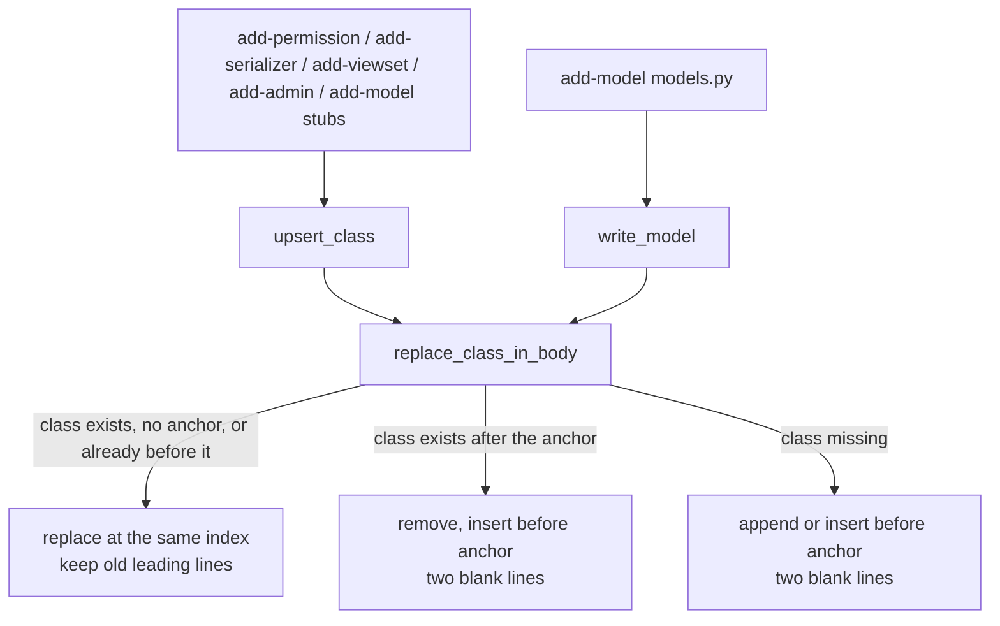

# Design Document

## Overview

Two small changes to code that already exists, plus three one-line spacing fixes:

1. **Replace in place.** One routine in `models_gen/cst_util.py` replaces a top-level class at its own position, keeping the lines above it. `upsert_class` and `write_model` both use it, so there is no second remove-then-append path left.
2. **One way to append.** Appending a new class keeps the two-blank-line rule it has today. `add-permission` creates its file through that same append instead of writing the class itself, so creating and regenerating produce the same bytes.
3. **Two blank lines in the two text-based writers.** `write_task` and `ensure_test_fixtures` append with `"\n\n"` or `"\n"` plus a block that starts with one newline; both now leave exactly two blank lines.

No new options, no new output.

## Steering Document Alignment

### Technical Standards (tech.md)
libcst for syntax-tree edits (as in `cst_util.py`), `OctaveError` subclasses for failures, fully annotated functions, ruff and pytest.

### Project Structure (structure.md)
All class editing stays in `models_gen/cst_util.py`; each generator keeps its own file; tests mirror the package.

## Code Reuse Analysis

### Existing Components to Leverage
- **`upsert_class`** (`models_gen/cst_util.py`): keeps its signature and its non-force behavior; only the replace branch changes.
- **`_RemoveClass`, `_top_level_class_index`, `_with_blank_leading`**: reused. `_with_blank_leading` stays the single place that decides the two blank lines in front of an appended class.
- **`ensure_class_before`**: unchanged (the non-force "move before the anchor" path).
- **`rollback_on_error`**: wraps every command already, so a failed replace still leaves the project unchanged.
- **`ModelWriteError`**: the parse-failure errors keep their wording.

### Integration Points
- **`write_model`** (`models_gen/writer.py`): its own remove-then-append block is replaced by the shared routine.
- **`write_permission`** (`api_parts/permission_gen.py`): the create branch writes only the header and then continues into `upsert_class`.
- **`write_task`** (`celery_gen/task_gen.py`) and **`ensure_test_fixtures`** (`api_parts/test_gen.py`): spacing only.

## Architecture



### Modular Design Principles
- **Single File Responsibility**: `cst_util.py` decides where a class goes; the generators only produce class source.
- **Component Isolation**: the new routine works on a libcst `Module` and returns a new one; it does no file I/O, so it is unit-testable on strings.
- **Utility Modularity**: `upsert_class` stays the I/O wrapper (imports, read, write); `write_model` keeps its import handling.

## Components and Interfaces

### `replace_class_in_module` (new, `models_gen/cst_util.py`)
- **Purpose:** put new top-level statements for `class_name` into a module, replacing an existing class in place.
- **Interface:**
  ```python
  def replace_class_in_module(
      module: cst.Module,
      class_name: str,
      addition: Sequence[cst.BaseStatement],
      *,
      before: str | None = None,
  ) -> cst.Module: ...
  ```
- **Behavior:**
  1. `old = _top_level_class_index(module, class_name)`, `anchor = _top_level_class_index(module, before)` when `before` is given.
  2. **Class exists and (no anchor, or `old < anchor`):** replace `body[old]` with `addition`; the first new statement takes over the `leading_lines` of the old class (blank lines and comments above it); everything else in the body is untouched, so the rest of the file is byte-identical.
  3. **Class exists and `old > anchor`:** remove it and insert `_with_blank_leading(addition)` before the anchor (same result as today).
  4. **Class missing:** append, or insert before the anchor, with `_with_blank_leading(addition)` (same as today).
- **Dependencies:** libcst, `_top_level_class_index`, `_with_blank_leading`.
- **Reuses:** the existing helpers; no new parsing code.

### `upsert_class` (changed)
- The `exists and force` branch no longer calls `_RemoveClass` and then appends; it parses the module once and calls `replace_class_in_module`. Imports, reading and writing, the `before` anchor handling when the class exists without `force`, and the error messages are unchanged.

### `write_model` (changed)
- After `_ensure_imports`, the model class goes through `replace_class_in_module(module, model_name, class_module.body)` (no anchor). The hand-written `leading_lines` block and `_RemoveClass` use are removed from this function. `format_written_python` still runs afterwards.

### `write_permission` (changed)
- When `permissions.py` does not exist, write only `_permissions_header(...)` and fall through to the existing `upsert_class(...)` call, which appends the class with two blank lines. Today the create branch writes `header + class_src` directly, which is where the single blank line comes from.

### `write_task` (changed, spacing)
- `_upsert_task_in_module` appends with `text.rstrip() + "\n\n\n" + stub` (two blank lines). Replacing an existing task is already in place and is untouched.

### `ensure_test_fixtures` (changed, spacing)
- The fixture blocks are appended with two blank lines above the first decorator (`source.rstrip() + "\n\n"` plus the block without its leading newline). Nothing is appended when the fixtures exist, as today.

## Data Models
No new data structures.

## Error Handling

### Error Scenarios
1. **The file does not parse (before or after the edit):**
   - **Handling:** `ModelWriteError` naming the file, as today; `rollback_on_error` and its parse check keep the project unchanged.
   - **User Impact:** unchanged message, exit 1.
2. **The anchor class does not exist:**
   - **Handling:** treated as no anchor (append / in place), as today.
   - **User Impact:** none.
3. **The old class has no `leading_lines` (first statement after a header)**:
   - **Handling:** the new class keeps exactly that, so a hand-formatted file is not "fixed" behind the user's back; only newly appended classes get the two-blank-line rule.
   - **User Impact:** none.

## Testing Strategy

### Unit Testing
- `tests/models_gen/test_cst_util.py` (extend): `replace_class_in_module` / `upsert_class` on strings:
  - replace the first, a middle and the last of three classes: order and the bytes of the other classes and of the lines between them unchanged;
  - a comment and blank lines above the replaced class are kept, one blank line stays one (no "fixing");
  - anchor: class before the anchor stays, class after the anchor moves before it, missing class is inserted before it, no anchor appends;
  - non-force with an existing class behaves as before (left alone / moved before the anchor);
  - an appended class has exactly two blank lines above it; a file with several statements per addition still works;
  - unparsable source raises the same error naming the file.
- `tests/models_gen/test_writer.py` (extend): `write_model` with `force` keeps the model's position among others.
- `tests/celery_gen` / `tests/api_parts`: appended tasks and fixture blocks have exactly two blank lines; `ruff check --preview --select E301,E302,E303,E305` is clean on the result (ruff is a dev dependency; the tests skip with a reason if it is missing).

### Integration Testing
- `tests/commands`: for `add-permission`, `add-serializer`, `add-viewset`, `add-admin`, `add-model`: a file with two classes, `--force` on the first: order and the other class unchanged; the same command run twice with `--force` changes nothing; for `add-permission` the file right after creating it equals the file after the first `--force`.
- A test that runs the explicit, repeatable commands once to create and once with `--force` (same arguments) and compares the two trees (the intentional richer-stub differences of `add-admin` and `add-viewset` excluded by constructing the expected file from a first `--force` run).

### End-to-End Testing
- The existing opt-in suites (owner scoping uses `--force` heavily) must pass unchanged.
- Reference project: generate from `HEAD` and from the new code with the same launch method (the generator formats only when `ruff` is on `PATH`, so both runs use `uv run`), `diff -r`: the only differences are added blank lines in `permissions.py`, `tasks.py` and `tests/conftest.py`.

## Task Ordering (for the tasks phase)
1. Failing tests that show the moved class and the blank-line differences on the current code.
2. `replace_class_in_module` and `upsert_class`, with unit tests.
3. `write_model`.
4. Creation spacing: `write_permission`, `write_task`, `ensure_test_fixtures`.
5. Docs: roadmap item 13 and the audit note; final verification.
