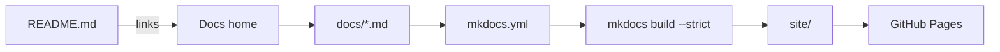

# Design Document

## Overview

Ship a **MkDocs Material** documentation site for django-octave. Curated Markdown under `docs/` becomes the how-to source of truth; **README** shrinks to a front door (pitch, install, one quick start, link to docs). Local `uv run mkdocs serve` is the day-to-day preview; **GitHub Pages** publishes the built site; CI runs `mkdocs build --strict` so broken nav/links fail early.

No CLI behavior changes — content + tooling only.

## Steering Document Alignment

### Technical Standards (tech.md)

- Docs today are README + OpenAPI-in-generated-apps; this upgrades the **generator** docs story without adding a runtime CLI dependency.
- **uv** remains the package manager: MkDocs lives in a **dev dependency group**, never in `[project].dependencies`.
- Aligns with product “docs site” enhancement and adoption-clarity metric.

### Project Structure (structure.md)

- User docs live under `docs/` (+ root `mkdocs.yml`).
- Specs stay under `.spec-workflow/`.
- Update Documentation Standards in steering lightly after ship: MkDocs + slim README (not README-only).

## Code Reuse Analysis

### Existing Components to Leverage

- **Current README** — source material for getting started + command pages (adapt, don’t leave orphan accuracy).
- **`docs/roadmap.md`** — keep as a nav page; do not delete.
- **CLI `--help` / command modules** — ground truth for flags; pages paraphrase with examples.
- **`.github/workflows/release.yml`** — pattern for Actions; add a separate docs workflow (Pages + optional strict build on PRs).

### Integration Points

- `pyproject.toml` — add `mkdocs-material` to `[dependency-groups] dev` (or a `docs` group if we want `uv sync --group docs`; prefer **dev** so one `uv sync` gets tests + docs).
- `.gitignore` — add `site/`.
- `README.md` — rewrite slim; link to docs.
- Optional: `scripts/docs.sh` thin wrapper (`serve` / `build`) — nice-to-have, not required if README/Development page documents `uv run mkdocs …`.

## Architecture



### Modular Design Principles

- **One concern per page** — command pages don’t mix with Docker deep-dives.
- **Nav is IA** — `mkdocs.yml` `nav:` is the catalog users see.
- **No mkdocstrings in v1** — curated how-tos beat auto API dumps for a Typer CLI.
- **Material theme** — default search + readable typography; keep a neutral palette (avoid loud “AI purple” branding).

## Components and Interfaces

### `mkdocs.yml`

```yaml
site_name: django-octave
site_description: Opinionated Django REST API project generator
repo_url: https://github.com/blindpenguin/django-octave
edit_uri: edit/master/docs/

theme:
  name: material
  palette:
    primary: indigo   # or blue/slate — pick one calm default in implementation
  features:
    - navigation.sections
    - navigation.expand
    - content.code.copy
    - search.suggest

markdown_extensions:
  - admonition
  - pymdownx.details
  - pymdownx.superfences
  - pymdownx.tabbed:
      alternate_style: true
  - tables
  - toc:
      permalink: true

plugins:
  - search

strict: true   # or rely on CLI --strict in CI

nav:
  - Home: index.md
  - Getting started:
      - Install: getting-started/install.md
      - First project: getting-started/first-project.md
  - Concepts:
      - Project layout: concepts/layout.md
      - Docker: concepts/docker.md
      - Multitenancy: concepts/multitenancy.md
      - Celery: concepts/celery.md
  - Commands:
      - new: commands/new.md
      - add: commands/add.md
      - add-model: commands/add-model.md
      - add-serializer: commands/add-serializer.md
      - add-viewset: commands/add-viewset.md
      - add-permission: commands/add-permission.md
      - add-action: commands/add-action.md
      - add-admin: commands/add-admin.md
      - add-test: commands/add-test.md
      - add-celery: commands/add-celery.md
      - add-task: commands/add-task.md
  - Development:
      - Contributing: development/contributing.md
      - Releases: development/releases.md
  - Roadmap: roadmap.md
```

Exact primary color / feature flags may be tweaked during implementation; **nav structure above is the target IA**.

### Docs file tree

```text
docs/
├── index.md
├── roadmap.md                 # existing — keep, maybe light intro line
├── getting-started/
│   ├── install.md
│   └── first-project.md
├── concepts/
│   ├── layout.md
│   ├── docker.md
│   ├── multitenancy.md
│   └── celery.md
├── commands/
│   ├── new.md
│   ├── add.md
│   ├── add-model.md
│   ├── add-serializer.md
│   ├── add-viewset.md
│   ├── add-permission.md
│   ├── add-action.md
│   ├── add-admin.md
│   ├── add-test.md
│   ├── add-celery.md
│   └── add-task.md
└── development/
    ├── contributing.md
    └── releases.md
```

### Command page template (content contract)

Each `commands/*.md`:

1. One-line purpose  
2. Minimal example(s)  
3. Important flags / options  
4. **What it writes or changes** (paths)  
5. Next steps / related commands  
6. Admonitions for caveats (`--force`, gates like “run add-celery first”)

### README (slim)

Keep:

- Title + one-paragraph pitch  
- Feature bullets (high level)  
- Install (`uv sync` / future PyPI note)  
- Single `django-octave new …` quick start  
- Link: **Documentation** → published Pages URL + `docs/` / `uv run mkdocs serve`  
- Requirements (Python 3.14+, uv)  
- License  

Move out: all per-command catalogs, release ritual detail (→ `development/releases.md`), Spec dashboard detail (→ contributing).

### Dependencies

```toml
[dependency-groups]
dev = [
  # existing pytest/ruff…
  "mkdocs-material>=9,<10",
]
```

Material pulls MkDocs + useful pymdownx extensions.

### GitHub Pages + CI

**Workflow A — docs build (PRs / push to master):**

```yaml
# .github/workflows/docs.yml
# uv sync → uv run mkdocs build --strict
```

**Workflow B — deploy Pages (push to master / workflow_dispatch):**

- Build with same command  
- Upload `site/` via `actions/upload-pages-artifact` + `actions/deploy-pages`  
- Or `peaceiris/actions-gh-pages` / `mkdocs gh-deploy` — prefer **official Pages actions** for token hygiene  

Document that the repo Settings → Pages must use **GitHub Actions** as source (one-time maintainer step). Until the first successful deploy, README can say “docs in `docs/`; published URL after Pages enable” and use a placeholder `https://blindpenguin.github.io/django-octave/` (confirm org/user Pages path).

`site_url` in `mkdocs.yml` set to the Pages URL once known.

### Steering touch-up

After content lands, small edits to `.spec-workflow/steering/structure.md` (Documentation Standards) and optionally `tech.md` (Docs line) to mention MkDocs — not a full steering re-approval unless those files are treated as steering updates requiring dashboard (prefer **implementation note** in tasks; if project rules require steering approval for steering edits, do a minimal steering update in the same PR as docs and request steering approval only if the workflow demands it — for this project, past practice edited roadmap without steering MCP; keep steering updates tiny and in-repo).

## Data Models

N/A — static Markdown + YAML config. No Django models.

## Error Handling

1. **Broken internal link / missing nav file** — `mkdocs build --strict` fails CI.  
2. **Stale flag in docs** — caught by review + future DoD note in contributing.  
3. **Pages not configured** — docs still usable via `mkdocs serve` / raw GitHub; deploy job may fail until Settings flipped — document in releases/contributing.  
4. **Duplicate content drift** — README must not re-expand into a second catalog; contributing says “put how-tos in docs/”.

## Testing Strategy

### Unit Testing

- Not applicable for Markdown prose.

### Integration / CI

- `uv run mkdocs build --strict` in CI (and locally before merge).  
- Optional: smoke that `site/index.html` exists after build.

### Manual

- Spot-check nav + one command page + getting started after Material theme loads.  
- Verify README links resolve (relative `docs/` on GitHub; absolute Pages URL once live).

## Implementation Notes

1. Create `mkdocs.yml` + directory tree; migrate README content into pages; slim README last so nothing is lost mid-flight.  
2. Add `site/` to `.gitignore`.  
3. Wire docs workflow(s); enable Pages after first green deploy (or document the Settings click).  
4. Prefer admonitions (`!!! note`, `!!! warning`) for Celery Beat / multitenancy create-time-only.  
5. English only; MDX-safe prose.  
6. Update `docs/roadmap.md` “Already shipped” with user-docs when done; priority list drops “docs” if it was only implicit.  
7. Do **not** vendor `site/` or commit build artifacts.
