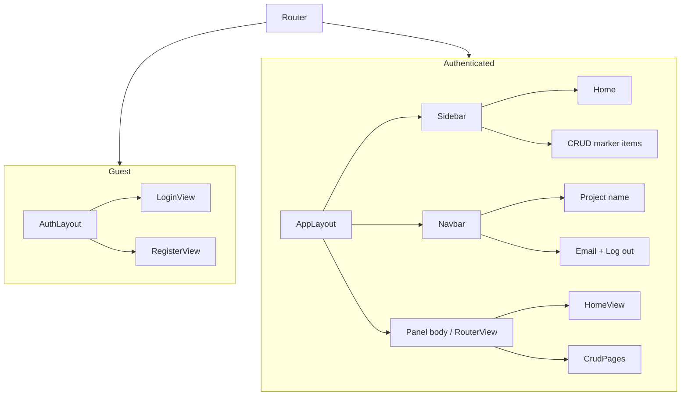

# Design Document

## Overview

Replace the temporary header-strip shell with a **Nuxt UI Dashboard** app chrome: **AuthLayout** for guest pages, **AppLayout** for authenticated pages using `UDashboardGroup` + `UDashboardSidebar` + `UDashboardPanel` / `UDashboardNavbar`. CRUD navigation moves into the sidebar via **JS marker injection** (compatible with `UNavigationMenu`). User identity for the app-bar dropdown comes from **email persisted at login** (cleared on logout). CRUD/home pages become **content-only** (no per-page layout wrap); the router nests authenticated routes under AppLayout.

## Steering Document Alignment

### Technical Standards (tech.md)

- Generator remains Jinja + Python; SPA stays Vue 3 + Vite + Vue Router + `@nuxt/ui` (not full Nuxt).
- Prefer Nuxt UI primitives over custom layout CSS.
- JWT + existing `apiFetch` / auth guards unchanged in spirit.

### Project Structure (structure.md)

- Templates under `src/django_octave/templates/frontend/` and `frontend_crud/`.
- Wiring in `frontend_gen/crud_wire.py` + auth helpers in `frontend_gen/django_patch.py` only if a me-endpoint is added (v1 prefers no new endpoint).
- Docs under `docs/commands/add-frontend.md`.

## Code Reuse Analysis

### Existing Components to Leverage

- **`UDashboardGroup` / `UDashboardSidebar` / `UDashboardPanel` / `UDashboardNavbar` / `UDashboardSidebarCollapse` / `UNavigationMenu` / `UDropdownMenu`**: Official Vue dashboard pattern (mobile slideover built into sidebar).
- **`crud_wire.py` markers**: Relocate nav markers into AppLayout script as a `crudNavItems` array; keep route markers in `router/index.ts`.
- **`login` / `logout` / tokens**: Extend token/auth helpers to store/clear display email.
- **`humanize_field_label` / model names**: Sidebar CRUD labels stay `ResourceSpec.model_name` (PascalCase).

### Integration Points

- **Vue Router**: Nested authenticated routes with `component: AppLayout` + `children`; guest routes use `AuthLayout` or page-level AuthLayout wrap.
- **CRUD page templates**: Drop `import AppLayout` / wrapping tags; render page body only (panel body content).
- **`add-frontend --force`**: Regenerates shell; re-run CRUD wire or instruct `--crud --force` to refill sidebar items.

## Architecture



### Modular Design Principles

- Layouts own chrome; pages own domain UI only.
- Nav data for CRUD is generated into a typed array (marker region), not ad-hoc header links.
- Auth identity display is a small concern in `auth/tokens.ts` (+ `useAuth`).

### Router shape (illustrative)

```ts
{
  path: '/login',
  component: AuthLayout,
  meta: { guest: true },
  children: [{ path: '', name: 'login', component: LoginView }],
},
{
  path: '/',
  component: AppLayout,
  meta: { requiresAuth: true },
  children: [
    { path: '', name: 'home', component: HomeView },
    // --- django-octave crud routes begin ---
    // paths without leading layout duplication; e.g. path: 'recipes', ...
    // --- django-octave crud routes end ---
  ],
}
```

**CRUD route paths** change from absolute `/recipes` at top level to **children** of `/` (e.g. `path: 'recipes'` → URL still `/recipes`). `crud_wire.build_routes_body` must emit child-route objects (no wrapping AppLayout in page components). `meta.requiresAuth` can live on the parent only.

### AppLayout structure (illustrative)

```vue
<UDashboardGroup unit="rem" class="h-dvh overflow-hidden">
  <UDashboardSidebar collapsible>
    <template #header><!-- brand optional --></template>
    <template #default="{ collapsed }">
      <UNavigationMenu
        :collapsed="collapsed"
        orientation="vertical"
        :items="navItems"
      />
    </template>
  </UDashboardSidebar>
  <UDashboardPanel>
    <template #header>
      <UDashboardNavbar :title="projectName">
        <template #leading>
          <UDashboardSidebarCollapse />
        </template>
        <template #title>
          <ULink to="/">{{ projectName }}</ULink>
        </template>
        <template #right>
          <UDropdownMenu :items="userMenuItems">
            <UButton variant="ghost" trailing-icon="i-lucide-chevron-down">
              {{ userEmail }}
            </UButton>
          </UDropdownMenu>
        </template>
      </UDashboardNavbar>
    </template>
    <template #body>
      <RouterView />
    </template>
  </UDashboardPanel>
</UDashboardGroup>
```

Mobile: `UDashboardSidebar` already opens as slideover; navbar toggle is built into `UDashboardNavbar`. Desktop: sidebar fixed; panel body scrolls.

### Nav markers (JS)

```ts
const crudNavItems = [
  // --- django-octave crud nav begin ---
  { label: 'Recipe', to: '/recipes' },
  // --- django-octave crud nav end ---
] as NavigationMenuItem[]

const navItems = [
  { label: 'Home', icon: 'i-lucide-house', to: '/' },
  ...crudNavItems,
]
```

`build_nav_body` emits `{ label: '…', to: '/…' },` lines. HTML comment markers become `// --- django-octave crud nav begin ---` (update `NAV_BEGIN` / `NAV_END` in `crud_wire.py`). Ensure-insert logic targets the `crudNavItems` array in AppLayout.

### Auth identity

1. On successful `login` / `register`, store email in `localStorage` key `octave_email` (alongside tokens).
2. `logout` clears email.
3. AppLayout reads email via a small `getUserEmail()` helper; dropdown label falls back to `"Account"` if missing (should not happen after login).
4. **No new `/api/auth/me/` required for v1** (keeps patch surface small). Optional follow-on if email must be refreshed from server.

### AuthLayout

Centered full-viewport (`min-h-dvh`) with muted background; `<RouterView />` or slot for Login/Register cards (pages keep their `UCard` forms; remove any leftover full-screen duplication from LoginView if AppLayout chrome is gone).

### CRUD / Home page changes

- Remove `AppLayout` import and wrapper from `HomeView`, `ListView`, `DetailView`, `CreateView`, `EditView`.
- Pages may keep an `h1` / local actions; avoid second site header.
- List/table pages rely on panel body scroll (remove assumptions about `max-w-3xl` page centering from old AppLayout—optional `max-w-*` inside page is OK for forms).

## Components and Interfaces

### AuthLayout.vue

- **Purpose:** Guest chrome (centered content).
- **Interfaces:** Default slot / `RouterView`.
- **Dependencies:** Nuxt UI surface tokens only.

### AppLayout.vue

- **Purpose:** Dashboard shell (sidebar + navbar + scrollable body).
- **Interfaces:** `RouterView` in panel body; exposes marker region for CRUD nav.
- **Dependencies:** auth email helper, logout, router.

### auth/tokens.ts (+ useAuth)

- **Purpose:** `setUserEmail` / `getUserEmail` / clear on logout; login stores email.

### crud_wire.py

- **Purpose:** Child-route snippets; JS nav item snippets; updated marker strings + ensure-insert for sidebar array.

### Router index.ts.j2

- **Purpose:** Nested guest/auth trees; empty CRUD marker block inside auth children.

## Data Models

### localStorage

- `octave_access`, `octave_refresh` (existing)
- `octave_email`: string (new)

### NavigationMenuItem (CRUD subset)

```
{ label: string, to: string, icon?: string }
```

## Error Handling

1. **Missing email in storage:** Show `"Account"` in menu; logout still works.
2. **Missing nav markers after manual edit:** `wire_crud` ensure-insert recreates empty marker block once; if AppLayout structure diverges too far, raise `CrudWireError` with clear message.
3. **Nuxt UI dashboard CSS:** Ensure `main.css` / `UApp` unchanged; if `h-dvh` conflicts, prefer `h-dvh` on `UDashboardGroup` per Nuxt docs.

## Testing Strategy

### Unit / generator

- Render frontend templates: assert AuthLayout + AppLayout files; router contains nested `AppLayout` + `crudNavItems` markers.
- `build_nav_body` / `build_routes_body` unit tests for child paths + JS nav objects.
- `wire_crud` on sample AppLayout with JS markers.
- Auth helper tests: login path stores email (if tested via small TS-free Python string asserts on generated `useAuth.ts`).

### Integration

- Existing `add-frontend` / CRUD CliRunner tests updated for new files and marker strings.
- Optional: regenerate support_desk shell + `pnpm build` smoke (manual/benchmark).

### End-to-End

- Not required in generator CI; manual: login → sidebar + user menu → mobile drawer → CRUD list scrolls under fixed chrome.

## Implementation notes

- Prefer Nuxt UI dashboard components over a hand-rolled sidebar/drawer.
- Breakpoint / mobile behavior: rely on Nuxt UI defaults (sidebar → slideover).
- Collapsible desktop sidebar: enable `collapsible` (+ collapse control in navbar leading slot).
- Docs: short “App shell” subsection under `add-frontend.md`.
- Roadmap: mark shell upgrade under Frontend shipped when done.
