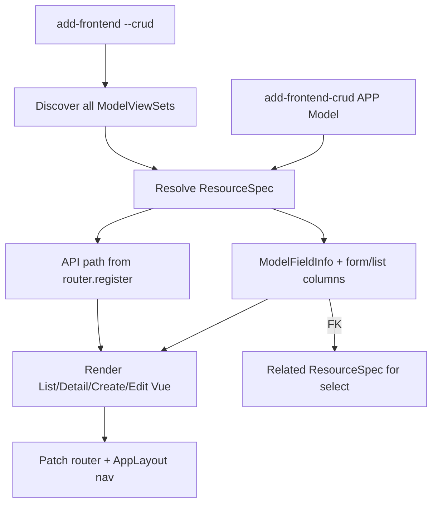

# Design Document

## Overview

Generate **full CRUD Vue pages** (list / detail / create / edit / delete-with-confirm) for DRF ModelViewSet resources into an existing `frontend/` SPA. Shared writer powers:

1. **`django-octave add-frontend-crud APP MODEL`**
2. **Bulk** on `add-frontend` / `new --frontend` via ask + `--crud` / `--no-crud`

FK fields use a **select** fed by the related model’s list API, labeled by a display heuristic. Field metadata comes from **libcst model inspection** (`inspect.model_fields`) plus router path discovery from `apps/<app>/urls.py` — no Django runtime, no OpenAPI fetch at generate time.

## Steering Document Alignment

### Technical Standards (tech.md)

- Generator stays Python/Jinja; SPA remains Vue 3 + Vite + Nuxt UI.
- REST + JWT remain source of truth; UI does not invent permissions.

### Project Structure (structure.md)

- Generated pages under `frontend/src/pages/<plural>/` (e.g. `recipes/ListView.vue`).
- Generator code under `src/django_octave/frontend_gen/crud_*` (+ CLI/prompts).
- Templates under `src/django_octave/templates/frontend_crud/` (Jinja page stubs).

## Code Reuse Analysis

### Existing Components to Leverage

- **`frontend_configured` / `setup_frontend`** — prerequisite gate; call CRUD after scaffold when `--crud`
- **`inspect.model_fields.inspect_model` / `ModelFieldInfo`** — field types + relations
- **`naming.pascal_to_snake` / `pluralize`** — routes and API paths (`/api/<plural>/`)
- **`ensure_router_registration` / urls CST** — parse `router.register("plural", …)` for collection path
- **SPA `apiFetch` / `apiJson` / auth guards** — all CRUD calls go through existing client
- **`AppLayout.vue`** — extend with nav links (marker region)

### Integration Points

- `frontend/src/router/index.ts` — inject authenticated routes (marker block)
- `frontend/src/layouts/AppLayout.vue` — nav links marker
- `add-frontend` / `new` prompts — `--crud` / `--no-crud` after frontend resolved on
- Optional: resource registry `frontend/src/api/resources.ts` listing plural → labelField for FK selects

## Architecture



### Modular Design Principles

| Module | Role |
|--------|------|
| `frontend_gen/crud_discover.py` | Find `(app, model, plural, basename)` from urls/views |
| `frontend_gen/crud_fields.py` | Map `ModelFieldInfo` → form/list field descriptors + FK label heuristic |
| `frontend_gen/crud_pages.py` | Jinja-render page set into `frontend/src/pages/<plural>/` |
| `frontend_gen/crud_wire.py` | Patch router + layout nav (markers) |
| `frontend_gen/crud_setup.py` | `generate_crud(root, app, model, *, force)` + `generate_crud_all(...)` |
| `commands/add_frontend_crud.py` + prompts | CLI |
| Extend `add_frontend` / `new_project` | `--crud` / ask |

## Components and Interfaces

### CLI: `add-frontend-crud`

```text
django-octave add-frontend-crud APP MODEL
  --path DIR
  --force
```

### CLI: extend `add-frontend` / `new`

```text
--crud / --no-crud   # when frontend enabled; prompted if TTY; required non-interactive with frontend
```

Resolution: if frontend off → `crud=False`. If frontend on and crud unset → prompt / fail.

### ResourceSpec (internal)

```python
@dataclass(frozen=True)
class ResourceSpec:
    app_name: str
    model_name: str          # PascalCase
    model_snake: str
    model_plural: str        # router path segment
    api_collection: str      # "/api/{plural}/"
    label_field: str         # for FK option labels & list title column
    fields: list[CrudField]  # ordered for forms/tables
```

### CrudField

```python
@dataclass(frozen=True)
class CrudField:
    name: str
    kind: Literal["string","text","number","boolean","decimal","date","datetime","email","slug","fk","readonly"]
    required: bool
    # FK only:
    related_plural: str | None      # for GET /api/{related_plural}/
    related_label_field: str | None
```

**Primary source:** model fields via `inspect_model` (deterministic). Skip: reverse relations, M2M (v1 **omit** M2M with printed note). Treat `id`, `created_at`, `updated_at` as readonly (detail only).

**FK label heuristic** (first hit on related model): `name`, `title`, `email`, `slug`, else first `CharField`/`EmailField`/`SlugField`, else `"id"`.

**API path:** prefer parse `router.register("…")` for `{Model}ViewSet` in `apps/<app>/urls.py`; fallback `pluralize(pascal_to_snake(model))` under `/api/`.

### Generated page layout

```text
frontend/src/pages/<plural>/
  ListView.vue      # UTable or UCard list + New button
  DetailView.vue    # read-only fields + Edit / Delete
  CreateView.vue    # form POST
  EditView.vue      # form GET + PATCH
  # Delete: UModal confirm on Detail (no separate route)
```

Shared composable (generated once, force-refreshable):

```text
frontend/src/composables/useResourceApi.ts   # list/get/create/update/remove helpers
frontend/src/components/ResourceForm.vue     # optional shared; or inline per page for simpler templates
```

**v1 choice:** generate **per-resource pages** with a thin shared `useCrudResource(apiPath)` composable; avoid a heavy generic framework. FK selects inline in Create/Edit using `apiJson('/api/{related_plural}/')` → options `{ value: id, label: row[labelField] }`.

### Pagination

```ts
// Normalize DRF page or plain array
function unwrapList(data: unknown): { items: Record<string,unknown>[]; total?: number }
```

If `{ results: [...] }` use `results`; else if `Array.isArray` use as-is.

### HTTP verbs

- Create: `POST /api/<plural>/`
- Update: `PATCH /api/<plural>/<id>/`
- Delete: `DELETE /api/<plural>/<id>/`
- Navigate: create/edit success → **detail**; delete success → **list**

### Router routes (example)

```ts
{
  path: '/recipes',
  name: 'recipes-list',
  component: () => import('../pages/recipes/ListView.vue'),
  meta: { requiresAuth: true },
},
{ path: '/recipes/new', name: 'recipes-create', ... },
{ path: '/recipes/:id', name: 'recipes-detail', ... },
{ path: '/recipes/:id/edit', name: 'recipes-edit', ... },
```

Marker in `router/index.ts`:

```ts
// --- django-octave crud routes begin ---
// ... generated route objects ...
// --- django-octave crud routes end ---
```

Nav marker in `AppLayout.vue`:

```vue
<!-- django-octave crud nav begin -->
<ULink to="/recipes">Recipes</ULink>
<!-- django-octave crud nav end -->
```

### Discovery for bulk

Scan `apps/*/urls.py` for `router.register("plural", SomeViewSet` and `apps/*/views.py` for `class SomeViewSet(…ModelViewSet)` with `queryset = Model.objects`. Map ViewSet → Model. Soft-skip starter stub models left from `add` if desired? **Include all ModelViewSets**; stubs still get pages (fine for v1). Soft-skip if model class missing in models.py.

### Force / refuse

- Per-model: if `frontend/src/pages/<plural>/ListView.vue` exists without `--force` → refuse.
- Bulk: skip existing without force; with `--force` overwrite each. Marker regions always replaced for routes/nav of regenerated resources.

## Data Models

No new Django models. Client-side only `ResourceSpec` / `CrudField` as above.

## Error Handling

1. **No frontend/** — exit 1, hint `add-frontend`
2. **No viewset / router** — exit 1, hint `add-viewset`
3. **Exists without force** — exit 1
4. **FK related list unknown** — generate PK number input + warning in CLI output
5. **Bulk soft-skip** — print `skip Model: reason`; continue
6. **API 400** — show DRF field errors under inputs; **403/404** — UAlert + optional redirect

## Testing Strategy

### Unit Testing

- Field mapping (Char→string, FK→fk with related_plural)
- Label heuristic
- Router/nav marker inject/replace
- unwrapList helper (tested via generated snippet or Python mirror)

### Integration Testing (generator)

- Fixture project with Recipe + Category viewsets → `add-frontend-crud recipes Recipe` creates 4 pages + routes
- FK `category` select references `categories`
- Refuse without frontend / without force
- `add-frontend --crud` discovers multiple models
- `--no-crud` creates no pages

### End-to-End Testing

- Optional: `pnpm build` on a tmp frontend after CRUD generate (one smoke if Node available); not required every unit test.

## Docs

- New MkDocs page `commands/add-frontend-crud.md`
- Update `add-frontend.md` / `new.md` for `--crud`
- Roadmap: frontend CRUD under shipped when done
