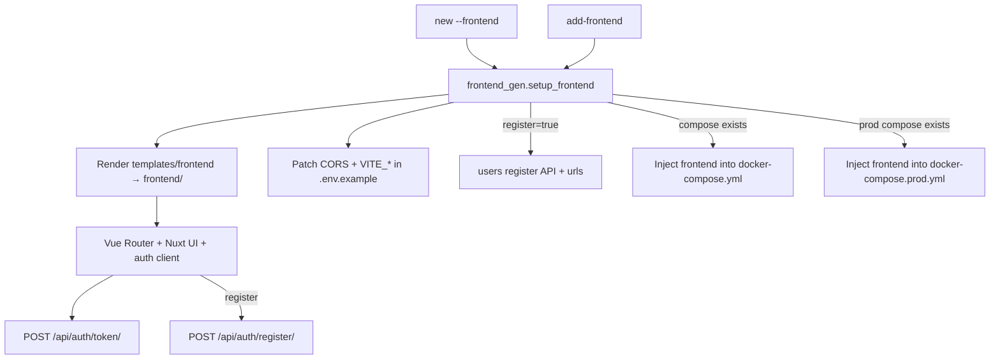

# Design Document

## Overview

Scaffold an optional **Vue 3 + Vite + Vue Router + Nuxt UI** SPA under `frontend/`, wired to SimpleJWT. Entry points: `django-octave new --frontend` (interactive prompt when unset) and `django-octave add-frontend`. Shared writer handles templates, CORS/env, optional register API, and Compose injection when Docker files exist.

Package manager: **pnpm** (matches Nuxt UI docs lead). Vite port: **5173**. Tokens: **localStorage** (simple shell; document XSS caveat). Register: opt-in page + `POST /api/auth/register/` on `apps.users`.

## Steering Document Alignment

### Technical Standards (tech.md)

- Generator stays Python/Jinja; frontend is generated artifacts, not a runtime dependency of the package.
- JWT + CORS already in stack; extend origins/env rather than inventing a new auth stack.
- Optional Docker remains opt-in; frontend Compose only when Compose already present.

### Project Structure (structure.md)

- Add `frontend/` beside `config/` / `apps/` in generated projects.
- Generator code: `src/django_octave/frontend_gen/` + `commands/add_frontend.py` + prompts; templates under `src/django_octave/templates/frontend/`.
- Extend `commands/new.py` / `prompts/new_project.py` like Celery post-render hook (but with dual UX for frontend/register).

## Code Reuse Analysis

### Existing Components to Leverage

- **`detect_project` / `NotOctaveProjectError`** — gate `add-frontend`
- **`celery_gen/compose.py` marker pattern** — inject frontend services with begin/end markers
- **`new` post-render hook** — same shape as `setup_celery(ctx.target_dir)` after `render_project`
- **Dual UX** — `Confirm.ask` / non-interactive missing-flag exit code 2 (`new_project.py`, `add_celery`)
- **`.env.example` / CORS** — already `CORS_ALLOWED_ORIGINS`; fix default Vite port (5173)
- **JWT urls** — `TokenObtainPairView` / `TokenRefreshView` at `/api/auth/token/` and `.../refresh/`
- **`apps.users.User`** — email `USERNAME_FIELD`; register uses email + password

### Integration Points

- `config/urls.py` — optional register route
- `.env.example`, generated README next steps
- `docker-compose.yml` + `docker-compose.prod.yml` when present
- `new` options: `--frontend/--no-frontend`, `--register/--no-register` (register only meaningful when frontend on)

## Architecture



### Modular Design Principles

- **`frontend_gen/setup.py`** — orchestrate render + patches (single entry for `new` and `add-frontend`)
- **`frontend_gen/detect.py`** — `frontend/` present? register endpoint present?
- **`frontend_gen/compose.py`** — marker-based Compose inject (dev + prod)
- **`frontend_gen/django_patch.py`** — CORS env, urls, register view module
- **`templates/frontend/**`** — Jinja tree; `include_register` context flag controls register route/page
- No Node toolchain required inside the generator at generate-time (ship lockfile-free `package.json`; user/CI runs `pnpm install`)

## Components and Interfaces

### CLI: `add-frontend`

```text
django-octave add-frontend
  --path DIR
  --register / --no-register   # required non-interactive; prompted if TTY
  --force
```

### CLI: `new` additions

```text
django-octave new …
  --frontend / --no-frontend   # prompted if TTY when unset; required non-interactive
  --register / --no-register   # prompted only if frontend enabled; required non-interactive when frontend
  --celery / --no-celery       # unchanged
```

Resolution order: resolve project options → if frontend → resolve register → render Django → `setup_frontend(..., register=...)` → optional celery → next steps.

### Generated `frontend/` layout

```text
frontend/
├── package.json              # vue, vue-router, @nuxt/ui, tailwindcss, vite, @vitejs/plugin-vue
├── pnpm-lock.yaml            # omit in v1 OR generate offline — prefer omit; document pnpm install
├── vite.config.ts
├── tsconfig.json / tsconfig.app.json
├── index.html                # root <div id="app" class="isolate">
├── .env.example              # VITE_API_BASE_URL=http://localhost:8000
├── .gitignore                # node_modules, dist, auto-imports.d.ts, components.d.ts
├── Dockerfile                # multi-stage: node build → nginx:alpine
├── nginx.conf                # serve SPA; proxy /api/ to web:8000 (prod)
├── public/
└── src/
    ├── main.ts               # css, router, @nuxt/ui/vue-plugin, mount
    ├── App.vue               # <UApp><RouterView /></UApp>
    ├── assets/css/main.css   # @import "tailwindcss"; @import "@nuxt/ui";
    ├── api/client.ts         # fetch wrapper + Bearer + refresh retry
    ├── auth/tokens.ts        # localStorage get/set/clear
    ├── auth/useAuth.ts       # login / logout / register / isAuthenticated
    ├── router/index.ts
    ├── layouts/AppLayout.vue # Nuxt UI shell (header + logout)
    └── pages/
        ├── LoginView.vue
        ├── HomeView.vue      # authenticated landing
        └── RegisterView.vue  # only if include_register
```

### Vite / Nuxt UI (aligned with official Vue install)

```ts
// vite.config.ts
import { defineConfig } from 'vite'
import vue from '@vitejs/plugin-vue'
import ui from '@nuxt/ui/vite'

export default defineConfig({
  plugins: [vue(), ui()],
  server: { host: true, port: 5173 },
})
```

### Auth client behavior

1. Login → `POST {VITE_API_BASE_URL}/api/auth/token/` with `{ email, password }` (SimpleJWT may expect `email` as username field — send username key if serializer uses `USERNAME_FIELD`; design: payload `{ "email", "password" }` matching custom user; verify against SimpleJWT TokenObtainPairSerializer — typically `username` field name even when USERNAME_FIELD is email). **Use `username` key with email value** for stock SimpleJWT compatibility, or subclass obtain serializer to accept `email` — prefer **thin custom obtain serializer** accepting `email` + `password` for DX consistency with the User model (optional small urls/serializers patch). **Decision: custom `EmailTokenObtainPairSerializer` + view** replacing stock obtain route when frontend is added (or always later); v1 on frontend setup: swap obtain view to email-aware serializer so login form can use `email`.
2. Store `access` + `refresh` in `localStorage` keys `octave_access` / `octave_refresh`.
3. API client attaches `Authorization: Bearer <access>`; on 401 try refresh once then retry; else clear + redirect `/login`.
4. Router `beforeEach`: protected routes require token; guest routes redirect home if already logged in.

### Register API (when opted in)

```text
POST /api/auth/register/
Body: { "email": "...", "password": "...", "password_confirm": "..." }
Response 201: { "email": "..." }  # then client logs in via token endpoint
```

- Module: `apps/users/api/register.py` (or `serializers.py` + `views.py` if splitting)
- `AllowAny`, validate email unique + Django password validators + confirm match
- Create via `User.objects.create_user`
- Wire in `config/urls.py`; Spectacular-compatible
- Idempotent: if register path already registered, skip

### CORS / env

- Ensure `.env.example` includes:
  - `CORS_ALLOWED_ORIGINS=http://localhost:5173,http://127.0.0.1:5173` (merge, don’t wipe existing)
  - For Docker prod SPA origin if exposed: `http://localhost:8080` (or document)
- Frontend `.env.example`: `VITE_API_BASE_URL=http://localhost:8000`
- Compose **dev** frontend: `VITE_API_BASE_URL=http://localhost:8000` (browser-side; host port of `web`)

### Docker

**Dev (`docker-compose.yml`)** — marker block:

```yaml
  frontend:
    image: node:22-alpine
    working_dir: /app
    volumes:
      - ./frontend:/app
    ports:
      - "5173:5173"
    environment:
      VITE_API_BASE_URL: http://localhost:8000
    command: sh -c "corepack enable && pnpm install && pnpm dev --host 0.0.0.0 --port 5173"
    depends_on:
      - web
```

**Prod (`docker-compose.prod.yml`)** — build `frontend/Dockerfile`:

- Stage 1: `pnpm install && pnpm build` with build-arg `VITE_API_BASE_URL=` empty or same-origin (nginx proxies `/api`)
- Stage 2: `nginx:alpine` + `nginx.conf`:
  - `location /` → SPA `try_files`
  - `location /api/` → `proxy_pass http://web:8000`
- Publish `8080:80`
- `web` stays API-only; browser hits frontend origin only

If only one compose file exists, inject into that file with the matching profile (dev vs prod heuristics: filename `*.prod*` → prod service).

### Force / refuse

- Presence of `frontend/package.json` (or `frontend/`) → refuse without `--force`
- Compose markers already present → refuse without `--force`; with force, replace marker region

## Data Models

No new Django models. Register uses existing `User`.

### Token storage (client)

```
octave_access: string
octave_refresh: string
```

### Register request

```
email: string
password: string
password_confirm: string
```

## Error Handling

1. **Not an octave project** — exit 1, message to run from project / use `--path`
2. **Frontend exists without `--force`** — exit 1, hint `--force`
3. **Non-interactive missing flags** — exit 2, list `--frontend/--no-frontend` and if frontend `--register/--no-register`
4. **Compose inject failure** — clear error; leave tree if already written? Prefer: detect compose issues before write where possible; on inject failure after tree write, print warning + manual snippet (same pragmatism as celery)
5. **Register already present** — skip Django register files; still generate SPA register page if opted in

## Testing Strategy

### Unit Testing

- `frontend_gen` helpers: compose inject/refuse/force; env CORS merge; detect existing frontend
- Prompt resolution: interactive mocks + non-interactive missing flags

### Integration Testing (generator)

- `add-frontend --no-register` creates tree without RegisterView / without register url
- `add-frontend --register` adds register view + url + RegisterView.vue
- Fixture project with `docker-compose.yml` gains frontend service markers
- `new --frontend --no-register --no-docker …` smoke (tmpdir) creates `frontend/`
- Help lists `add-frontend`

### End-to-End Testing

- Out of scope for generator CI to run `pnpm build` in every PR if too heavy; **optional** smoke: run `pnpm install && pnpm build` in one marked test or docs-only. Design preference: **one CI-friendly smoke** if Node available in Actions; else document manual verify. v1: generator tests assert file presence/content; add `pnpm build` smoke only if workflow already has Node (GitHub Actions `setup-node` in a dedicated job later is OK as follow-on).

## Docs

- MkDocs: new page `commands/add-frontend.md` + mention on getting-started / `new`
- Generated README section when frontend enabled
- Roadmap: move frontend row to shipped after implementation
